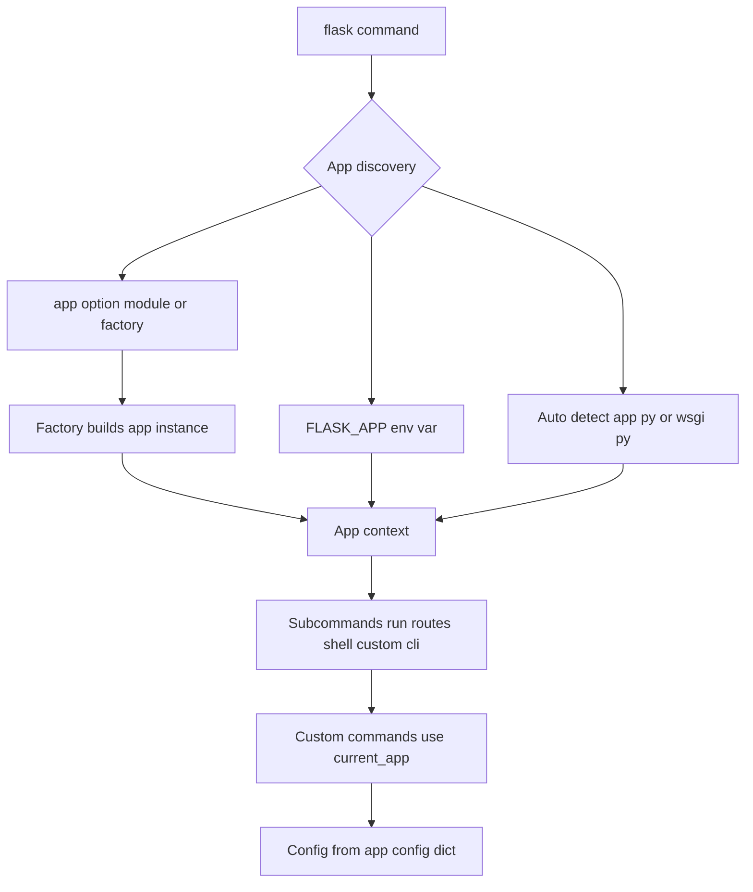

# CLI Commands, Environment Configuration, and the flask run Workflow

## English

Flask ships with a command-line interface that most people only skim, yet it shapes how apps are configured and operated. The entry point is the flask command, which needs to know which application to load. Historically this was the FLASK_APP environment variable; modern Flask also auto-detects an app.py or wsgi.py, and accepts --app to point at a module or factory call like 'myproject:create_app()'. The factory form matters because it lets you build different app instances for different configurations without module-level side effects.

Once Flask knows the app, it exposes subcommands. flask run starts the development server — single-process, reloader on by default, not for production. flask routes prints the URL map, which is invaluable when a rule is not firing as expected. flask shell opens a Python REPL with the application context pushed, so you can query models or inspect config interactively. And flask --help lists everything, including commands contributed by extensions and by your own code.

That last point is the real power: @app.cli.command() and the app.cli group let you register custom commands. A classic use is a seed command that populates a development database, or a scheduled maintenance task invoked by cron. Because the command runs inside the app context, it can use current_app and extensions exactly as a view would. Click, the library Flask uses for its CLI, gives you argument parsing, options, and help text for free — so your commands feel like first-class tools rather than ad-hoc scripts.

Configuration is the sibling topic. Flask reads config from a plain dictionary, app.config, populated from defaults, from a config file, from environment variables, or from a factory argument. The twelve-factor habit is to keep secrets out of code: read them from the environment, and use something like app.config.from_prefixed_env() to pull in variables with a chosen prefix. Instance folders — the instance_path — are the recommended place for per-deployment data like a SQLite file or uploaded documents, because they sit outside the package and are not committed to version control.

The workflow payoff is reproducibility. A new developer clones the repo, sets FLASK_APP or relies on auto-detection, exports a couple of environment variables, and runs flask run. A deploy script runs flask db upgrade (from Flask-Migrate) and then starts Gunicorn against the same factory. Because configuration flows through one place and commands are declared in code, the difference between local, staging, and production is a set of environment values, not a pile of edited files. That discipline is what keeps a small Flask project from turning into an unreproducible mess.

## 中文

Flask 附帶一個命令列介面，多數人只是略讀，但它形塑了應用程式的配置與維運方式。進入點是 flask 指令，它需要知道要載入哪個應用程式。以往這是 FLASK_APP 環境變數；現代 Flask 也會自動偵測 app.py 或 wsgi.py，並接受 --app 指向模組或像 'myproject:create_app()' 這樣的工廠呼叫。工廠形式很重要，因為它讓你為不同配置建構不同的應用程式例項，而不產生模組層級的副作用。

一旦 Flask 知道應用程式，它就提供子指令。flask run 啟動開發伺服器——單一行程、預設開啟過載器，不可用於正式環境。flask routes 印出 URL 對應表，當某條規則不如預期觸發時極其有用。flask shell 開啟一個已推入應用程式情境的 Python REPL，讓你能互動式地查詢模型或檢視配置。而 flask --help 列出所有內容，包括擴充套件與你自己程式碼貢獻的指令。

最後一點才是真正的力量：@app.cli.command() 與 app.cli 群組讓你註冊自訂指令。經典用途是填充開發資料庫的種子指令，或由 cron 呼叫的排程維護任務。因為指令在應用程式情境內執行，它可以像檢視函式一樣使用 current_app 與擴充套件。Click——Flask 用於命令列的函式庫——免費提供引數解析、選項與說明文字，讓你的指令感覺像一等公民工具，而非臨時指令碼。

配置是它的姊妹主題。Flask 從一個普通字典 app.config 讀取配置，其內容來自預設值、配置檔、環境變數或工廠引數。十二要素（twelve-factor）的習慣是把機密留在程式碼之外：從環境讀取，並使用 app.config.from_prefixed_env() 之類的方法，拉進帶有指定字首的變數。例項資料夾——instance_path——是存放每次部署專屬資料（如 SQLite 檔案或上傳檔案）的建議位置，因為它位於套件之外，且不會被提交到版本控制。

工作流程的回報是可重現性。新的開發者複製儲存庫、設定 FLASK_APP 或依賴自動偵測、匯出幾個環境變數，然後執行 flask run。部署指令碼執行 flask db upgrade（來自 Flask-Migrate），再對同一個工廠啟動 Gunicorn。因為配置只流經一個地方，而指令在程式碼中宣告，本機、預備與正式環境之間的差別就只是一組環境值，而非一堆被改過的檔案。這份紀律正是讓小型 Flask 專案不致淪為無法重現的一團亂的關鍵。

## Key Takeaway

Treat the flask CLI and app.config as one system: declare custom commands in code and feed configuration from the environment so every deployment is reproducible.

## Related Concepts
- Twelve-factor configuration
- Click command-line library

## Diagram

