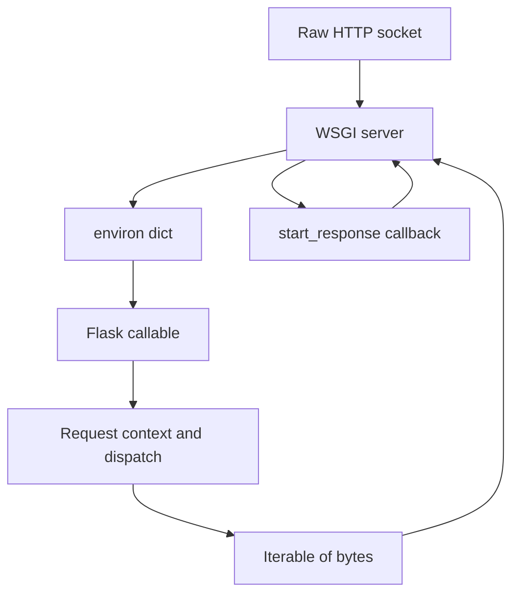

# The WSGI Contract: What Flask Actually Sits On

## English

Before Flask can route anything, something has to translate a raw HTTP socket into a Python callable. That something is WSGI — the Web Server Gateway Interface, defined in PEP 3333. WSGI is a contract between two parties: a server (Gunicorn, uWSGI, Werkzeug's development server) and an application. The application side is deceptively simple: it must be a callable that accepts two arguments, `environ` and `start_response`, and returns an iterable of bytes. The `environ` is a plain dict stuffed with CGI-style keys like `REQUEST_METHOD`, `PATH_INFO`, and `wsgi.input` (a file-like object holding the request body). `start_response(status, headers)` is a callback the app invokes to declare the response status line and headers before yielding the body.

Flask never exposes this raw shape to you. The `Flask` object itself is the WSGI callable, and inside its `__call__` it builds a Request object from `environ`, pushes a request context, dispatches to your view, and converts whatever you return into a proper WSGI response. This is why you can do `app(environ, start_response)` directly in a test without any network at all — it is just a function call. It also explains a subtle gotcha: because WSGI is synchronous and one-callable-per-request, a worker process handles exactly one request at a time. That is the real reason the classic `2 * cores + 1` worker heuristic exists — each worker is a blocking OS process, so you need enough of them to overlap I/O waits.

WSGI also constrains what Flask can stream. Because the return value is an iterable, you can yield chunks lazily for server-sent events or large downloads, but you cannot easily do full-duplex protocols like WebSockets. That is why real-time Flask apps typically bolt on a separate ASGI server (via Flask-SocketIO or an ASGI wrapper) rather than fighting the spec. Understanding WSGI turns a lot of Flask's "magic" into ordinary Python: contexts, `g`, and `url_for` all exist because the framework needs somewhere to stash per-request state between the WSGI entry point and your view function.

A practical way to internalize this: write a ten-line WSGI app by hand — one function, a dict lookup on `PATH_INFO`, a call to `start_response('200 OK', [('Content-Type', 'text/plain')])`, and `return [b'hello']`. Once you have done that, reading Flask's source becomes far less intimidating, and debugging weird deployment errors (a proxy stripping headers, a server buffering your stream) becomes a matter of asking "which side of the WSGI boundary is misbehaving?"

## 中文

在 Flask 能夠進行任何路由之前，必須有東西把原始的 HTTP socket 轉換成一個 Python 可呼叫物件。這個東西就是 WSGI——Web Server Gateway Interface，定義於 PEP 3333。WSGI 是兩方之間的契約：伺服器（Gunicorn、uWSGI、Werkzeug 開發伺服器）與應用程式。應用程式這一側看似簡單：它必須是一個可呼叫物件，接受兩個參數 `environ` 與 `start_response`，並回傳一個位元組的可迭代物件。`environ` 是一個普通 dict，塞滿了 CGI 風格的鍵，例如 `REQUEST_METHOD`、`PATH_INFO`，以及 `wsgi.input`（一個類檔案物件，裝著請求主體）。`start_response(status, headers)` 是應用程式在產生主體之前呼叫的回呼，用來宣告回應的狀態行與標頭。

Flask 從不把這個原始形狀暴露給你。`Flask` 物件本身就是那個 WSGI 可呼叫物件，在它的 `__call__` 裡面，它會從 `environ` 建立 Request 物件、推入請求情境、分派到你的檢視函式，並把你回傳的任何東西轉換成合法的 WSGI 回應。這就是為什麼你可以在測試中完全不經網路，直接呼叫 `app(environ, start_response)`——它就只是一次函式呼叫。這也解釋了一個微妙的陷阱：因為 WSGI 是同步的，而且每個請求對應一次可呼叫，一個 worker 行程一次只處理一個請求。這正是經典 `2 * 核心數 + 1` worker 經驗法則的真正原因——每個 worker 都是一個會阻塞的作業系統行程，所以你需要足夠多的 worker 來重疊 I/O 等待。

WSGI 也限制了 Flask 能串流什麼。因為回傳值是可迭代物件，你可以為伺服器推送事件或大型下載惰性地逐塊產生內容，但你無法輕易做到像 WebSocket 那樣的全雙工協定。這就是為什麼即時性的 Flask 應用通常會外掛一個獨立的 ASGI 伺服器（透過 Flask-SocketIO 或 ASGI 包裝層），而不是跟規範硬碰硬。理解 WSGI 會把許多 Flask 的「魔法」變成普通的 Python：情境、`g`、`url_for` 之所以存在，都是因為框架需要在 WSGI 入口點與你的檢視函式之間找個地方暫存每個請求的狀態。

一個實用的內化方法：親手寫一個十行的 WSGI 應用——一個函式、對 `PATH_INFO` 做 dict 查詢、呼叫 `start_response('200 OK', [('Content-Type', 'text/plain')])`、然後 `return [b'hello']`。一旦你做過這件事，閱讀 Flask 原始碼就不再那麼嚇人，而除錯奇怪的部署錯誤（代理剝掉標頭、伺服器緩衝你的串流）也會變成一個問題：「到底是 WSGI 邊界的哪一側出了問題？」

## Key Takeaway

Flask is just a well-organized WSGI callable, and knowing the environ/start_response contract explains workers, streaming, and context internals.

## Related Concepts
- PEP 3333
- Gunicorn worker model

## Diagram

