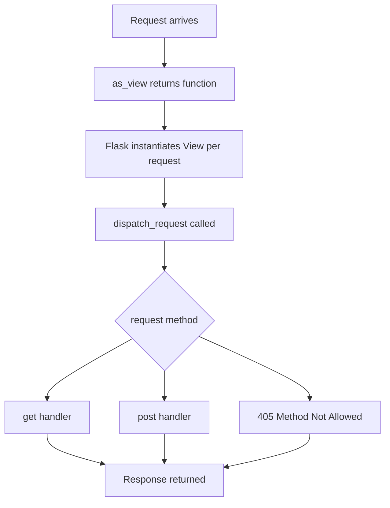

# Reading Flask's Source: The MethodView and Pluggable View Class System

## English

Most Flask tutorials show function-based views, but the framework also ships a class-based view system that is genuinely useful once your resource has several HTTP verbs sharing state. The base is `flask.views.View`, which you subclass and implement a `dispatch_request` method on. Flask instantiates it per request via `as_view`, and you register it like a function: `app.add_url_rule('/items', view_func=ItemView.as_view('items'))`. The `as_view` call returns a function whose `__name__` you control, which matters because endpoint names must be unique and are what `url_for` resolves against.

The more ergonomic sibling is `MethodView`, which auto-dispatches based on `request.method`. You define methods named `get`, `post`, `put`, `delete`, and Flask maps them to the corresponding HTTP verbs; a `405 Method Not Allowed` is raised automatically for verbs you did not define. This is where class-based views shine: shared helpers like `get_object_or_404` or an authentication check live as instance methods, and each verb handler stays short. You can also declare `decorators = [login_required]` as a class attribute, and MethodView applies them to every dispatched method — a clean way to enforce a policy across a whole resource without repeating decorator stacks.

A crucial subtlety is that a new instance is created for every request. That is deliberate: it keeps class-based views stateless and thread-safe, mirroring how Flask treats function views. If you want request-scoped data, use `self` attributes set inside `dispatch_request` or the verb handler — they live only for that one request. Anything you cache on the class itself is shared across threads and will bite you under a multi-worker server. This per-request instantiation is also why you cannot rely on `__init__` receiving route parameters; URL variables arrive as keyword arguments to `dispatch_request` and the verb methods instead.

Reading `flask/views.py` is a great exercise because it is small and shows the framework's design taste. You will see `MethodView.__init_subclass__`, which inspects the class body at subclass-creation time to work out which methods are defined and set `cls.methods` accordingly (older Flask versions up to 2.1 used a `MethodViewType` metaclass for this job), and `View.as_view` building a closure that instantiates the class and calls `dispatch_request`. Recognizing this pattern helps you decide when a class-based view beats a function: when several verbs share validation or serialization logic, or when you want a reusable base class across many resources. For a single GET endpoint, a plain function is still clearer and cheaper.

Finally, class-based views compose nicely with blueprints and application factories, since `as_view` produces an ordinary view function that blueprints can register. They are also easy to unit test: instantiate the view, set up a test request context, and call the verb method directly. The lesson is not "always use classes" but that Flask's minimal core still gives you a real extension point when your handlers grow beyond a few lines.

## 中文

大多數 Flask 教學示範的是函式式檢視，但框架也附帶了一套類別式檢視系統，當你的資源有多個 HTTP 動詞共用狀態時，它真的很好用。基底是 `flask.views.View`，你繼承它並實作 `dispatch_request` 方法。Flask 會透過 `as_view` 為每個請求實例化它，你像註冊函式一樣註冊它：`app.add_url_rule('/items', view_func=ItemView.as_view('items'))`。`as_view` 呼叫會回傳一個函式，其 `__name__` 由你控制，這很重要，因為端點名稱必須唯一，而 `url_for` 正是靠它來解析。

更好用的兄弟是 `MethodView`，它根據 `request.method` 自動分派。你定義名為 `get`、`post`、`put`、`delete` 的方法，Flask 便把它們對應到相應的 HTTP 動詞；對於你沒有定義的動詞，會自動拋出 `405 Method Not Allowed`。這正是類別式檢視發光的地方：像 `get_object_or_404` 或身分驗證檢查這類共用輔助方法可以寫成實例方法，而每個動詞處理器保持簡短。你也可以把 `decorators = [login_required]` 宣告為類別屬性，MethodView 會把它套用到每個被分派的方法上——這是一種乾淨的方式，讓你在整個資源上貫徹某項政策，而不必重複堆疊裝飾器。

一個關鍵的微妙之處是：每個請求都會建立一個新實例。這是刻意的：它讓類別式檢視保持無狀態且執行緒安全，與 Flask 對待函式檢視的方式一致。如果你想要請求範圍的資料，請在 `dispatch_request` 或動詞處理器內部設定 `self` 屬性——它們只存活於那一個請求。任何你快取在類別本身的東西都會跨執行緒共用，在多 worker 伺服器下會反咬你一口。這種每請求實例化也正是為什麼你不能依賴 `__init__` 接收路由參數；URL 變數反而是以關鍵字參數的形式傳入 `dispatch_request` 與動詞方法。

閱讀 `flask/views.py` 是很棒的練習，因為它很小，而且展現了框架的設計品味。你會看到 `MethodView.__init_subclass__`，它在建立子類別時檢查類別本體，判斷定義了哪些方法並據此設定 `cls.methods`（Flask 2.1 及以前的舊版本是用一個 `MethodViewType` metaclass 做同一件事），以及 `View.as_view` 建立一個閉包，該閉包會實例化類別並呼叫 `dispatch_request`。認出這個模式能幫你判斷何時類別式檢視勝過函式：當多個動詞共用驗證或序列化邏輯時，或當你想在許多資源之間重用一個基底類別時。對於單一的 GET 端點，普通函式仍然更清楚也更便宜。

最後，類別式檢視能與 blueprint 和應用程式工廠良好組合，因為 `as_view` 產生的是普通檢視函式，blueprint 可以註冊它。它們也很容易做單元測試：實例化檢視、設定測試請求情境、直接呼叫動詞方法。教訓不是「永遠用類別」，而是 Flask 的精簡核心在你處理器成長到超過幾行時，仍然給你一個真正的擴充點。

## Key Takeaway

Flask's View and MethodView classes are a small but real extension point: per-request instances, automatic verb dispatch, and class-level decorator policies.

## Related Concepts
- MethodView
- class-based views

## Diagram

