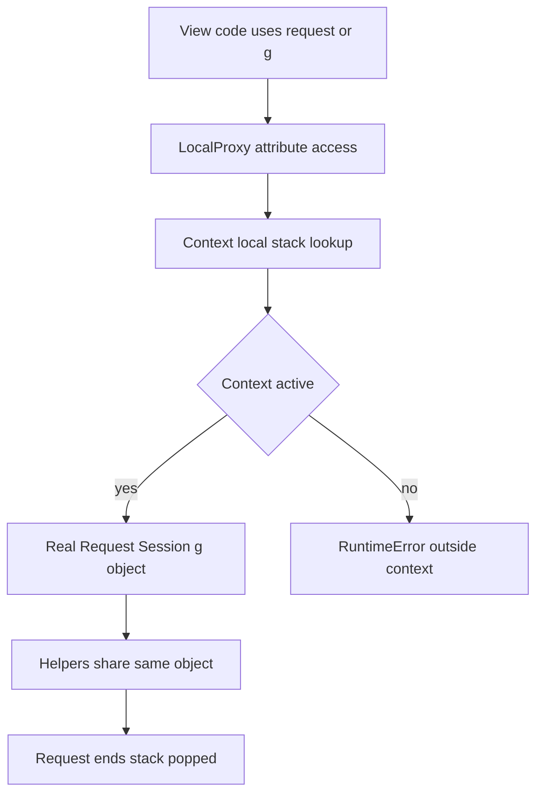

# The Request-Scoped Object Graph: g, current_app, and Proxy Objects Demystified

## English

One of the first things that confuses newcomers is that Flask lets you reference `request`, `session`, `g`, and `current_app` inside a view without ever passing them in. These are not globals in the ordinary sense — they are context-local proxy objects. Each is an instance of Werkzeug's `LocalProxy`, which forwards attribute access to the real object stored in a thread-local (and, in modern Flask, context-local) stack. When a request arrives, Flask pushes a request context that binds the actual Request and Session objects; the proxy resolves against whatever is currently on top of that stack for the current thread or async task.

This design solves a real problem. Your view function is called by Flask's dispatcher, not by you, so there is no natural place to inject dependencies. Rather than threading a `request` argument through every helper, Flask makes `request` a name you can import anywhere and access safely as long as a context is active. The catch is that the proxy is only valid inside a context. Accessing `request` at module import time, in a background thread, or after the response has been returned raises a `RuntimeError` about working outside an application context. That error is not a bug — it is the proxy telling you the stack is empty.

`g` is the request-scoped scratchpad: a simple namespace object that lives for the duration of one request context. It is the idiomatic place to stash a database connection opened in a `before_request` hook, or the current user resolved from a token, so that multiple helpers in the same request can share it without passing arguments. Crucially, `g` is not shared across requests, so it is safe for per-request state, but it is also not a cache — do not assume it survives between requests, because it does not. `current_app` is the sibling proxy pointing at the active application object, which is what lets extensions and blueprints read config without a circular import of the app instance.

There are two contexts, not one: the application context (holding `current_app` and `g`) and the request context (holding `request` and `session`). Pushing a request context implicitly pushes an application context if none exists. This matters in tests and CLI commands: `app.app_context()` lets you use `current_app` and `g` without an HTTP request, while `app.test_request_context('/path')` gives you a fake request. Flask's `flask shell` and custom CLI commands run inside an app context automatically for exactly this reason.

The practical takeaway is to treat these proxies as a controlled form of implicit dependency injection, and to respect their lifetime. Prefer passing explicit arguments into pure helper functions you want to unit test in isolation; use `g` and `current_app` for cross-cutting, request-bound concerns. And when you spawn a thread or async task, capture the plain values you need (a user id, a config string) before leaving the context, because the proxy will not follow you out.

## 中文

讓新手困惑的第一件事之一，是 Flask 讓你在檢視函式裡引用 `request`、`session`、`g` 與 `current_app`，卻從不需要把它們傳進去。這些並不是普通意義上的全域變數——它們是情境區域的代理物件。每一個都是 Werkzeug 的 `LocalProxy` 實例，會把屬性存取轉發到儲存在執行緒區域（在現代 Flask 中則是情境區域）堆疊上的真實物件。當請求到達時，Flask 會推入一個請求情境，綁定實際的 Request 與 Session 物件；代理會對當前執行緒或非同步任務堆疊頂端的任何東西進行解析。

這個設計解決了一個真實問題。你的檢視函式是由 Flask 的分派器呼叫的，不是你呼叫的，所以沒有自然的地方可以注入依賴。與其把 `request` 參數穿過每一個輔助函式，Flask 讓 `request` 成為一個你可以在任何地方匯入、只要情境有效就能安全存取的名字。陷阱在於代理只在情境內有效。在模組匯入時、在背景執行緒中、或在回應已經回傳之後存取 `request`，會拋出關於在應用程式情境之外運作的 `RuntimeError`。那個錯誤不是 bug——它是代理在告訴你堆疊是空的。

`g` 是請求範圍的便條紙：一個簡單的命名空間物件，存活於一個請求情境的期間。它是放置那種慣用做法的地方：在 `before_request` 勾子裡開啟的資料庫連線，或從權杖解析出的當前使用者，好讓同一請求中的多個輔助函式能共用它而不必傳參數。關鍵是，`g` 不會跨請求共用，所以對每請求狀態是安全的，但它也不是快取——不要假設它會在請求之間存活，因為它不會。`current_app` 是兄弟代理，指向作用中的應用程式物件，這正是讓擴充套件與 blueprint 能讀取設定，而不必循環匯入應用程式實例的原因。

情境有兩個，不是一個：應用程式情境（持有 `current_app` 與 `g`）與請求情境（持有 `request` 與 `session`）。推入請求情境時，若不存在應用程式情境，會隱含地推入一個。這在測試與 CLI 命令中很重要：`app.app_context()` 讓你不需要 HTTP 請求就能使用 `current_app` 與 `g`，而 `app.test_request_context('/path')` 給你一個假的請求。Flask 的 `flask shell` 與自訂 CLI 命令會自動在應用程式情境內執行，正是這個原因。

實務上的重點是把這些代理當成一種受控的隱含依賴注入，並尊重它們的生命週期。對於你想獨立做單元測試的純輔助函式，偏好傳入明確參數；把 `g` 與 `current_app` 留給橫切、與請求綁定的關注點。而當你啟動執行緒或非同步任務時，在離開情境之前先把你需要的普通值（使用者 id、設定字串）捕捉下來，因為代理不會跟著你走出去。

## Key Takeaway

request, g, session, and current_app are context-local proxies with real lifetimes; respect the context boundary and they become safe implicit dependency injection.

## Related Concepts
- LocalProxy
- application context

## Diagram

