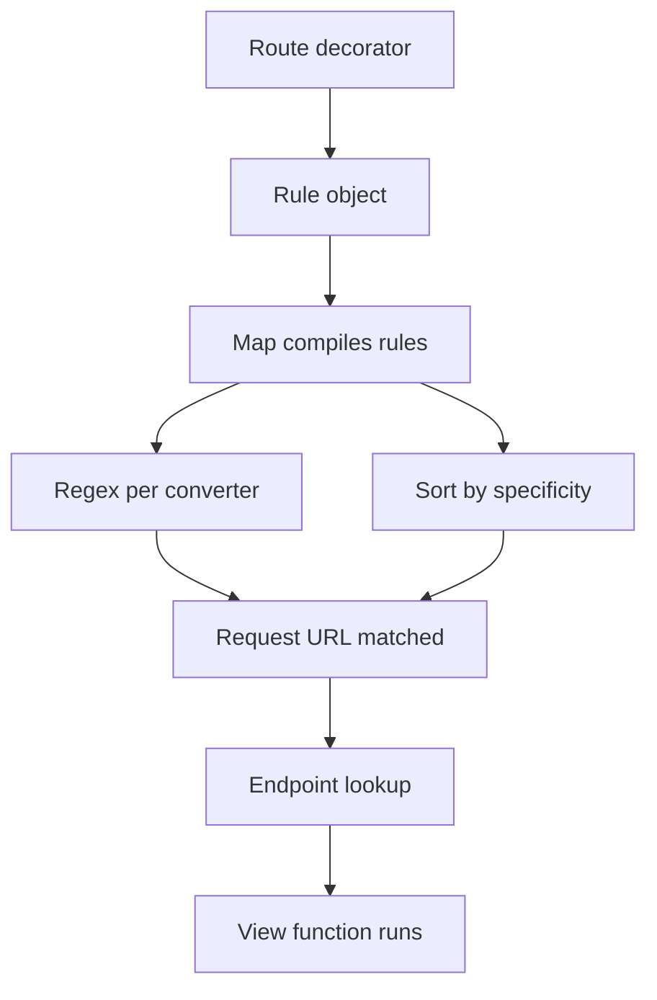

# Routing Internals: Werkzeug's Map, Rules, and Matching Order

## English

Flask does not own its URL matching logic; it delegates to Werkzeug's routing module. When you write @app.route('/user/<int:user_id>'), Flask builds a Rule object and adds it to a Map. The Map compiles all rules into a structure that Werkzeug can search efficiently, and each Rule carries a compiled regular expression derived from the URL pattern. Converters like int, float, path, uuid, and any are really just regex fragments with a to_python/from_python pair, so <int:user_id> becomes a numeric-only pattern and rejects 'abc' before your view function ever runs. This is why a non-numeric segment produces a 404 rather than a ValueError inside your handler.

Matching order matters more than most people expect. Werkzeug sorts rules by complexity and specificity, not purely by declaration order, so a static rule like /about usually wins over a dynamic one like /<page>. When two rules are genuinely ambiguous, Werkzeug resolves the ambiguity by that ordering at match time rather than raising an error — the registration-time errors you will actually see are about conflicting endpoints, not ambiguous paths. One historical note: `Rule.weights` used to let you steer matching manually, but it was deprecated in Werkzeug 2.2 and removed in 2.3, so there is no weights argument to pass today; the `endpoint` and `defaults` arguments are the levers that remain. Understanding this prevents the classic bug where a catch-all route swallows every other path.

Each rule also has an endpoint name — by default the function name — and Flask keeps a view_functions dictionary mapping endpoints to callables. This indirection is what makes url_for('endpoint_name') possible and what lets a single function serve multiple URLs. It also means renaming a view function silently breaks url_for calls elsewhere, so endpoint stability is a real maintenance concern in larger codebases.

Methods and redirects are part of the same picture. By default a rule answers GET and implicitly HEAD and OPTIONS. If you declare methods=['POST'] only, a GET request to that URL returns 405 Method Not Allowed, and Werkzeug can suggest the allowed methods in the response. Trailing-slash behaviour is also rule-level: a rule ending in a slash will redirect /path to /path/ with a 308, while a rule without a slash will 404 on the slashed variant. These small semantics are worth knowing because they shape API contracts.

You can inspect the whole map at runtime with app.url_map, which prints every rule, its methods, and its endpoint. That single line of debugging has saved countless hours when a route 'mysteriously' does not fire. Treat the URL map as a first-class design artifact: read it, test it, and keep it small and predictable.

## 中文

Flask 本身不負責 URL 比對邏輯，而是交給 Werkzeug 的 routing 模組。當你寫 @app.route('/user/<int:user_id>') 時，Flask 會建立一個 Rule 物件並加入 Map。Map 會把全部規則編譯成 Werkzeug 能高效搜尋的結構，而每條 Rule 都帶有由 URL 模式衍生的正規表達式。int、float、path、uuid、any 等轉換器其實只是正規表達式片段加上一對 to_python／from_python 方法，所以 <int:user_id> 會變成只接受數字的模式，在檢視函式執行之前就擋掉 'abc'。這就是為何非數字片段會回傳 404，而不是在處理函式裡拋出 ValueError。

比對順序比大多數人想像中重要。Werkzeug 會依複雜度與具體程度排序規則，而不是純粹依宣告順序，所以像 /about 這種靜態規則通常會勝過 /<page> 這種動態規則。當兩條規則真正有歧義時，Werkzeug 是靠這套排序在比對時化解，而不是在註冊階段報錯——你真正會在註冊階段看到的錯誤，是關於 endpoint 衝突，而不是路徑有歧義。有一點歷史值得知道：`Rule.weights` 過去可以讓你手動引導比對，但它在 Werkzeug 2.2 已被棄用、2.3 移除，所以今日已經沒有權重參數可傳；剩下能用的槓桿是 `endpoint` 與 `defaults` 參數。理解這一點，就能避免「萬用路由吃掉所有其他路徑」這種經典 bug。

每條規則也有一個 endpoint 名稱——預設就是函式名稱——而 Flask 用一個 view_functions 字典把 endpoint 對應到可呼叫物件。這層間接正是 url_for('endpoint_name') 得以運作的原因，也讓同一個函式可以服務多個 URL。但這也意味著重新命名檢視函式會悄悄弄壞別處的 url_for 呼叫，所以在較大型的程式庫裡，endpoint 的穩定性是實實在在的維護課題。

HTTP 方法與重新導向也屬於同一張圖。預設情況下，一條規則會回應 GET，並隱含支援 HEAD 與 OPTIONS。若你只宣告 methods=['POST']，對該 URL 發 GET 就會回傳 405 Method Not Allowed，而 Werkzeug 可以在回應中提示允許的方法。結尾斜線的行為也是規則層級：以斜線結尾的規則會用 308 把 /path 重新導向到 /path/，而不以斜線結尾的規則則會對帶斜線的版本回傳 404。這些小語意值得了解，因為它們形塑了 API 的契約。

你可以在執行時用 app.url_map 檢視整張地圖，它會印出每條規則、方法與 endpoint。這一行除錯常常省下無數小時，尤其是在路由「莫名其妙」沒觸發的時候。把 URL 地圖當成第一級的設計產物：閱讀它、測試它，並讓它保持小而可預測。

## Key Takeaway

Flask's routing is Werkzeug's Map of compiled Rule objects, so matching order, converters, endpoints, and slash semantics all follow Werkzeug's rules rather than your declaration order.

## Related Concepts
- Werkzeug routing converters
- HTTP method semantics

## Diagram

