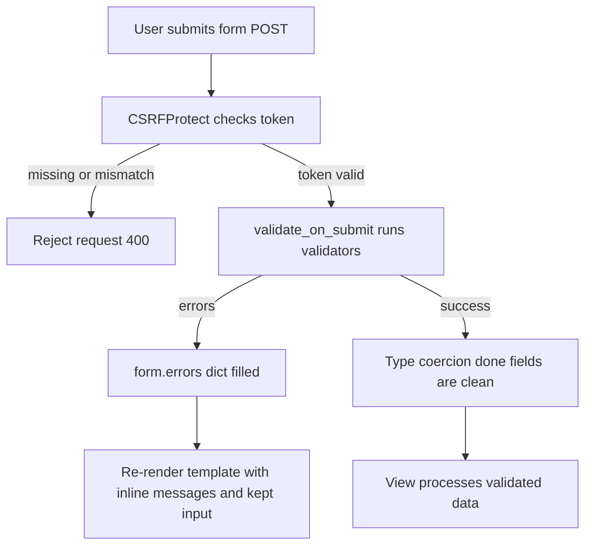

# Flask-WTF and CSRF: Forms, Validation, and the Token Dance

## English

HTML forms are deceptively hard: you need to parse incoming data, validate it, re-render errors without losing user input, and defend against cross-site request forgery. Flask's core gives you request.form, a plain MultiDict, and nothing else. Flask-WTF builds on WTForms to provide declarative form classes where each field is a class attribute with its own validators. A typical form declares StringField('email', validators=[DataRequired(), Email()]) and IntegerField with NumberRange. Calling form.validate_on_submit() checks the HTTP method and runs every validator, returning a boolean you branch on.

Validation errors land in form.errors, a dictionary keyed by field name, which Jinja templates can loop over to render inline messages next to each input. Because the form object still holds the submitted data, re-rendering the template preserves what the user typed — a small UX detail that hand-rolled parsing almost always gets wrong. WTForms also handles type coercion: an IntegerField turns the raw string into an int or records a validation error, so your view never sees a half-parsed value.

CSRF is the security half of the story. Cross-site request forgery tricks a logged-in user's browser into submitting a state-changing request to your site from an attacker's page. Flask-WTF's CSRFProtect extension generates a per-session token, embeds it in forms via {{ form.csrf_token }}, and rejects any POST, PUT, PATCH, or DELETE whose token is missing or mismatched. The token is tied to the session and compared in constant time server-side. For AJAX you typically expose the token in a meta tag and send it in an X-CSRFToken header, which the extension also checks.

A subtle but important point: CSRF protection only makes sense when authentication rides on cookies, because the browser attaches cookies automatically. If your API uses bearer tokens in an Authorization header, a cross-site form post cannot supply that header, so classic CSRF is largely moot — which is why token-authenticated APIs often disable CSRFProtect for their JSON routes while keeping it for session-based HTML routes. Mixing both in one app requires per-blueprint or per-view exemptions, configured explicitly.

Finally, file uploads deserve a mention. FileField and FileRequired validate presence, but you must still enforce size limits, allowed extensions, and safe filenames yourself, and never trust the client-supplied name when writing to disk. Flask's MAX_CONTENT_LENGTH setting caps request body size globally and returns 413 when exceeded. Treat Flask-WTF as a thin, well-tested layer over parsing and CSRF — it removes boilerplate, but the security thinking is still yours.

## 中文

HTML 表單比表面上看起來難得多：你需要解析送進來的資料、驗證它、在不丟失使用者輸入的情況下重新渲染錯誤，還要防禦跨站請求偽造。Flask 核心只給你 request.form，一個普通的 MultiDict，其他什麼都沒有。Flask-WTF 建構在 WTForms 之上，提供宣告式的表單類別，每個欄位都是帶有自己驗證器的類別屬性。典型表單會宣告 StringField('email', validators=[DataRequired(), Email()]) 以及帶 NumberRange 的 IntegerField。呼叫 form.validate_on_submit() 會檢查 HTTP 方法並執行所有驗證器，回傳一個布林值讓你分支處理。

驗證錯誤會落在 form.errors，一個以欄位名稱為鍵的字典，Jinja 範本可以逐一走訪，在每個輸入框旁渲染行內訊息。因為表單物件仍持有送出的資料，重新渲染範本就能保留使用者打過的內容——這個小小的使用者體驗細節，手寫解析幾乎總是做錯。WTForms 也處理型別轉換：IntegerField 會把原始字串轉成 int，或記錄一筆驗證錯誤，所以你的檢視函式永遠不會看到半解析的值。

CSRF 是這個故事的安全面。跨站請求偽造會誘騙已登入使用者的瀏覽器，從攻擊者的頁面對你的網站送出會改變狀態的請求。Flask-WTF 的 CSRFProtect 擴充會產生一個隨 session 的權杖，透過 {{ form.csrf_token }} 嵌入表單，並拒絕任何權杖缺失或不符的 POST、PUT、PATCH、DELETE。權杖與 session 綁定，並在伺服器端以常數時間比較。對於 AJAX，你通常會把權杖放在 meta 標籤裡，並在 X-CSRFToken 標頭中送出，擴充也會檢查它。

一個微妙但重要的點：CSRF 防護只有在認證依賴 cookie 時才有意義，因為瀏覽器會自動附上 cookie。若你的 API 使用 Authorization 標頭中的 bearer token，跨站表單送出無法提供那個標頭，所以經典的 CSRF 大致上不成立——這就是為何以權杖認證的 API 常常對其 JSON 路由停用 CSRFProtect，同時對以 session 為基礎的 HTML 路由保留它。在同一個應用裡混用兩者，需要明確設定每個 blueprint 或每個檢視的豁免。

最後，檔案上傳值得一提。FileField 與 FileRequired 會驗證檔案是否存在，但你仍必須自己強制大小上限、允許的副檔名與安全檔名，而且寫入磁碟時絕不要信任客戶端提供的名稱。Flask 的 MAX_CONTENT_LENGTH 設定會全域限制請求主體大小，超過時回傳 413。把 Flask-WTF 當成解析與 CSRF 之上的一層薄薄且經過良好測試的封裝——它移除樣板碼，但安全思考仍然是你的責任。

## Key Takeaway

Flask-WTF turns forms into declarative classes with validation and adds session-bound CSRF tokens, but only cookie-based authentication actually needs CSRF defence.

## Related Concepts
- WTForms validators
- Cross-site request forgery

## Diagram

