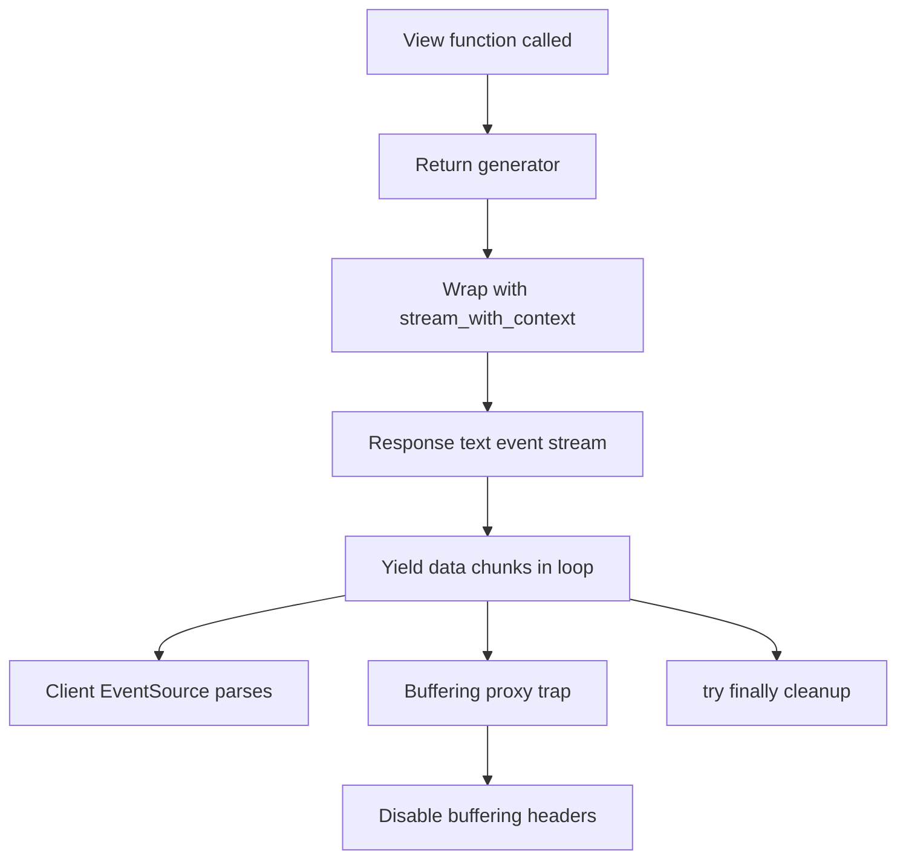

# Streaming, Server-Sent Events, and Long-Lived Responses

## English

Most Flask views return a complete response, but the framework also supports returning a generator, which Werkzeug wraps in a streaming response. This matters for large downloads, live logs, and progress feeds. The classic pattern is a view that returns a generator function yielding bytes chunks, often paired with Response(stream_with_context(gen())). The stream_with_context wrapper is essential because the request context is normally torn down when the view returns; without it, any code inside the generator that touches request or session will fail with a 'working outside of request context' error.

Server-Sent Events (SSE) are a natural fit. SSE is a simple text protocol over a long-lived HTTP response: the server sends lines like 'data: ...' followed by a blank line, and the browser's EventSource API parses them into events. In Flask you set the mimetype to text/event-stream, disable buffering, and yield formatted messages in a loop, usually with a small sleep or a queue wait between them. Because SSE is one-directional server-to-client, it is far simpler than WebSockets when you only need to push updates.

Buffering is the usual trap. Proxies such as Nginx and some WSGI servers buffer responses by default, so your carefully streamed chunks arrive in one lump at the end. You may need to disable proxy buffering for that route, set X-Accel-Buffering: no, and ensure the WSGI server itself does not buffer. Also remember that each streaming connection holds a worker thread or process for its whole lifetime, so a handful of idle SSE clients can exhaust a small Gunicorn pool. Size your worker count accordingly and consider a dedicated async worker class.

Resource cleanup is the other half. Generators should use try/finally so that closing the client connection releases any queue, database cursor, or subscription. Detecting client disconnects mid-stream is possible but server-dependent; a common approach is to catch the exception raised when the socket closes and exit the generator cleanly. Heartbeat comments (a line starting with a colon in SSE) keep intermediaries from timing out idle connections.

Finally, know when not to stream. If a response is small and fast, ordinary rendering is simpler and easier to cache. Streaming shines for large files, tailing logs, incremental LLM output, and notification feeds. Pick the tool by the shape of the data flow, not by novelty.

## 中文

大多數 Flask 檢視會回傳完整的回應，但框架也支援回傳產生器，Werkzeug 會把它包成串流回應。這對大型下載、即時日誌與進度饋送很重要。經典模式是讓檢視回傳一個逐塊產生位元組的產生器函式，通常搭配 Response(stream_with_context(gen()))。stream_with_context 包裝是不可或缺的，因為請求情境通常在檢視回傳時就被拆掉；少了它，產生器內任何碰觸 request 或 session 的程式碼都會以「在請求情境之外運作」的錯誤失敗。

伺服器推送事件（SSE）是天然的好搭檔。SSE 是長壽命 HTTP 回應上的一種簡單文字協定：伺服器送出像 'data: ...' 這樣的行，後面接一個空行，瀏覽器的 EventSource API 會把它們解析成事件。在 Flask 裡，你把 mimetype 設成 text/event-stream、關閉緩衝，並在迴圈中產生格式化的訊息，通常在之間加一點 sleep 或等待佇列。因為 SSE 是單向的伺服器到客戶端，當你只需要推送更新時，它比 WebSocket 簡單得多。

緩衝是常見的陷阱。Nginx 等代理與某些 WSGI 伺服器預設會緩衝回應，於是你精心串流的區塊會在最後一次整塊送達。你可能需要對該路由關閉代理緩衝、設定 X-Accel-Buffering: no，並確保 WSGI 伺服器本身不緩衝。也別忘了每條串流連線在整個生命週期都會佔住一個工作執行緒或行程，所以少數閒置的 SSE 客戶端就能耗盡一個小型 Gunicorn 集區。請據此調整工作數，並考慮使用專門的非同步工作類別。

資源清理是另一半。產生器應使用 try/finally，讓關閉客戶端連線時釋放任何佇列、資料庫游標或訂閱。在串流中途偵測客戶端斷線是可行的，但取決於伺服器；常見做法是捕捉 socket 關閉時拋出的例外，並乾淨地結束產生器。心跳註解（SSE 中以冒號開頭的行）能讓中介者不會因閒置連線而逾時。

最後，要知道何時不該串流。若回應又小又快，普通渲染更簡單也更容易快取。串流在大型檔案、追蹤日誌、增量 LLM 輸出與通知饋送時才發光。依資料流的形狀選工具，而不是依新奇感。

## Key Takeaway

Flask streams by returning a generator wrapped in stream_with_context, but buffering proxies and per-connection worker cost are the real constraints to design around.

## Related Concepts
- Server-Sent Events protocol
- WSGI server worker models

## Diagram

