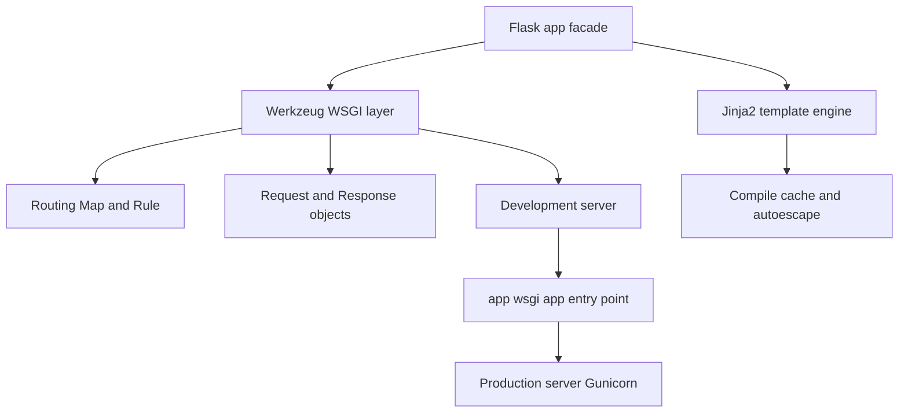

# Flask's Core Dependencies: Werkzeug and Jinja2 Explained

## English

Flask is often described as a "micro" framework, but that label hides a key fact: Flask itself is remarkably thin, and much of what you experience as "Flask" is actually two libraries it depends on. Werkzeug (German for "tool") is a comprehensive WSGI utility library. It provides the routing machinery, the Request and Response objects, the development server, and low-level HTTP parsing. Jinja2 is the template engine that renders your HTML with Python-like expressions. When you write `from flask import request`, that `request` object is fundamentally a Werkzeug `Request` wrapped in a proxy.

Understanding this split matters because it tells you where to look when things go wrong. If a URL isn't matching, the bug is almost certainly in Werkzeug's `Map` and `Rule` matching logic, not in Flask's routing wrapper. If a template renders an unexpected value, the issue lives in Jinja2's evaluation rules — for example, how it handles undefined variables, attribute access, and its sandboxing behavior. Knowing the boundary saves you from searching the wrong source tree.

Werkzeug also gives you the development server you launch with `flask run`. That server is explicitly not for production — it is single-threaded by default and lacks hardening. This is why production deployments hand the WSGI callable to Gunicorn or uWSGI. The `app.wsgi_app` attribute is the actual WSGI entry point Werkzeug's server calls; Flask's `app` object is a thin facade around it.

Jinja2 deserves its own mental model. It compiles templates to Python bytecode on first render and caches them, which is why the first request to a page is slower than subsequent ones. It also has its own escaping rules: autoescaping is on for `.html` templates by default in Flask, which is your primary defense against cross-site scripting (XSS) when interpolating user data. Turning autoescape off is almost always a mistake.

Finally, both libraries are maintained by the Pallets project alongside Flask, so their version compatibility is coordinated. When you read Flask's release notes, you'll often see "requires Werkzeug >= X" — that's not incidental; it reflects real coupling in the proxy, routing, and request handling layers. Treating Flask as "Werkzeug + Jinja2 + glue" makes the whole ecosystem far less mysterious.

## 中文

Flask 經常被形容為「微」框架，但這個標籤掩蓋了一個關鍵事實：Flask 本身極度纖薄，你體驗到的許多「Flask」功能，其實來自它所依賴的兩個程式庫。Werkzeug（德文意思是「工具」）是一套完整的 WSGI 工具程式庫，提供路由機制、Request 與 Response 物件、開發伺服器，以及低階的 HTTP 解析。Jinja2 則是樣板引擎，用類似 Python 的運算式渲染你的 HTML。當你寫 `from flask import request`，那個 `request` 物件本質上就是一個被代理物件（proxy）包裝起來的 Werkzeug `Request`。

理解這層分工很重要，因為它告訴你出錯時該往哪裡找。如果某個 URL 無法匹配，問題幾乎肯定出在 Werkzeug 的 `Map` 與 `Rule` 匹配邏輯，而不是 Flask 的路由包裝層。如果樣板渲染出意料之外的值，問題就落在 Jinja2 的求值規則上——例如它如何處理未定義變數、屬性存取，以及它的沙箱行為。知道這條界線，能讓你避免翻錯原始碼。

Werkzeug 也提供你用 `flask run` 啟動的開發伺服器。那個伺服器明確不適合生產環境——它預設是單執行緒，也缺乏安全加固。這就是為何生產部署要把 WSGI 可呼叫物件交給 Gunicorn 或 uWSGI。`app.wsgi_app` 屬性才是 Werkzeug 伺服器真正呼叫的 WSGI 進入點；Flask 的 `app` 物件只是包在它外面的一層薄薄門面。

Jinja2 值得擁有自己的心智模型。它在首次渲染時把樣板編譯成 Python 位元碼並快取，所以某個頁面的第一次請求會比後續請求慢。它也有自己的跳脫規則：在 Flask 中，`.html` 樣板預設開啟自動跳脫（autoescaping），這是你在插入使用者資料時防禦跨站腳本（XSS）的主要手段。關掉自動跳脫幾乎總是錯誤的決定。

最後，這兩個程式庫與 Flask 一樣由 Pallets 專案維護，因此版本相容性是協調過的。當你讀 Flask 的發行說明，常會看到「requires Werkzeug >= X」——這並非偶然，而是反映了代理、路由與請求處理層之間真實的耦合。把 Flask 視為「Werkzeug + Jinja2 + 膠水」，整個生態系就沒那麼神秘了。

## Key Takeaway

Flask is a thin layer over Werkzeug (routing, request/response, dev server) and Jinja2 (templating), so knowing which library owns a behavior tells you where bugs and security boundaries actually live.

## Related Concepts
- Werkzeug
- Jinja2

## Diagram

