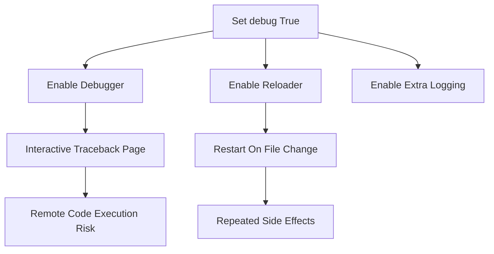

# Debug Mode, the Reloader, and the Interactive Debugger's Risks

## English

When you set `debug=True` (or `FLASK_DEBUG=1`), you are enabling three distinct behaviors at once, and conflating them is a common source of confusion. First, the debugger: unhandled exceptions render an interactive traceback page in the browser where you can inspect stack frames and evaluate Python expressions in each frame's context. Second, the reloader: a background process watches your source files and restarts the server when they change, so you don't manually restart after every edit. Third, extra logging and more verbose error output. Each of these is separately useful and separately dangerous.

The interactive debugger is the most notorious. Because it lets anyone who can reach the page execute arbitrary Python in your server process, it is a remote code execution (RCE) hole if exposed. Werkzeug mitigates this by requiring a PIN, derived partly from machine-specific values, before frames can be inspected. But PINs have been bypassed in the wild, and the mitigation assumes the attacker cannot read your filesystem or environment. The safe rule: never enable the debugger on a host reachable by untrusted networks. If you need it on a remote dev box, tunnel it over SSH rather than opening the port.

The reloader has subtler costs. It runs your app in a child process and restarts it on file changes, which means module-level side effects run repeatedly — connections opened at import time, background threads started at import, caches populated. This is one reason application factories and lazy initialization are recommended: code that only runs inside a factory is easier to reload cleanly. The reloader also watches imported modules, so edits to a library you're developing locally trigger restarts too.

A frequent gotcha is that `debug=True` also implies `use_reloader=True` and `use_debugger=True`, but you can toggle them independently. For example, `app.run(debug=True, use_reloader=False)` keeps the interactive debugger but disables auto-restart — handy when your code spawns subprocesses that the reloader would kill. In modern Flask, `flask run --debug` is the idiomatic way to enable all three, while `flask run --no-reload` disables just the reloader.

Finally, remember that debug mode changes error behavior: instead of your custom 500 handler, you get the traceback page. Tests and staging environments should run with debug off so you exercise the same error paths production uses. Treat debug as a local development convenience, not a configuration you flip in a shared environment.

## 中文

當你設定 `debug=True`（或 `FLASK_DEBUG=1`），你其實同時啟用了三種截然不同的行為，把它們混為一談是常見的困惑來源。第一是除錯器：未處理的例外會在瀏覽器渲染互動式 traceback 頁面，讓你檢視堆疊框架，並在每個框架的上下文中求值 Python 運算式。第二是重載器（reloader）：背景程序監看你的原始檔，一有變動就重啟伺服器，讓你不用每次修改都手動重啟。第三是額外日誌與更詳盡的錯誤輸出。這三者各自有用，也各自危險。

互動式除錯器最惡名昭彰。因為它讓任何能觸及該頁面的人在你的伺服器程序中執行任意 Python，一旦對外暴露，就是一個遠端程式碼執行（RCE）漏洞。Werkzeug 透過要求 PIN 來緩解，PIN 部分由機器特定值推導而來，必須輸入才能檢視框架。但 PIN 在真實世界曾被繞過，而這個緩解措施假設攻擊者讀不到你的檔案系統或環境變數。安全守則是：絕不要在不受信任網路可觸及的機器上啟用除錯器。若你需要在遠端開發機上使用，請透過 SSH 隧道轉送，而不是開放連接埠。

重載器的代價較隱微。它在子程序中執行你的應用，並在檔案變動時重啟，這意味著模組層級的副作用會反覆執行——在 import 時開啟的連線、在 import 時啟動的背景執行緒、被填充的快取。這正是建議使用應用工廠（application factory）與延遲初始化的原因之一：只在工廠內執行的程式碼更容易乾淨地重載。重載器也會監看被 import 的模組，所以你本機正在開發的程式庫若有修改，同樣會觸發重啟。

常見的陷阱是：`debug=True` 同時隱含 `use_reloader=True` 與 `use_debugger=True`，但你可以獨立切換。例如 `app.run(debug=True, use_reloader=False)` 保留互動式除錯器但停用自動重啟——當你的程式會產生子程序、而重載器會把它們殺掉時，這很方便。在現代 Flask 中，`flask run --debug` 是啟用全部三者的慣用方式，而 `flask run --no-reload` 只停用重載器。

最後，記得除錯模式會改變錯誤行為：你不會看到自訂的 500 處理器，而是看到 traceback 頁面。測試與預備環境應以關閉除錯的方式執行，這樣你才會走過與生產相同的錯誤路徑。把除錯當成本機開發的便利工具，而不是在共用環境中隨手切換的設定。

## Key Takeaway

debug=True bundles the interactive debugger, the reloader, and verbose errors; the debugger is a remote-code-execution risk if reachable, and the reloader re-runs import-time side effects, so keep debug strictly local.

## Related Concepts
- Werkzeug
- Application Factories

## Diagram

