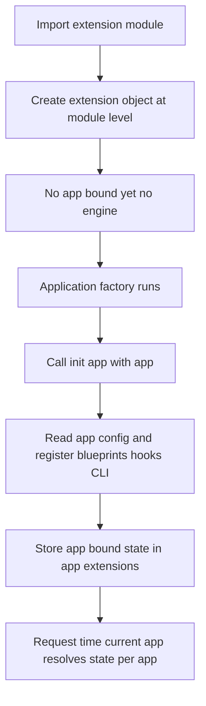

# The Flask Extension Contract: init_app, App-Bound State, and Extension Design

## English

Flask extensions are not magic plugins — they follow a loose but consistent contract that you can learn to read and even write yourself. The convention is that an extension exposes a class or object with an `init_app(app)` method, which registers blueprints, hooks, before/after request handlers, CLI commands, or configuration defaults on the given app. This is why extensions work with application factories: you create the extension object once at module level, then call `init_app(app)` inside your factory for each app instance.

This two-step pattern exists because of a subtlety: extensions often need to bind state to a specific app, but the app may not exist yet when the extension module is imported. `init_app` is the deferred binding step. For example, Flask-SQLAlchemy's `db = SQLAlchemy()` at import time holds no engine; the engine and session are configured when `db.init_app(app)` runs, reading `app.config` values like `SQLALCHEMY_DATABASE_URI`. In older versions, the extension reached into `app` directly at import — which broke factories and multiple-app scenarios. The `init_app` contract fixed that.

Extensions also rely on Flask's application context and `current_app` proxy to access configuration at request time. A well-behaved extension stores app-specific state keyed by the app instance, often in `app.extensions`, a dict Flask provides for exactly this purpose. When you call `db.session` inside a view, the extension looks up the session bound to `current_app`, not to some global. This is how one process can serve multiple Flask apps with independent database configurations without cross-talk.

Some extensions also register teardown handlers via `app.teardown_appcontext` to close sessions or release resources at the end of each request or app context. Others add CLI commands through `app.cli`, which is how `flask db upgrade` appears after Flask-Migrate is initialized. Understanding these hooks explains why the order of `init_app` calls can occasionally matter — if one extension's teardown depends on another's resource, registration order affects cleanup.

When you write your own extension, keep to the same discipline: accept `app=None` in the constructor, defer all app-specific setup to `init_app`, store per-app state in `app.extensions`, and use `current_app` rather than importing the app object. This makes your extension factory-compatible, testable, and safe in multi-app processes — the same properties the mature extensions in the ecosystem rely on.

## 中文

Flask 擴充套件不是魔法外掛——它們遵循一套寬鬆但一致的契約，你可以學會閱讀、甚至自己撰寫。慣例是擴充套件公開一個類別或物件，帶有 `init_app(app)` 方法，該方法在傳入的 app 上註冊藍圖、鉤子、before/after 請求處理器、CLI 指令或設定預設值。這就是擴充套件能與應用工廠搭配的原因：你在模組層級建立一次擴充套件物件，然後在工廠內為每個 app 實例呼叫 `init_app(app)`。

這個兩步模式的存在有其微妙原因：擴充套件往往需要把狀態綁定到特定的 app，但擴充套件模組被 import 時，app 可能還不存在。`init_app` 就是延後的綁定步驟。例如 Flask-SQLAlchemy 的 `db = SQLAlchemy()` 在 import 時並不持有引擎；引擎與 session 是在 `db.init_app(app)` 執行時才設定，並讀取 `app.config` 中的 `SQLALCHEMY_DATABASE_URI` 等值。較舊版本中，擴充套件在 import 時就直接伸手拿 `app`——這破壞了工廠與多 app 情境。`init_app` 契約修正了這點。

擴充套件也依賴 Flask 的應用上下文與 `current_app` 代理物件，在請求時存取設定。行為良好的擴充套件會以 app 實例為鍵儲存 app 專屬狀態，通常放在 `app.extensions` 這個 Flask 專門提供的字典中。當你在檢視函式中呼叫 `db.session`，擴充套件查的是綁定到 `current_app` 的 session，而不是某個全域物件。這就是為什麼一個程序能服務多個 Flask app，各自擁有獨立的資料庫設定而不互相干擾。

有些擴充套件也會透過 `app.teardown_appcontext` 註冊收尾處理器，在每個請求或應用上下文結束時關閉 session 或釋放資源。其他則透過 `app.cli` 新增 CLI 指令，這就是 Flask-Migrate 初始化後會出現 `flask db upgrade` 的原因。理解這些鉤子，就能解釋為何 `init_app` 的呼叫順序偶爾會有意義——若某個擴充套件的收尾依賴另一個擴充套件的資源，註冊順序就會影響清理。

當你自己撰寫擴充套件，請遵守同樣的紀律：建構子接受 `app=None`，把所有 app 專屬設定延後到 `init_app`，把每個 app 的狀態存在 `app.extensions`，並使用 `current_app` 而非 import app 物件。這能讓你的擴充套件相容於工廠、易於測試，並在多 app 程序中安全——這正是生態系中成熟擴充套件所依賴的性質。

## Key Takeaway

Extensions follow an init_app contract that defers app-specific binding, stores per-app state in app.extensions, and accesses config through current_app — which is what makes them factory-compatible and safe across multiple apps.

## Related Concepts
- Application Factories
- current_app proxy

## Diagram

