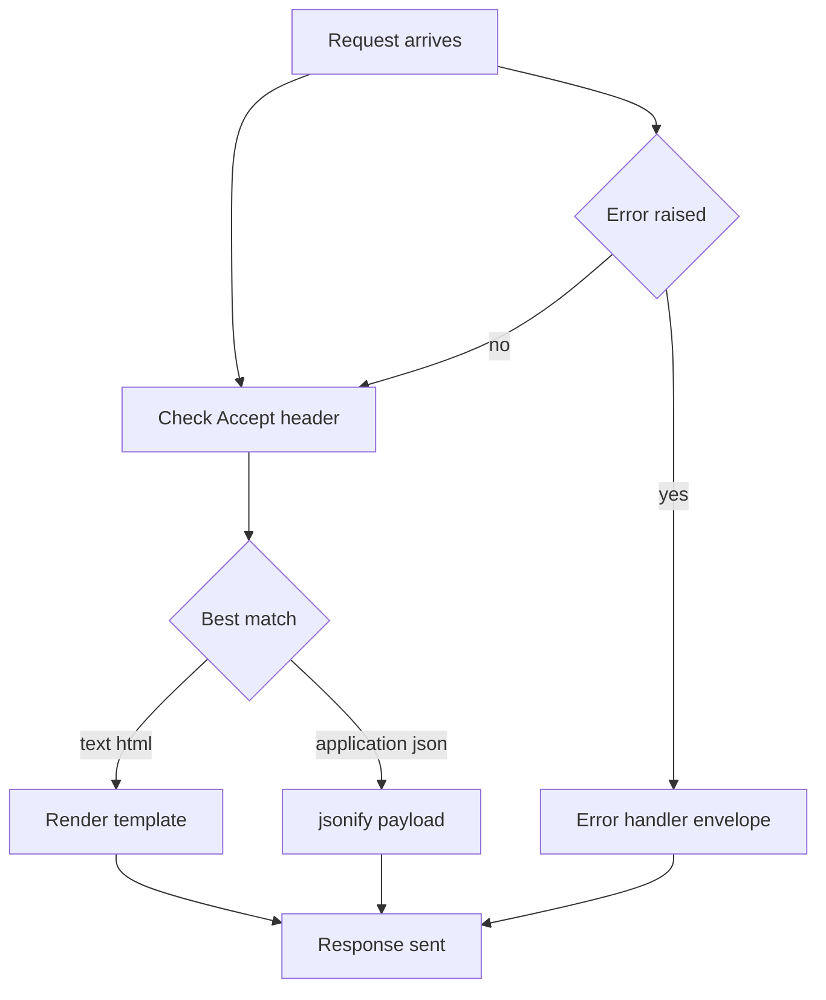

# JSON APIs Without Extensions: jsonify, Content Negotiation, and Error Envelopes

## English

Flask can serve JSON APIs with nothing but its core. The key helper is `jsonify()`, which serializes Python dicts and lists into a JSON response and — importantly — sets the `Content-Type` header to `application/json` for you. If you hand a plain dict back from a view function, modern Flask will also convert it to a JSON response, but calling `jsonify` explicitly is clearer and lets you pass status codes and headers: `return jsonify({"error": "not found"}), 404`. Under the hood Flask uses its configured JSON provider, which you can swap out to change how dates, decimals, or custom objects are serialized.

Content negotiation is the dance where the client says what it wants via the `Accept` header and the server decides what to send back. A common pattern is to inspect `request.accept_mimetypes` and branch: if the client prefers `text/html`, render a Jinja2 template; if it prefers `application/json`, return `jsonify(...)`. Flask ships `request.accept_mimetypes.best_match([...])` for exactly this. This lets one URL serve both a browser and an API client without duplicating routes, which is handy for small services that want human-readable output in a browser and machine-readable output in scripts.

Error handling deserves its own envelope. Clients parsing JSON hate getting an HTML error page back. Flask's `@app.errorhandler` can catch `HTTPException` (the base class Werkzeug raises for 404, 405, etc.) and return `jsonify({"error": ...}), exc.code`. For validation failures you might define a small helper that builds a consistent shape like `{"error": {"code": "invalid_payload", "message": "..."}}`. Consistency matters more than the exact schema: once clients learn one shape, every endpoint should honour it.

Two subtleties bite people. First, HTTP status codes matter: returning `200` with `{"success": false}` in the body confuses proxies, caches, and monitoring. Use real 4xx/5xx codes. Second, JSON is not HTML-safe by default when embedded in a page — if you ever inline JSON into a `<script>` tag, escape `<`, `>`, and `&` to avoid XSS. Flask's `tojson` filter in Jinja2 does this for you; hand-rolled `json.dumps` does not.

Finally, remember that JSON APIs are stateless by design. Cookies and sessions still work but are usually the wrong tool; tokens in the `Authorization` header are the norm. Keeping your API responses pure JSON (no redirects to login pages, no HTML error pages) is the single biggest quality-of-life improvement for API consumers.

## 中文

Flask 只用核心本身就可以提供 JSON API。關鍵幫手是 `jsonify()`，它把 Python 的 dict 與 list 序列化成 JSON 回應，而且重點是會替你設定 `Content-Type: application/json`。如果你從 view function 直接回傳一個普通 dict，現代 Flask 也會幫你轉成 JSON 回應，但明寫 `jsonify` 更清楚，而且可以順便帶上狀態碼與標頭：`return jsonify({"error": "not found"}), 404`。底層是 Flask 設定好的 JSON provider，你可以替換它來改變日期、Decimal 或自訂物件的序列化方式。

Content negotiation（內容協商）是客戶端透過 `Accept` 標頭說自己想要什麼、伺服器再決定回傳什麼的舞蹈。常見做法是檢查 `request.accept_mimetypes` 然後分支：客戶端偏好 `text/html` 就 render Jinja2 模板；偏好 `application/json` 就回傳 `jsonify(...)`。Flask 內建 `request.accept_mimetypes.best_match([...])` 正是為此而設。這樣同一個 URL 可以同時服務瀏覽器與 API 客戶端，不必重複定義路由，對小型服務特別好用——瀏覽器看得到人看的內容，腳本拿得到機器讀的內容。

錯誤處理值得有自己的一套信封格式。解析 JSON 的客戶端最討厭收到 HTML 錯誤頁。Flask 的 `@app.errorhandler` 可以攔截 `HTTPException`（Werkzeug 為 404、405 等拋出的基底類別），回傳 `jsonify({"error": ...}), exc.code`。驗證失敗時可以定義小幫手，產生一致的形狀，例如 `{"error": {"code": "invalid_payload", "message": "..."}}`。形狀本身是什麼不重要，一致性才重要：客戶端一旦學會一種格式，每個端點都應該遵守。

有兩個細節常讓人踩雷。第一，HTTP 狀態碼要正確：回傳 `200` 但 body 寫 `{"success": false}` 會讓代理、快取、監控全部搞混。該用 4xx/5xx 就用。第二，JSON 嵌進網頁時預設不是 HTML 安全的——如果你把 JSON 內嵌進 `<script>` 標籤，要轉義 `<`、`>`、`&` 以防 XSS。Jinja2 的 `tojson` 濾鏡會替你處理，自己手寫 `json.dumps` 則不會。

最後，記得 JSON API 本質上是無狀態的。Cookie 與 session 仍然可用，但通常不是對的工具；`Authorization` 標頭裡的 token 才是常態。讓 API 回應保持純 JSON（不要重導向到登入頁、不要回 HTML 錯誤頁）是提升 API 使用者體驗最大的單一改善。

## Key Takeaway

Use jsonify with real HTTP status codes and a consistent error envelope; keep API responses pure JSON and let content negotiation decide between HTML and JSON.

## Related Concepts
- Content negotiation
- HTTP status codes

## Diagram

