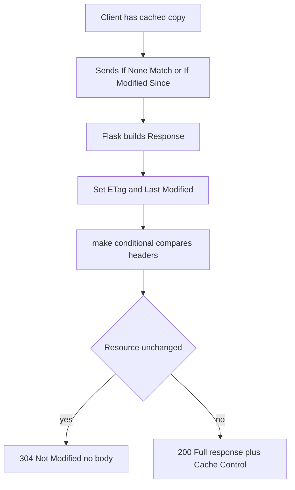

# Caching and Conditional Requests: ETags, Last-Modified, and Cache-Control in Flask

## English

HTTP caching is the cheapest performance win available, and Flask exposes the primitives directly. When a browser or proxy has a cached copy, it can send `If-None-Match` with the ETag it stored, or `If-Modified-Since` with the timestamp. If the server agrees the resource is unchanged, it responds `304 Not Modified` with no body — saving bandwidth and CPU on both ends. Flask's `Response` object has helpers: `response.set_etag("v1")` and `response.make_conditional(request)` will compare the request headers against the response's ETag and `Last-Modified` and convert the response to a 304 automatically when appropriate.

An ETag is an opaque string the server chooses; it can be a hash of the content, a version number, or anything stable per version. `Last-Modified` is a timestamp, but it has a one-second resolution problem: two updates within the same second look identical to the client. That is why ETags are generally preferred for anything that changes frequently. You can use both: `Last-Modified` for cheap first-pass checks, ETag for precision.

`Cache-Control` is the policy header. `public, max-age=3600` tells shared caches (CDNs, proxies) they may store the response for an hour. `private` restricts caching to the browser. `no-store` forbids caching entirely — appropriate for anything user-specific and sensitive. In Flask you set these with `response.headers["Cache-Control"] = "..."`. A common mistake is caching a personalised page publicly, leaking one user's data to another; if the response depends on `session` or a user ID, mark it `private` or `no-store`.

Flask's `send_file` and `send_from_directory` do much of this automatically — they set `Last-Modified` from the file's mtime, generate an ETag, and honour `If-None-Match` / `If-Modified-Since` via Werkzeug. That is why serving static files through Flask in development feels instant on reload: the browser gets a 304. In production you normally hand static files to Nginx, but the same semantics apply.

A practical recipe: for public, rarely changing resources (images, docs), use `public, max-age=86400` plus a strong ETag. For per-user JSON, use `private, no-cache` (allowing storage but requiring revalidation) or `no-store` if truly sensitive. For dynamic pages whose content depends on a database, compute a cheap version token (e.g. max `updated_at`) and use it as the ETag so unchanged pages skip rendering entirely. Measure before and after with the browser devtools Network panel — the 304s will show up plainly.

## 中文

HTTP 快取是成本最低的效能改善，而 Flask 直接暴露了相關的基本元件。當瀏覽器或代理已有快取副本，它可以帶上 `If-None-Match`（存下來的 ETag）或 `If-Modified-Since`（時間戳）。若伺服器同意資源未變，就回 `304 Not Modified`，不帶 body——兩端都省下頻寬與 CPU。Flask 的 `Response` 物件有幫手：`response.set_etag("v1")` 與 `response.make_conditional(request)` 會比對請求標頭與回應的 ETag 及 `Last-Modified`，在適當時自動把回應轉成 304。

ETag 是伺服器自選的不透明字串，可以是內容的雜湊、版本號，或任何「每個版本固定」的值。`Last-Modified` 是時間戳，但有一秒解析度的問題：同一秒內的兩次更新對客戶端看起來一樣。這就是為什麼頻繁變動的資源一般偏好用 ETag。兩者可以並用：`Last-Modified` 做便宜的第一關，ETag 做精確比對。

`Cache-Control` 是政策標頭。`public, max-age=3600` 告訴共享快取（CDN、代理）可以存一小時。`private` 限制只有瀏覽器能存。`no-store` 完全禁止快取——適用於任何與使用者相關且敏感的內容。在 Flask 用 `response.headers["Cache-Control"] = "..."` 設定。常見錯誤是把個人化頁面以 public 快取，結果把某位使用者的資料洩漏給另一位；只要回應依賴 `session` 或使用者 ID，就標 `private` 或 `no-store`。

Flask 的 `send_file` 與 `send_from_directory` 已經自動處理大部分：它們依檔案 mtime 設定 `Last-Modified`、產生 ETag，並透過 Werkzeug 尊重 `If-None-Match` / `If-Modified-Since`。這就是為什麼開發時透過 Flask 提供靜態檔，重新整理感覺瞬間完成：瀏覽器拿到 304。正式環境通常把靜態檔交給 Nginx，但語意完全相同。

實用配方：公開且少變的資源（圖片、文件）用 `public, max-age=86400` 加強 ETag。每位使用者的 JSON 用 `private, no-cache`（允許儲存但必須重新驗證），真的很敏感就 `no-store`。內容依賴資料庫的動態頁，可以算一個便宜的版本 token（例如最大的 `updated_at`）當 ETag，未變的頁面就完全跳過 render。用瀏覽器開發者工具的 Network 面板前後對照，304 會清楚顯示出來。

## Key Takeaway

Set ETag, Last-Modified, and Cache-Control deliberately — use make_conditional for 304s, and never mark personalised responses as publicly cacheable.

## Related Concepts
- HTTP ETag
- Cache-Control directives

## Diagram

