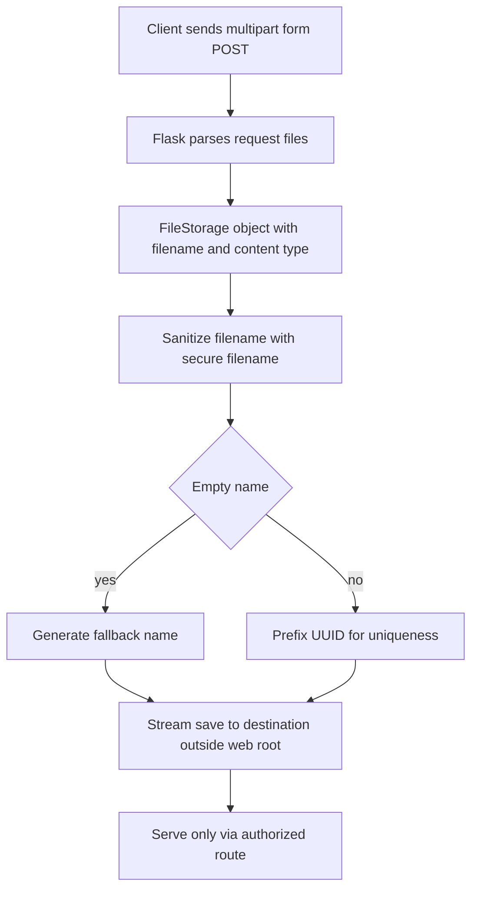

# File Uploads and Safe Handling: request.files, Streaming Saves, and Path Traversal

## English

Uploads in Flask arrive through `request.files`, a `MultiDict` of `FileStorage` objects. A form must be `enctype="multipart/form-data"`; a plain form POST will not populate `request.files`. You fetch a file by name: `f = request.files["document"]`. `FileStorage` behaves like a file object (`.read()`, `.save(path)`) but also carries `.filename` and `.content_type` supplied by the client. Treat both as untrusted: the client can lie about either. The `.filename` may contain `../` sequences, absolute paths, or Windows drive letters — using it directly in a path is a classic path traversal vulnerability.

Use `werkzeug.utils.secure_filename()` to sanitise the basename. It strips directory components and dangerous characters, but it does not guarantee uniqueness and can return an empty string for some inputs. A robust pattern is: take `secure_filename(f.filename)`, if empty fall back to a generated name, then prefix a UUID or hash so two users uploading `report.pdf` do not collide. Store files outside the web root, or under a directory served only by an explicit route that checks authorisation — never let a path in the URL map directly to the filesystem.

Large uploads should not be slurped into memory. `FileStorage.save(dest)` streams from the underlying temp file to the destination in chunks, which is memory-safe. If you need to inspect or transform the content, read in chunks (`f.stream.read(8192)`) rather than calling `.read()` with no argument. Flask buffers uploads to a temporary file once they exceed a threshold, so RAM stays bounded even for big files, but your code should still avoid loading the whole payload at once.

The `MAX_CONTENT_LENGTH` config caps the total request body size; Flask raises a `413 Request Entity Too Large` for oversize requests when it is set. Also check the extension and, ideally, sniff the magic bytes to verify the file type — a `.png` extension proves nothing. For images, re-encoding through a library like Pillow is the safest validation: it rejects malformed files and strips embedded metadata that could carry scripts.

Finally, think about serving uploads back. Serving user files from the same origin as your app invites stored XSS if the file is HTML or SVG. Either serve from a separate domain, force `Content-Disposition: attachment`, or set a restrictive `Content-Security-Policy`. And always require authentication on the download route — an unguessable filename is not an access-control mechanism.

## 中文

Flask 的上傳檔案透過 `request.files` 抵達，那是一個裝著 `FileStorage` 物件的 `MultiDict`。表單必須是 `enctype="multipart/form-data"`；普通的表單 POST 不會填充 `request.files`。用名稱取出檔案：`f = request.files["document"]`。`FileStorage` 像檔案物件（`.read()`、`.save(path)`），但也帶著客戶端提供的 `.filename` 與 `.content_type`。兩者都不可信：客戶端可以對任一說謊。`.filename` 可能含 `../` 序列、絕對路徑或 Windows 磁碟代號——直接把它拼進路徑就是典型的 path traversal 漏洞。

用 `werkzeug.utils.secure_filename()` 清理 basename。它會剝掉目錄部分與危險字元，但不保證唯一，而且某些輸入會回傳空字串。穩健的做法是：取 `secure_filename(f.filename)`，若為空就換成產生的名稱，再前面加 UUID 或雜湊，避免兩位使用者都上傳 `report.pdf` 時互相覆蓋。檔案要存在 web root 之外，或放在只由明確檢查授權的路由提供的目錄——永遠不要讓 URL 中的路徑直接對應到檔案系統。

大型上傳不該整個吸進記憶體。`FileStorage.save(dest)` 會從底層暫存檔分塊串流到目的地，記憶體安全。如果需要檢查或轉換內容，要分塊讀（`f.stream.read(8192)`），而不是無參數呼叫 `.read()`。Flask 在上傳超過門檻後會緩衝到暫存檔，所以即使大檔 RAM 也有上限，但你的程式仍應避免一次載入整個 payload。

`MAX_CONTENT_LENGTH` 設定會限制請求 body 總大小；設定後，過大的請求會讓 Flask 拋出 `413 Request Entity Too Large`。還要檢查副檔名，最好再嗅探 magic bytes 驗證檔案型別——`.png` 副檔名什麼都證明不了。對圖片而言，用 Pillow 之類的函式庫重新編碼是最安全的驗證：它會拒絕畸形檔案，並剝掉可能夾帶腳本的中繼資料。

最後，想想如何把上傳檔提供回去。從與應用同源的網域提供使用者檔案，若檔案是 HTML 或 SVG，就會招來 stored XSS。可以改用獨立網域、強制 `Content-Disposition: attachment`，或設定嚴格的 `Content-Security-Policy`。而且下載路由永遠要驗證身份——難以猜測的檔名不是存取控制機制。

## Key Takeaway

Treat uploads as hostile input: sanitise filenames with secure_filename, add your own uniqueness prefix, cap size with MAX_CONTENT_LENGTH, validate content not extensions, and serve downloads through an authenticated route with safe headers.

## Related Concepts
- Path traversal
- multipart/form-data

## Diagram

