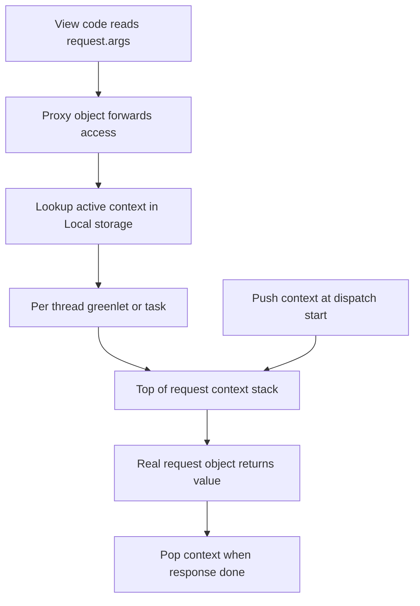

# Context Locals and Proxy Objects: How request and g Actually Work

## English

When you write `request.args` inside a view, you never passed `request` in as a parameter. So how does Flask know which request you mean, especially when the same worker process is handling several requests at once? The answer is a context-local, implemented by Werkzeug's `LocalProxy` and `Local` classes. A `Local` object is a container whose contents are stored per-thread (or per-greenlet, or per-async-task depending on the configured context) rather than globally. Flask pushes a request context onto a stack at the start of dispatch and pops it when the response is finished, so any code running in that window sees the right values.

The `request`, `session`, `g`, and `current_app` names you import from `flask` are not the real objects — they are proxy objects. A proxy forwards every attribute access to whatever object currently sits on top of the relevant stack. `request.method` does not read a stored attribute; it looks up the active request object in the current context, then asks that object for its `method`. This indirection is what lets library code and helper functions reach the request without threading it through every function signature.

The stack matters because contexts can nest. If you push a test request context inside a view (common in testing, or when calling `test_request_context()`), the inner context shadows the outer one until it is popped. Flask keeps separate stacks for application contexts and request contexts, and pushing a request context implicitly pushes an application context if none exists. This is why `current_app` works even in a bare script that has not started a server — you can push an app context manually with `with app.app_context():` and then use `current_app.config`.

The classic failure mode is accessing a proxy outside any context. If you call `request.args` from a background thread, a scheduled job, or a plain function invoked after the response has been returned, you get a `RuntimeError` saying you are working outside of a request context. That error is a feature: it tells you the proxy has nothing to point at. The fix is to capture the concrete data you need (copy `request.args` into a dict, read `current_app.config` into a variable) while the context is still alive, then pass those plain values onward.

Understanding this also explains a subtle correctness issue. Because the `Local` is thread-scoped, a long-running background thread spawned from a view does not inherit the request context — and it should not, since the request may be long gone. Meanwhile, in async views Flask uses context variables so that concurrent tasks do not stomp on each other's `request`. The mental model: proxies are thin handles, the real data lives on a stack, and the stack is bound to the current execution unit. Keep that in mind and the 'outside of context' error becomes predictable rather than mysterious.

## 中文

當你在 view 裡面寫 `request.args` 時，你從來沒有把 `request` 當作引數傳進去。那麼 Flask 怎麼知道你指的是哪個 request？尤其同一個 worker process 可能同時處理好幾個 request。答案是一個 context-local（上下文區域性）物件，由 Werkzeug 的 `LocalProxy` 和 `Local` 類別實作。`Local` 是一個容器，它的內容是按 thread（或 greenlet、或 async task，視乎設定的 context）分開儲存，而不是全域共用。Flask 在分派開始時把 request context 推入一個 stack，回應完成後再彈出，所以在那段視窗內執行的任何程式碼都會見到正確的值。

你從 `flask` import 的 `request`、`session`、`g`、`current_app` 並不是真正的物件，而是 proxy（代理）。Proxy 會把每一次屬性存取轉發給相關 stack 最頂層的那個物件。`request.method` 並不是讀取某個儲存的屬性；它會先在當前 context 找到活躍的 request 物件，再向那個物件查詢 `method`。這層間接就是為何函式庫程式碼和輔助函式可以取得 request，而不必在每個函式簽名中一路傳遞。

Stack 之所以重要，是因為 context 可以巢狀。如果你在 view 裡面再推入一個測試 request context（測試時很常見，或呼叫 `test_request_context()`），內層 context 會遮蔽外層，直到被彈出為止。Flask 為 application context 和 request context 分別維護獨立的 stack，而推入 request context 時若沒有 application context，會隱式地一併推入。這就是為何 `current_app` 在一個未啟動伺服器的純指令碼中也能運作——你可以用 `with app.app_context():` 手動推入 app context，然後使用 `current_app.config`。

最典型的失敗情況是在任何 context 之外存取 proxy。如果你從背景 thread、排程工作，或在回應已回傳之後才呼叫的普通函式中存取 `request.args`，你會得到 `RuntimeError`，說你在 request context 之外工作。這個錯誤其實是好事：它告訴你 proxy 沒有任何東西可指向。解法是在 context 仍然存活時，把你真正需要的具體資料擷取下來（把 `request.args` 複製成 dict、把 `current_app.config` 讀進變數），然後把這些純值傳出去。

明白這一點亦解釋了一個微妙的正確性問題。因為 `Local` 是按 thread 劃分的，從 view 衍生出來的長時間背景 thread 不會繼承 request context——它亦不應該繼承，因為那個 request 可能早已結束。另一方面，在 async view 中 Flask 使用 context variable，令並行的 task 不會互相覆蓋對方的 `request`。心智模型：proxy 是薄薄的把手，真正的資料存在 stack 上，而 stack 繫結於當前的執行單元。記住這點，「outside of context」錯誤就會變得可預測，而非神秘莫測。

## Key Takeaway

request, g, and current_app are proxies that forward to objects on a per-thread context stack, so they only work while the context is pushed.

## Related Concepts
- Werkzeug LocalProxy
- Application context vs request context

## Diagram

