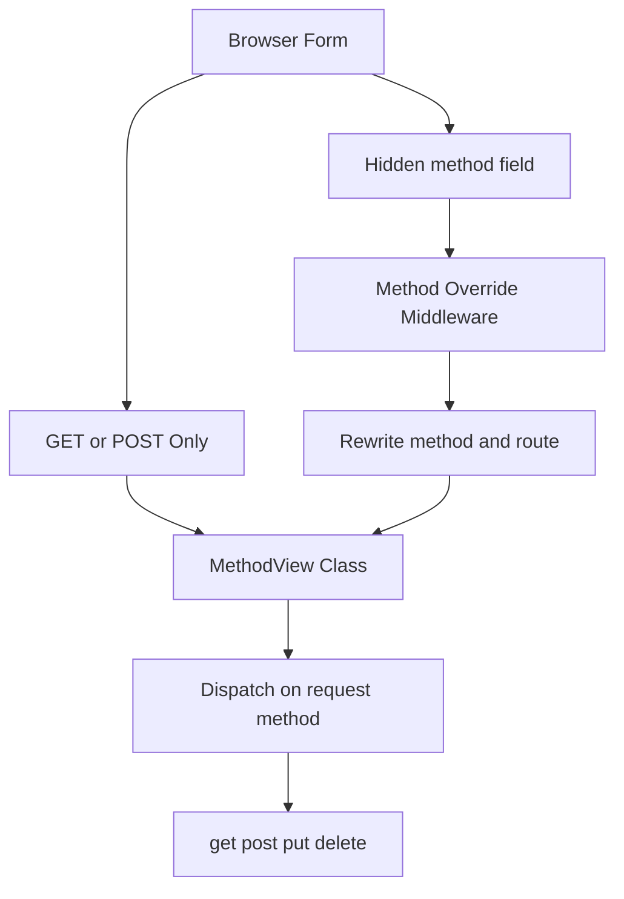

# Method Override and the Hidden Limits of HTML Forms

## English

HTML forms can only send GET and POST. There is no `<form method="PUT">` that browsers honour — the spec allows only GET and POST for form submission. Yet REST-style APIs want PUT, PATCH, and DELETE. Flask's answer is `MethodView`, a class-based view where you define `get()`, `post()`, `put()`, `delete()` methods and Flask dispatches to the right one based on `request.method`. This is cleaner than a chain of `if request.method == ...` inside one function, and it pairs naturally with `url_for` since the endpoint name is derived from the class.

But a class-based view still cannot receive a PUT from a plain HTML form. The common workaround is method override: the form posts normally, but includes a hidden field like `<input type="hidden" name="_method" value="PUT">`, and middleware rewrites `request.method` before routing or dispatching. Flask extensions such as Flask-MethodOverride implement this pattern by reading that hidden field. (Werkzeug's `ProxyFix` is a different tool — it rewrites the WSGI environment's scheme, host, and path from `X-Forwarded-*` headers, not the request method; method override in the Rack world is `Rack::MethodOverride`.) The security implication is real: if you enable method override globally, a cross-site form can trigger a DELETE on your API unless you also enforce CSRF tokens, because the browser will happily submit the form with the spoofed method.

`MethodView` has other sharp edges worth knowing. Because dispatch happens on the instance, you cannot easily share state between methods unless you use class attributes or `init` hooks — and class attributes are shared across all requests, which is a trap if you store per-request data there. Flask's `MethodView` does not automatically provide `OPTIONS`; you either define `options()` yourself or rely on Werkzeug to synthesise a default `OPTIONS` response listing allowed methods, which Flask does when the view does not handle it. Likewise `HEAD` falls back to `get()` automatically, which is usually what you want but means your `get()` must not have side effects.

The decorator story is also different, and it trips people up. Flask is explicit about this: decorators applied to the class itself are **not** applied to the generated view function. If you want a class-wide guard such as `@login_required`, you must list it in the class's `decorators = [...]` attribute (or wrap the function returned by `as_view()`); putting it directly on the class silently does nothing. `@app.route()` cannot decorate a class-based view at all — you register the view with `app.add_url_rule('/path', view_func=MyView.as_view('my_view'))`. Per-method decorators then apply to the individual methods, and their ordering relative to each other matters, since a decorator listed in `decorators = [...]` runs outside the method-level ones. A frequent bug is decorating the class with something that expects a function signature, which breaks because the class is instantiated, not called directly by the router.

Finally, `MethodView` is not magic — it is a thin wrapper around `View` that implements `dispatch_request` by looking up `getattr(self, request.method.lower(), None)`. If the attribute is missing, it returns a 405 Method Not Allowed, and Werkzeug adds the `Allow` header. Knowing this lets you debug 405s quickly: the route matched, but the class has no method for that verb. For API-only services, this class-based style plus explicit 405 handling gives you clean, discoverable endpoints without pulling in a heavier framework.

## 中文

HTML 表單只能送出 GET 和 POST。瀏覽器並不支援 `<form method="PUT">`——規範只允許表單提交使用 GET 和 POST。然而 REST 風格 API 想要 PUT、PATCH 和 DELETE。Flask 的答案是 `MethodView`，一種以類別為基礎的 view，你定義 `get()`、`post()`、`put()`、`delete()` 方法，Flask 根據 `request.method` 分派到正確的方法。這比在單一函式裡寫一串 `if request.method == ...` 乾淨得多，而且與 `url_for` 自然配合，因為 endpoint 名稱是由類別衍生出來的。

但以類別為基礎的 view 仍然無法接收來自普通 HTML 表單的 PUT。常見的變通方法是 method override（方法覆寫）：表單正常 POST，但包含一個隱藏欄位如 `<input type="hidden" name="_method" value="PUT">`，然後中介軟件在路由或分派之前改寫 `request.method`。Flask-MethodOverride 等擴充套件就是讀取那個隱藏欄位來實作這個模式。（Werkzeug 的 `ProxyFix` 是另一回事——它是從 `X-Forwarded-*` 標頭改寫 WSGI 環境的 scheme、host 與路徑，不是改寫請求方法；Rack 生態裡做方法覆寫的是 `Rack::MethodOverride`。）安全上的影響是真實的：如果你全域啟用 method override，一個跨站表單可以對你的 API 觸發 DELETE，除非你同時強制 CSRF token，因為瀏覽器會樂意提交帶有偽造方法的表單。

`MethodView` 還有其他值得知道的尖銳邊緣。因為分派發生在實例上，你無法輕易在方法之間共享狀態，除非使用類別屬性或者 `init` 鉤子——而類別屬性在所有 request 之間共享，如果你把每個 request 的資料存在那裡，就會中招。Flask 的 `MethodView` 不會自動提供 `OPTIONS`；你要麼自己定義 `options()`，要麼依賴 Werkzeug 合成一個預設的 `OPTIONS` 回應列出允許的方法，當 view 沒有處理時 Flask 會這樣做。同樣地，`HEAD` 會自動回退到 `get()`，這通常是你要的，但意味著你的 `get()` 不能有副作用。

裝飾器的情況也不同，而且很容易踩坑。Flask 講得好清楚：套用在類別本身的裝飾器**不會**套用到產生的 view 函式。如果你想有一個類別層級的守衛如 `@login_required`，必須把它列在類別的 `decorators = [...]` 屬性裡（或包裝 `as_view()` 傳回的函式）；直接套在類別上是靜靜地沒有作用的。`@app.route()` 也不能裝飾類別式 view——你要用 `app.add_url_rule('/path', view_func=MyView.as_view('my_view'))` 註冊。逐方法的裝飾器則要套用到個別方法上，而它們彼此之間的相對順序很重要，因為列在 `decorators = [...]` 裡的裝飾器會在方法層級的裝飾器之外層執行。一個常見的 bug 是用期望函式簽名的東西去裝飾類別，這會壞掉，因為類別是被實例化的，而不是被路由器直接呼叫。

最後，`MethodView` 並不神奇——它是 `View` 的薄包裝，實作了 `dispatch_request`，透過 `getattr(self, request.method.lower(), None)` 查找。如果屬性不存在，它會回傳 405 Method Not Allowed，Werkzeug 會加上 `Allow` 標頭。知道這點就能快速除錯 405：路由匹配了，但類別沒有對應那個動詞的方法。對於純 API 服務，這種類別式風格加上明確的 405 處理，讓你在不引入更重框架的情況下，得到乾淨、可探索的 endpoint。

## Key Takeaway

HTML forms only send GET and POST, so MethodView plus a method-override middleware is the standard bridge to REST verbs — and it must be paired with CSRF protection.

## Related Concepts
- Flask MethodView
- HTTP method override

## Diagram

