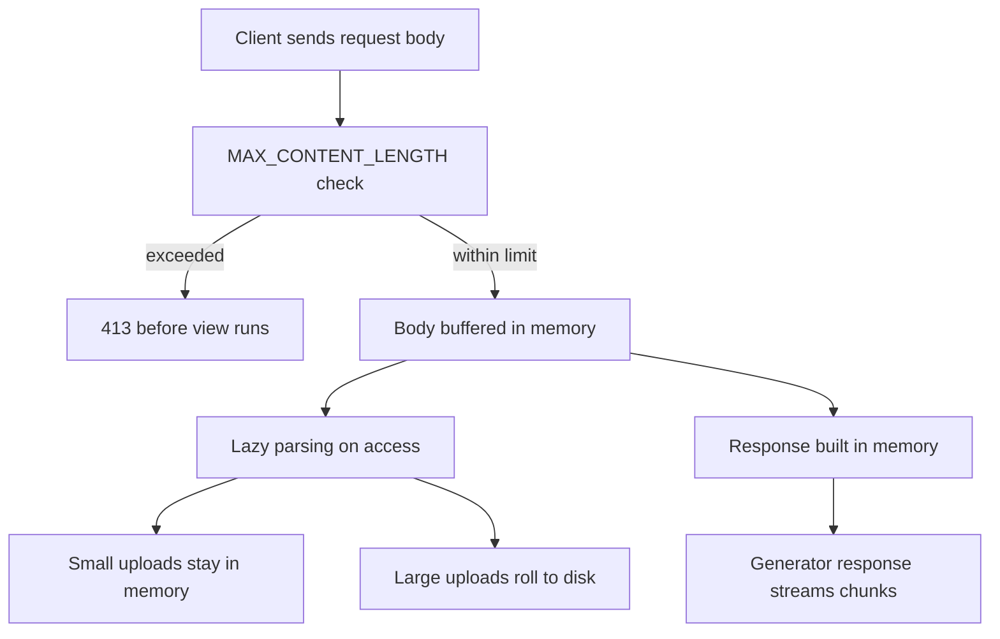

# Flask's Request/Response Cycle in Memory: Buffering, Size Limits, and Streaming Trade-offs

## English

By default, Flask does not read the request body before your view runs. `request.get_data()`, `request.form` and `request.json` trigger parsing, and Werkzeug then stores the bytes in the request object. For a normal JSON API this is fine — payloads are small. But it means a malicious or buggy client can send a 10 GB body and your worker will try to buffer it. Werkzeug's development server and most WSGI servers impose a maximum content length, and Flask exposes `MAX_CONTENT_LENGTH` in config; when exceeded, Flask raises a 413 Request Entity Too Large before your view is called. Setting this is not optional in production.

There is a subtler cost: parsing is lazy but sticky. If your view never touches `request.form`, the body may not be parsed at all, which is good. But the moment any code path reads it, Werkzeug parses the whole thing. For file uploads, `request.files` gives you `FileStorage` objects that wrap a `SpooledTemporaryFile` — small uploads stay in memory, larger ones roll over to disk after a threshold. That threshold is a Werkzeug detail, not a Flask one, and it is why naive upload handlers that call `.read()` on the whole file can exhaust memory even though the storage layer was clever.

On the response side, Flask normally builds the whole body in memory too. `jsonify` serialises a dict to a string; a template renders to a string; then the WSGI server writes it out. For large payloads, this doubles peak memory (data plus serialised string). The alternative is a generator response: return an iterable of chunks, and the WSGI server streams them to the client. This is how `stream_with_context` works — it keeps the request context alive across yields so that `request` and `g` remain usable inside the generator, at the cost of holding a worker busy for the duration.

The trade-off is that streaming breaks assumptions downstream. A reverse proxy like Nginx may buffer the response unless you disable it, defeating the point. Content-Length is unknown, so the response uses chunked transfer encoding, and clients that need the length (some download managers, some progress UIs) cannot get it. Error handling also changes: once you have started yielding bytes, you cannot change the status code. If an exception occurs halfway through a stream, the client sees a truncated body with a 200 status — a silent corruption that is much worse than a clean 500.

The practical rule: buffer by default, stream only when you must (large files, server-sent events, long polling), and when you stream, validate everything you can before the first yield. Set `MAX_CONTENT_LENGTH`, prefer `send_file` with `conditional=True` for downloads since it handles range requests and ETags for you, and remember that a generator response ties up a worker thread for its whole lifetime — which changes your capacity planning, not just your code.

## 中文

預設情況下，Flask 不會在你的 view 執行之前把 request body 讀進記憶體。`request.get_data()`、`request.form` 和 `request.json` 會觸發解析，之後 Werkzeug 才把位元組存在 request 物件裡。對於正常的 JSON API 這沒問題——payload 很小。但這意味著惡意或有 bug 的客戶端可以送出 10 GB 的 body，而你的 worker 會嘗試緩衝它。Werkzeug 的開發伺服器和大多數 WSGI 伺服器都會施加最大內容長度限制，而 Flask 在 config 中提供 `MAX_CONTENT_LENGTH`；超過時，Flask 會在你的 view 被呼叫之前丟擲 413 Request Entity Too Large。在生產環境中設定這個並非可選項。

還有一個更微妙的成本：解析是惰性的，但一旦開始就會黏住。如果你的 view 從不碰 `request.form`，body 可能完全不會被解析，這是好事。但任何程式碼路徑一讀取它，Werkzeug 就會解析整個東西。對於檔案上傳，`request.files` 給你包裝 `SpooledTemporaryFile` 的 `FileStorage` 物件——小上傳留在記憶體，較大的在超過門檻後轉存到磁碟。那個門檻是 Werkzeug 的細節，不是 Flask 的，這正是為何天真地對整個檔案呼叫 `.read()` 的上傳處理器會耗盡記憶體，即使儲存層本身很聰明。

在回應方面，Flask 通常也在記憶體中建構整個 body。`jsonify` 把 dict 序列化成字串；template 渲染成字串；然後 WSGI 伺服器寫出去。對於大型 payload，這會令峰值記憶體加倍（資料加上序列化字串）。替代方案是 generator 回應：回傳一個 chunk 的可迭代物件，WSGI 伺服器把它們串流給客戶端。這就是 `stream_with_context` 的運作方式——它在 yield 之間保持 request context 存活，令 `request` 和 `g` 在 generator 內仍然可用，代價是整個期間佔住一個 worker。

取捨在於串流會打破下游的假設。像 Nginx 這樣的反向代理可能會緩衝回應，除非你停用它，那就違背了原意。Content-Length 未知，所以回應使用 chunked transfer encoding，而需要長度的客戶端（某些下載管理器、某些進度 UI）拿不到。錯誤處理也會改變：一旦你開始 yield 位元組，你就不能改變狀態碼。如果串流中途發生例外，客戶端會見到截斷的 body 配 200 狀態——一種靜默的損壞，比乾淨的 500 糟糕得多。

實用規則：預設緩衝，只在必須時串流（大檔案、server-sent events、long polling），而當你串流時，在第一次 yield 之前驗證所有能驗證的東西。設定 `MAX_CONTENT_LENGTH`，下載時偏好 `send_file` 配 `conditional=True`，因為它幫你處理 range request 和 ETag，並記住 generator 回應會在整個生命週期佔住一個 worker thread——這改變的是你的容量規劃，不只是程式碼。

## Key Takeaway

Flask buffers request and response bodies in memory by default; set MAX_CONTENT_LENGTH and reserve streaming for cases where the memory or latency trade-off genuinely demands it.

## Related Concepts
- MAX_CONTENT_LENGTH
- stream_with_context

## Diagram

