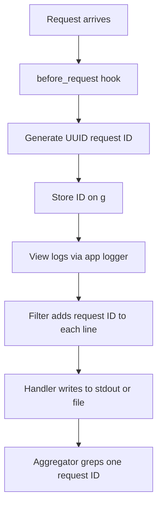

# Logging and Observability: Making a Flask App Tell You What It Is Doing

## English

Flask ships with almost no logging of its own beyond a few lines in development, so a production app that fails silently is a common surprise. Python's standard library logging module is the real engine here: Flask configures a logger named 'flask.app' plus a default handler, and any call to app.logger writes through it. The practical habit is to treat app.logger as your application's voice — log at INFO when a meaningful business event happens, WARNING when something suspicious occurs but the request still succeeds, and ERROR (with exc_info=True) when a request collapses. A request ID is the single most useful piece of context you can attach: generate a UUID at the start of each request in a before_request hook, store it on g, and include it in every log line via a logging.Filter or a custom Formatter. When a user reports a broken checkout, that ID lets you grep one vertical slice of the story out of thousands of interleaved lines.

The subtlety is that Flask's development server and Gunicorn behave differently. Under Gunicorn with multiple worker processes, each worker is a separate OS process with its own memory, so in-memory log buffers or counters are useless for a global view — you must write to stdout/stderr (which Gunicorn captures) or to a file, and let an external system aggregate. TimedRotatingFileHandler or RotatingFileHandler prevents a single log file from filling a disk. Also remember that logging is not metrics: logs are discrete events with text payloads, while metrics (counters, histograms) are aggregated numbers. A request-duration histogram tells you p95 latency is 800 ms; logs tell you which endpoint and which user. You usually want both.

A concrete wiring pattern: in your application factory, call logging.config.dictConfig with a dictionary that defines a formatter including %(asctime)s, %(levelname)s, %(name)s and — if you use a filter — %(request_id)s. Attach a filter that pulls request_id from Flask's g, guarding with getattr so that log lines emitted outside a request (during startup, for example) do not crash. Set the root logger level from configuration so that production runs at INFO and debugging runs at DEBUG without editing code. Never call app.logger.debug inside a hot loop without checking isEnabledFor; string formatting is cheap but not free.

Finally, be careful what you log. Passwords, session cookies, Authorization headers, and full request bodies containing personal data must never reach a log file — logs are copied, shipped, and retained far more casually than databases. Log identifiers, not secrets. Structured logging (emitting JSON lines with fields like event, user_id, latency_ms) makes downstream querying dramatically easier than free-text messages, and it costs almost nothing to adopt early. Observability is a habit, not a library: decide what question you will ask at 3 a.m. and make sure the answer is already in the log.

## 中文

Flask 本身幾乎不附帶任何日誌功能，除了開發模式下幾行輸出之外，所以「正式環境的應用程式一聲不響地壞掉」是常見的意外。真正的引擎是 Python 標準庫的 logging 模組：Flask 會設定一個名為 flask.app 的 logger 及預設 handler，任何對 app.logger 的呼叫都會經由它輸出。實務上的習慣是把 app.logger 當成應用程式的嘴巴——發生有意義的業務事件時用 INFO，出現可疑情況但請求仍然成功時用 WARNING，請求徹底失敗時用 ERROR（並帶 exc_info=True）。請求 ID 是你所能附加之中最有用的上下文：在 before_request hook 中為每個請求產生一個 UUID，存到 g 上，再透過 logging.Filter 或自訂 Formatter 把它加進每一行日誌。當使用者回報結帳壞掉時，這個 ID 讓你能從數千行交錯的紀錄中，把那一條完整的時間線 grep 出來。

微妙之處在於 Flask 開發伺服器與 Gunicorn 的行為不同。在 Gunicorn 多個 worker 程序的情況下，每個 worker 都是獨立的作業系統程序、各有自己的記憶體，所以記憶體內的日誌緩衝或計數器對全域視圖毫無用處——你必須寫到 stdout/stderr（由 Gunicorn 捕捉）或寫到檔案，再交給外部系統彙整。TimedRotatingFileHandler 或 RotatingFileHandler 可避免單一日誌檔把磁碟塞滿。另外要記得，日誌不等於指標：日誌是帶文字內容的離散事件，指標（計數器、直方圖）則是彙總後的數字。請求耗時直方圖告訴你 p95 延遲是 800 毫秒；日誌則告訴你是哪個端點、哪個使用者。你通常兩者都需要。

一個具體的接線方式：在 application factory 裡呼叫 logging.config.dictConfig，用一個字典定義 formatter，包含 %(asctime)s、%(levelname)s、%(name)s，若你用了 filter 再加上 %(request_id)s。掛上一個從 Flask 的 g 取出 request_id 的 filter，並用 getattr 保護，這樣在請求之外（例如啟動期間）發出的日誌行就不會令程式崩潰。從組態設定 root logger 的等級，讓正式環境跑 INFO、除錯時跑 DEBUG，而不必改程式碼。不要在熱迴圈裡未經 isEnabledFor 檢查就呼叫 app.logger.debug；字串格式化便宜，但不是免費。

最後，注意你記錄了什麼。密碼、session cookie、Authorization 標頭，以及含有個人資料的完整請求內容，絕不應進入日誌檔——日誌被複製、傳送與保留的隨意程度遠高於資料庫。記錄識別碼，不要記錄機密。結構化日誌（輸出帶有 event、user_id、latency_ms 等欄位的 JSON 行）讓下游查詢比自由文字訊息容易得多，而且越早採用成本越低。可觀測性是一種習慣，不是一個函式庫：先想清楚你凌晨三點會問什麼問題，再確保答案早已寫在日誌裡。

## Key Takeaway

Treat app.logger as your app's voice, attach a per-request ID for traceability, and never log secrets.

## Related Concepts
- Python logging module
- Gunicorn worker processes

## Diagram

