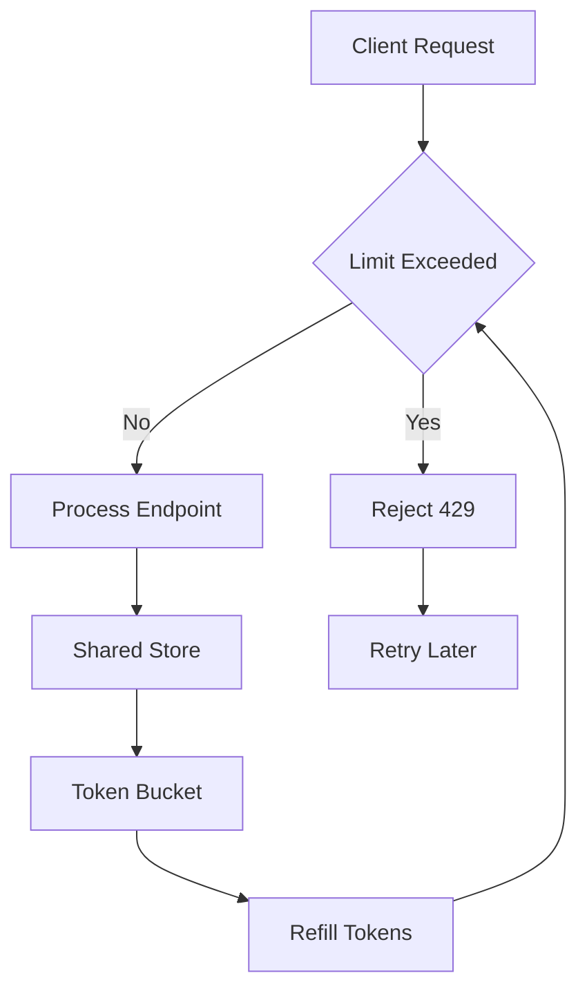

# Rate Limiting and Abuse Resistance: Protecting a Flask Endpoint from Itself

## English

A Flask app that works perfectly for one user can be trivially knocked over by one script. Rate limiting is the practice of capping how many requests a client may make in a time window, and it matters for three distinct reasons: protecting expensive resources (a database query that takes 200 ms multiplied by 1,000 concurrent requests is an outage), protecting fairness (one client should not starve others), and protecting credentials (limiting login attempts to, say, five per minute per IP and per account makes brute-forcing a password practically hopeless). These are separate goals and often need separate limits — a generous global limit plus a tight limit on /login and /password-reset.

The core algorithm choice shapes behaviour. A fixed window counter (reset the count every 60 seconds) is simple but allows a burst of 2× the limit across a window boundary. A sliding window log keeps timestamps of recent requests and is precise but memory-hungry. The token bucket is the usual sweet spot: a bucket holds up to N tokens, refills at a steady rate, and each request consumes one; empty bucket means rejection. Token bucket naturally permits short bursts while enforcing a long-run average, which matches how real clients behave. Leaky bucket smooths output to a constant rate instead. Knowing which one you are using matters, because 'rate limit' without an algorithm is not a specification.

Implementation-wise, in-memory dictionaries work only for a single process — with Gunicorn's multiple workers each process would keep its own counter, so the effective limit multiplies by the worker count. The correct home for counters is a shared store: Redis is the canonical choice, with atomic operations (INCR plus EXPIRE, or a Lua script for token bucket) so that concurrent workers do not race. Extensions such as Flask-Limiter wrap this pattern and let you declare limits per route or globally, with configurable storage backends; if you build it yourself, remember that the key you throttle on is a policy decision — IP address is easy but wrong behind NAT or a proxy (you must trust X-Forwarded-For only from your own load balancer), user ID is fairer for authenticated routes, and API key is right for machine clients.

Two things people forget. First, always return HTTP 429 Too Many Requests with a Retry-After header telling the client how long to wait; a silent drop or a generic 500 teaches clients to retry harder. Second, rate limiting is not a substitute for other defences: it slows brute force but does not stop credential stuffing spread across thousands of IPs, so pair it with account lockout heuristics, CAPTCHA on suspicious patterns, and strong password hashing. Also limit request body size (MAX_CONTENT_LENGTH) and paginate every list endpoint, because an unbounded query is a self-inflicted denial of service.

## 中文

一個對單一使用者運作完美的 Flask 應用程式，可能被一支腳本輕易打垮。限流（rate limiting）是指限制用戶端在某段時間內可發出多少請求，它有三個截然不同的理由：保護昂貴資源（一個耗時 200 毫秒的資料庫查詢乘以一千個並行請求就是一場停機事故）、保護公平性（單一用戶端不應令其他人餓死）、保護憑證（把登入嘗試限制在每個 IP、每個帳號每分鐘五次，會令暴力破解密碼實際上變得無望）。這些是不同目標，通常需要不同的限制——一個寬鬆的全域限制，加上對 /login 與 /password-reset 的嚴格限制。

演算法的選擇會塑造行為。固定視窗計數器（每 60 秒重設計數）簡單，但容許在視窗邊界跨越時出現兩倍限制的突發量。滑動視窗日誌保存近期請求的時間戳，精確但耗記憶體。令牌桶（token bucket）通常是甜蜜點：桶子最多容納 N 個令牌，以穩定速率補充，每個請求消耗一個；桶空即拒絕。令牌桶天然允許短暫突發，同時強制長期平均，正好符合真實用戶端的行為。漏桶（leaky bucket）則把輸出平滑成固定速率。知道你用的是哪一種很重要，因為「限流」若沒有演算法就不是一份規格。

實作上，記憶體內的字典只在單一程序有效——在 Gunicorn 多個 worker 下，每個程序各自保留計數器，有效限制就會乘以 worker 數量。計數器的正確歸宿是共享儲存：Redis 是標準選擇，配合原子操作（INCR 加 EXPIRE，或用 Lua 腳本實作令牌桶），讓並行 worker 不會競態。Flask-Limiter 之類的擴充套件包裝了這個模式，讓你按路由或全域宣告限制，並可設定儲存後端；若自己動手，要記得「用什麼鍵來限流」是政策決定——IP 位址簡單，但在 NAT 或代理後面就錯了（只有在來自家裡負載平衡器時才可信任 X-Forwarded-For），已驗證路由用使用者 ID 較公平，機器用戶端則用 API 金鑰。

有兩件事常被遺忘。第一，永遠回傳 HTTP 429 Too Many Requests 並附上 Retry-After 標頭告訴用戶端要等多久；默默丟棄或回一個籠統的 500，只會教會用戶端更用力重試。第二，限流不能取代其他防禦：它減慢暴力破解，但擋不住分散在數千個 IP 的憑證填充攻擊，所以要配合帳號鎖定啟發式規則、可疑模式下的 CAPTCHA，以及強密碼雜湊。同時限制請求內容大小（MAX_CONTENT_LENGTH）並為每個列表端點分頁，因為無上限的查詢就是自己造成的阻斷服務。

## Key Takeaway

Rate limiting needs a shared store like Redis, an explicit algorithm, and a proper 429 with Retry-After — and it complements, never replaces, other defences.

## Related Concepts
- Token bucket algorithm
- HTTP 429 Too Many Requests

## Diagram

