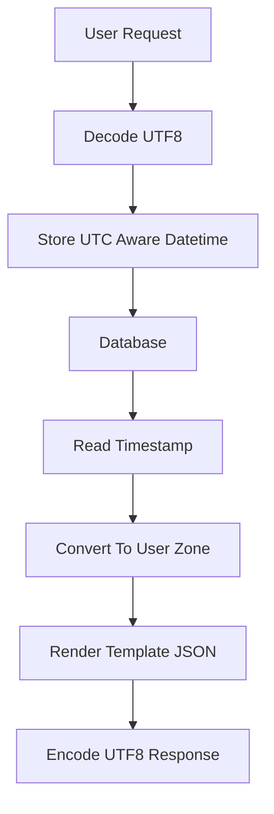

# Timezone, Encoding, and i18n Traps: The Bugs That Only Appear in Other Countries

## English

Most Flask tutorials assume one timezone and one language, and that assumption quietly breaks the moment a real user in another country signs up. Start with time: store every timestamp in UTC in the database, using timezone-aware datetime objects (Python's datetime with tzinfo set, typically datetime.now(timezone.utc)), and convert to a local zone only at the presentation boundary — in the template or the JSON serialiser. Storing naive local times is the classic disaster: when daylight saving time shifts, a stored 02:30 becomes ambiguous or nonexistent, and ordering events across regions becomes impossible. SQLite in particular has no native datetime type and will happily store whatever string you give it, so consistency is entirely your responsibility; PostgreSQL's timestamptz is stricter and worth preferring. In Jinja2, a filter that formats a UTC datetime into the user's zone (using zoneinfo in modern Python) keeps templates honest.

Text encoding is the second trap. Python 3 strings are Unicode, but bytes are not, and every boundary between them is a place to fail: a request body declared as latin-1, a CSV export opened in Excel, a filename with Chinese characters. Flask decodes request data according to the charset in the Content-Type header (UTF-8 by default), and jsonify produces an `application/json` body, which is UTF-8 by specification — but note that Flask's default JSON provider sets `ensure_ascii = True`, so non-ASCII characters are escaped as `\uXXXX` sequences rather than emitted as literal UTF-8 bytes. Set `app.json.ensure_ascii = False` if you want raw UTF-8 output. When you write files, always pass encoding='utf-8' explicitly to open() — the platform default differs between Linux and Windows and is a notorious source of mojibake. For responses, set Content-Type with charset, and for downloads use the RFC 5987 filename* parameter so non-ASCII filenames survive the trip through browsers.

The third layer is internationalisation (i18n) and localisation (l10n): i18n is making the code capable of multiple languages, l10n is actually supplying them. The standard Flask path is Flask-Babel, which reads a locale from the request (query string, session, or Accept-Language header), selects a translation catalog, and exposes gettext as _() in templates and code. Message catalogs are extracted to .pot files, translated to .po files, and compiled to .mo files that the runtime reads. The subtle discipline is that you must never build sentences by concatenating translated fragments — word order differs across languages, so use named placeholders like _('Hello, %(name)s') instead. Plurals are worse: English has two forms, Polish has several, and gettext's ngettext exists precisely because '%d items' cannot be translated correctly by string substitution alone.

Finally, locale affects formatting, not just words. Dates (31/12/2025 versus 12/31/2025), decimal separators (1,5 versus 1.5), currency symbols, and even collation order for sorting names all vary. Never parse a user-entered date with a hand-rolled split on slashes; use an explicit format or a library, and echo the expected format in the UI. And test with non-ASCII data from day one — a fixture with a Chinese name, an emoji, and a right-to-left string will surface encoding bugs in minutes that would otherwise appear in production weeks later.

## 中文

大多數 Flask 教學都假設單一時區與單一語言，而這個假設在另一位國家的真實使用者註冊的那一刻就會悄悄破裂。先談時間：資料庫中每個時間戳都以 UTC 儲存，使用帶時區的 datetime 物件（Python 的 datetime 並設定 tzinfo，通常是 datetime.now(timezone.utc)），只在呈現邊界——模板或 JSON 序列化器——才轉換成本地時區。儲存不帶時區的本地時間是經典災難：日光節約時間切換時，儲存的 02:30 會變得歧義或不存在，跨地區的事件排序也變得不可能。SQLite 尤其沒有原生 datetime 型別，你給它什麼字串它就存什麼，一致性完全是你自己的責任；PostgreSQL 的 timestamptz 較嚴格，值得優先選用。在 Jinja2 中，用一個把 UTC datetime 格式化成使用者時區的 filter（現代 Python 用 zoneinfo），可讓模板保持誠實。

文字編碼是第二個陷阱。Python 3 的字串是 Unicode，但 bytes 不是，而兩者之間的每個邊界都是出錯的地方：宣告為 latin-1 的請求內容、用 Excel 開啟的 CSV 匯出、含中文字元的檔名。Flask 依 Content-Type 標頭中的 charset 解碼請求資料（預設 UTF-8），而 jsonify 產生的是 `application/json` 內容，按規格屬 UTF-8——但要注意 Flask 預設的 JSON provider 設定了 `ensure_ascii = True`，所以非 ASCII 字元會被轉義成 `\uXXXX` 序列，而唔係以原始 UTF-8 位元組輸出。如果想要原始 UTF-8 輸出，設定 `app.json.ensure_ascii = False`。寫檔案時，永遠明確傳 encoding='utf-8' 給 open()——平台預設值在 Linux 與 Windows 之間不同，是惡名昭彰的亂碼來源。回應方面，Content-Type 要帶 charset；下載方面，使用 RFC 5987 的 filename* 參數，讓非 ASCII 檔名能安然穿過瀏覽器。

第三層是國際化（i18n）與本地化（l10n）：i18n 是讓程式有能力支援多語言，l10n 是實際提供譯文。Flask 的標準路徑是 Flask-Babel，它從請求（查詢字串、session 或 Accept-Language 標頭）讀取語系，選擇翻譯目錄，並在模板與程式碼中以 _() 暴露 gettext。訊息目錄先抽取成 .pot 檔，翻譯成 .po 檔，再編譯成執行時讀取的 .mo 檔。微妙的紀律是：絕不可用串接翻譯片段的方式造句——各語言詞序不同，所以要用具名佔位符，例如 _('Hello, %(name)s')。複數更麻煩：英文有兩種形式，波蘭文有好幾種，gettext 的 ngettext 之所以存在，正是因為「%d items」無法單靠字串替換正確翻譯。

最後，地區設定影響的不只是文字，還有格式。日期（31/12/2025 對 12/31/2025）、小數分隔符（1,5 對 1.5）、貨幣符號，甚至姓名排序的校勘順序都各不相同。絕不要用手寫的斜線切割來解析使用者輸入的日期；用明確格式或函式庫，並在介面上回顯預期格式。而且從第一天就用非 ASCII 資料測試——一份含中文姓名、一個 emoji、一段由右至左字串的測試資料，幾分鐘內就會浮現那些原本要幾週後才在正式環境出現的編碼錯誤。

## Key Takeaway

Store UTC, decode and encode UTF-8 explicitly at every boundary, and never concatenate translated fragments — use placeholders and ngettext.

## Related Concepts
- Python zoneinfo
- GNU gettext message catalogs

## Diagram

