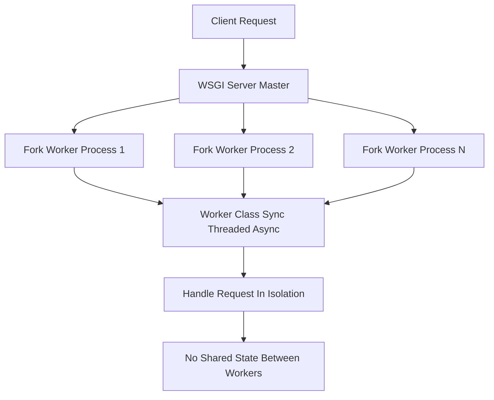

# Threads, Processes, and the GIL: Concurrency Reality for Flask Apps

## English

Flask itself contains no concurrency machinery. It is a WSGI application — a callable that accepts an environ dictionary and a start_response callable — and it simply runs inside whatever server hosts it. That means the concurrency model is chosen by the WSGI server, not by Flask, and understanding that split is essential before you tune anything. The development server (flask run) is single-process, but since Flask 1.0 it is multi-threaded by default — `Flask.run()` does `options.setdefault("threaded", True)` — so it can handle several requests concurrently rather than one at a time; it even warns you not to use it in production. Gunicorn, by contrast, is a pre-forking server: a master process starts, then forks N worker processes that each import your app and accept connections independently. Each worker is a separate OS process with its own memory, so no shared Python state exists between them — anything you store in a module-level dict lives only in one worker and will appear to vanish randomly as requests land on different workers. The `g` object is the exception: it is bound to the application context of a single request, so it is discarded when that request ends in every worker alike — it is never shared across workers in the first place.

The classic rule of thumb of roughly 2 × CPU cores + 1 workers exists because these are processes doing blocking I/O. While one worker waits on a database query or an outbound HTTP call, the OS scheduler lets another worker run on the CPU. The +1 gives a little headroom for a worker that is momentarily stalled. But this number is a starting point for measurement, not a law: if your handlers are CPU-heavy (image resizing, cryptography, large JSON serialization), adding workers beyond core count just causes context-switching overhead, and if your handlers are I/O-heavy you may need many more.

Threads are a second axis. Gunicorn workers can be configured with different worker classes — synchronous (one request at a time per worker), threaded (each worker runs a pool of threads), or asynchronous (event-loop based, such as gevent or eventlet). Threaded workers help when requests block on I/O, because a thread waiting on a socket releases the interpreter so another thread can run. However, Python's Global Interpreter Lock (GIL) means only one thread executes Python bytecode at any instant, so threads do not give you CPU parallelism. For pure Python CPU work, threads are nearly useless for throughput; you need processes, or you need to move the work out of the request entirely (a task queue, a separate service).

This is where the classic bug appears: an app that works perfectly with one worker and breaks with eight. In-memory rate limiters, in-memory caches, in-memory session stores, and counters kept in module globals all assume a single process. With multiple workers, each has its own copy, so a rate limit of 100 requests per minute silently becomes 800. The fix is to move shared state to something all workers can see: Redis, a database, or a signed cookie held by the client. The same reasoning explains why Flask's default session is a signed cookie rather than server-side storage — it needs no shared memory at all.

Finally, remember that a process-based server interacts with your app's startup code differently than you might expect. Each worker imports the application fresh, so module-level code runs once per worker. If you open a connection pool at import time, you get N pools; if you start a background thread at import time, you get N threads. Application factories and explicit init_app calls exist partly to make this lifecycle legible. When debugging 'why does this only happen sometimes', the first question is usually: how many workers, and which one answered this request?

## 中文

Flask 本身完全沒有併發機制。它是一個 WSGI 應用程式——一個接受 environ 字典與 start_response 可呼叫物件的 callable——它只是運行在託管它的伺服器裡面。也就是說，併發模型是由 WSGI 伺服器選擇的，而不是 Flask，理解這個分工是調校任何東西之前的基本功。開發伺服器（flask run）是單一進程，但自 Flask 1.0 起預設就是多執行緒——`Flask.run()` 會 `options.setdefault("threaded", True)`——所以它能同時處理多個請求，而不是一次只處理一個；它甚至會警告你不要在生產環境使用。相反，Gunicorn 是 pre-fork 型伺服器：一個 master 進程啟動，然後 fork 出 N 個 worker 進程，每個都獨立匯入你的應用並接受連線。每個 worker 是獨立的作業系統進程，有自己的記憶體，所以它們之間沒有共享的 Python 狀態——你存在模組層級 dict 裡的任何東西只活在一個 worker 裡，當請求落到不同 worker 時就會看似隨機地消失。`g` 物件則是例外：它綁定在單一請求的應用程式脈絡（application context）上，所以不論在哪個 worker，該請求結束時它都會被丟棄——它本來就不會跨 worker 共用。

「大約 CPU 核心數 × 2 + 1 個 worker」這條經典經驗法則之所以存在，是因為這些是處理阻塞式 I/O 的進程。當一個 worker 在等資料庫查詢或對外 HTTP 呼叫時，作業系統排程器會讓另一個 worker 在 CPU 上跑。那個 +1 是給偶爾卡住的 worker 一點餘裕。但這個數字是測量的起點，不是定律：如果你的處理程序是 CPU 密集的（影像縮放、密碼學、大型 JSON 序列化），把 worker 加到超過核心數只會造成上下文切換開銷；如果是 I/O 密集，你可能需要更多。

執行緒是第二個軸。Gunicorn worker 可以設定不同的 worker class——同步（每個 worker 一次一個請求）、執行緒式（每個 worker 跑一個執行緒池）或非同步（基於事件迴圈，例如 gevent 或 eventlet）。執行緒式 worker 在請求阻塞於 I/O 時有幫助，因為等待 socket 的執行緒會釋放解譯器讓另一個執行緒跑。然而，Python 的全域解譯器鎖（GIL）意味著任何瞬間只有一個執行緒在執行 Python 位元碼，所以執行緒不會給你 CPU 平行性。對於純 Python 的 CPU 工作，執行緒對吞吐量幾乎沒有用；你需要進程，或者把工作移出請求之外（任務佇列、獨立服務）。

經典的 bug 就在這裡出現：一個在單一 worker 下完美運作、在八個 worker 下就壞掉的應用。記憶體內的速率限制器、記憶體快取、記憶體 session 儲存，以及存在模組全域變數裡的計數器，全都假設只有一個進程。多個 worker 時每個都有自己的副本，所以每分鐘 100 次請求的限制會悄悄變成 800 次。解法是把共享狀態移到所有 worker 都看得到的地方：Redis、資料庫，或由客戶端持有的簽章 cookie。同樣的道理也解釋了為何 Flask 預設 session 是簽章 cookie 而非伺服器端儲存——它根本不需要共享記憶體。

最後，記住以進程為基礎的伺服器與你應用啟動碼的互動方式可能和你想的不同。每個 worker 都會重新匯入應用，所以模組層級的程式碼每個 worker 跑一次。如果你在匯入時開啟連線池，你會得到 N 個池；如果你在匯入時啟動背景執行緒，你會得到 N 條執行緒。應用工廠與明確的 init_app 呼叫部分就是為了讓這個生命週期可辨識。當你在除錯「為什麼這只有時發生」時，第一個問題通常是：有幾個 worker，這次是哪一個回答的？

## Key Takeaway

Flask delegates concurrency to the WSGI server, so worker count and worker class determine your throughput, and any in-memory shared state breaks as soon as you run more than one process.

## Related Concepts
- The WSGI Contract: What Flask Actually Sits On
- Configuration, Secrets, and Production Deployment with Gunicorn and Nginx

## Diagram

