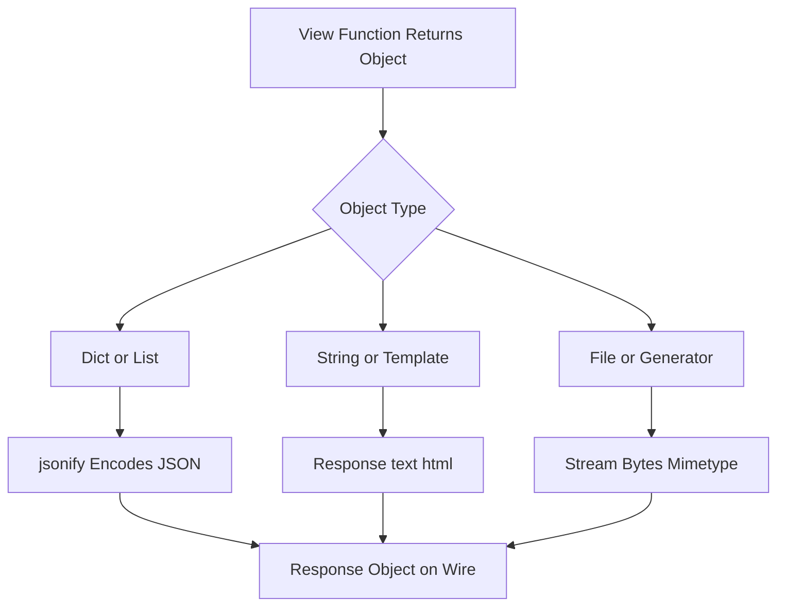

# Serialization Boundaries: What Leaves Your App and How It Is Encoded

## English

Every Flask response is bytes on the wire, but the interesting decisions happen before that: what Python object do you hand back, and who turns it into text? Flask gives you three broad doors. The first is jsonify, which serializes with Python's json module, sets the Content-Type to application/json, and — importantly — returns a Response object so you can chain status codes. The second is a returned string or template render, which Flask wraps in a Response with text/html. The third is send_file or a generator, which streams bytes with whatever mimetype you declare. The trap is that only the first door understands Python data structures; if you return a dict directly from a view, modern Flask will actually convert it to JSON for you, but older code and many tutorials return json.dumps(...) manually, which skips the Content-Type header and gives you a subtle content-negotiation bug.

JSON serialization itself has sharp edges. Python's json module knows how to encode dict, list, tuple, str, int, float, bool, and None — tuples are serialized natively as JSON arrays — and nothing else. A datetime, a Decimal, a UUID, a set, or a SQLAlchemy model instance will raise TypeError. There are three standard escapes: convert to primitives before returning (the most explicit and testable), pass a default= callable to the serializer that handles unknown types, or write a custom JSONProvider in modern Flask to change the behavior globally. The default= approach is convenient but easy to abuse: it makes the API's shape implicit, so a change in a model silently changes the wire format. Converting explicitly at the boundary keeps the contract visible in the code.

Dates deserve special attention because JSON has no date type. ISO 8601 strings (for example 2024-03-17T12:00:00Z) are the interoperable choice — they sort lexicographically in the same order as chronologically, they are unambiguous about timezone when you include the offset, and every language parses them. Sending Unix epoch integers is compact but loses timezone information and confuses humans reading logs. Sending a locale-formatted string like 03/17/2024 is a bug waiting to happen: it is ambiguous between day-first and month-first, and it will break for users in other regions. The same logic applies to decimals and money: JSON numbers are IEEE 754 doubles, so 0.1 + 0.2 does not equal 0.3, and large integers can lose precision in JavaScript. Money should travel as a string with a declared currency, or as integer minor units (cents).

Character encoding is the other silent boundary. JSON is defined to be UTF-8, and Flask's jsonify emits UTF-8; Flask's DefaultJSONProvider has ensure_ascii = True, so non-ASCII characters are escaped in current Flask too. Emitting them unescaped is opt-in (set app.json.ensure_ascii = False or supply a custom JSONProvider), which makes the payload smaller and more readable but requires the client to decode correctly. The classic failure is a database column or a text file read with the wrong encoding: you get mojibake (garbled characters) or a UnicodeDecodeError deep in a stack trace. The rule is to decode bytes to str as early as possible (at the I/O boundary), keep str everywhere inside the app, and encode to bytes only when writing out. Never rely on the platform default encoding, which varies by operating system.

Finally, think about size and streaming. jsonify builds the entire response in memory before sending it. For a list of ten thousand records that is fine; for a million it is not, and you should paginate or stream. Streaming JSON is awkward because the format is a single document, so the common pattern is newline-delimited JSON (one JSON object per line), which is trivially parseable incrementally. Whatever you choose, document it: the serialization format is part of your API contract, and clients will depend on details you did not consciously decide.

## 中文

每個 Flask 回應在網路上都是位元組，但有趣的決定發生在那之前：你交回什麼 Python 物件，由誰把它變成文字？Flask 給你三道大門。第一道是 jsonify，它用 Python 的 json 模組序列化、把 Content-Type 設為 application/json，而且重要的是——回傳一個 Response 物件，讓你可以串接狀態碼。第二道是回傳字串或樣板渲染，Flask 會把它包進 Content-Type 為 text/html 的 Response。第三道是 send_file 或產生器，用你宣告的 mimetype 串流位元組。陷阱在於只有第一道門懂 Python 資料結構；如果你直接從 view 回傳 dict，現代 Flask 其實會幫你轉成 JSON，但較舊的程式碼和許多教學會手動 json.dumps(...)，這會跳過 Content-Type 標頭，造成微妙的內容協商 bug。

JSON 序列化本身有尖銳的邊緣。Python 的 json 模組知道如何編碼 dict、list、tuple、str、int、float、bool 和 None——tuple 會原生序列化為 JSON 陣列——其他一律不行。datetime、Decimal、UUID、set 或 SQLAlchemy 模型實例都會拋出 TypeError。有三種標準逃生口：回傳前先轉成基本型別（最明確、最好測試）、傳一個 default= 可呼叫物件給序列化器處理未知型別，或在現代 Flask 寫自訂 JSONProvider 全域改變行為。default= 的做法方便但容易被濫用：它讓 API 的形狀變成隱含的，模型一改線路格式就悄悄改變。在邊界明確轉換能讓契約在程式碼中看得見。

日期值得特別注意，因為 JSON 沒有日期型別。ISO 8601 字串（例如 2024-03-17T12:00:00Z）是可互通性的選擇——它們按字典序排序的順序和按時間排序一致、包含偏移時對時區無歧義、而且每種語言都能解析。送 Unix epoch 整數很精簡但會丟失時區資訊，也讓人類讀日誌時困惑。送像 03/17/2024 這種地區格式字串是等著發生的 bug：它在日先還是月先之間有歧義，其他地區的使用者會壞掉。同樣的邏輯適用於小數與金錢：JSON 數字是 IEEE 754 雙精度浮點，所以 0.1 + 0.2 不等於 0.3，大整數在 JavaScript 裡可能失去精度。金錢應該以附帶幣別宣告的字串，或以最小單位整數（分）傳遞。

字元編碼是另一個沉默的邊界。JSON 被定義為 UTF-8，Flask 的 jsonify 輸出 UTF-8；Flask 的 DefaultJSONProvider 有 ensure_ascii = True，因此現代 Flask 一樣會把非 ASCII 字元轉義。要讓它們不轉義是選擇性開啟（設定 app.json.ensure_ascii = False 或提供自訂 JSONProvider），這樣輸出更小更可讀，但要求客戶端正確解碼。經典的失敗是用錯編碼讀取資料庫欄位或文字檔：你會得到 mojibake（亂碼字元）或堆疊追蹤深處的 UnicodeDecodeError。規則是盡早把位元組解碼成 str（在 I/O 邊界），應用內部一律保持 str，只在寫出時編碼成位元組。永遠不要依賴平台預設編碼，它因作業系統而異。

最後，想想大小與串流。jsonify 在送出前把整個回應建在記憶體裡。一萬筆記錄的清單沒問題；一百萬筆就不行，你應該分頁或串流。串流 JSON 很彆扭，因為格式是單一文件，所以常見模式是換行分隔 JSON（每行一個 JSON 物件），它可以被輕鬆地增量解析。無論你選什麼，都要記錄下來：序列化格式是你 API 契約的一部分，客戶端會依賴你沒有刻意決定的細節。

## Key Takeaway

The serialization boundary is where type errors, timezone bugs, and encoding failures live, so convert explicitly to primitives (ISO 8601 dates, string or integer money) before anything leaves the app.

## Related Concepts
- JSON APIs Without Extensions: jsonify, Content Negotiation, and Error Envelopes
- Timezone, Encoding, and i18n Traps: The Bugs That Only Appear in Other Countries

## Diagram

