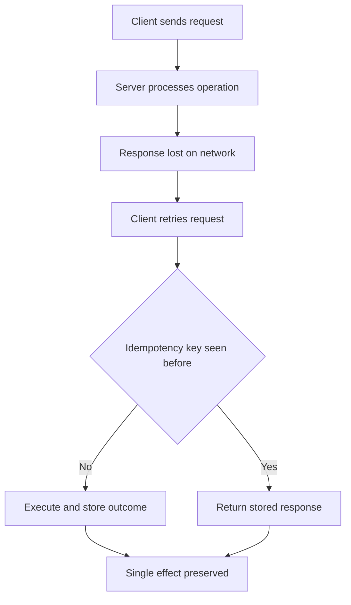

# Idempotency and the Retry Problem: Designing Endpoints That Survive Being Called Twice

## English

Networks are unreliable in a specific, one-sided way: a client can send a request, the server can process it fully, and the response can still be lost on the way back. From the client's point of view the request failed, so the natural reaction is to retry — and now the server has executed the same operation twice. This is not a rare edge case. Mobile apps switch networks, load balancers time out, browsers resubmit on refresh, and payment providers retry webhooks for days. An endpoint that is not designed for this will double-charge, double-send emails, or create duplicate rows, and the bug will only appear under real-world conditions.

The HTTP specification gives you a vocabulary for this. A method is safe if it does not change server state (GET, HEAD, OPTIONS, TRACE) and idempotent if repeating it has the same effect as calling it once (all safe methods plus PUT and DELETE — that is, GET, HEAD, OPTIONS, TRACE, PUT, DELETE). POST is neither, which is exactly why it is the dangerous one. If you model 'create a resource' as PUT to a client-chosen URL (for example PUT /orders/abc-123), the operation becomes idempotent: the second call overwrites the same resource rather than creating a second one. That is a design lever available to you before writing any code, and it removes an entire class of bugs.

When POST is unavoidable — and often it is, because the server wants to assign the ID — the standard fix is an idempotency key. The client generates a unique value (a UUID) and sends it in a header on every attempt of the same logical operation. The server stores the key alongside the outcome: if it sees the key again, it returns the stored response instead of re-executing. The storage must be atomic, which is why databases are the natural home: a unique constraint on the key column means two concurrent attempts race, one wins the insert, and the loser reads the winner's result. Redis with a set-if-not-exists operation works too, but you must decide how long keys live — a key that expires too soon reopens the double-execution window.

There is a subtlety about ordering. The idempotency record should be written in the same transaction as the business effect, or you risk a crash between them: effect committed, key not recorded, retry executes again. If they cannot share a transaction, write the key first in a 'pending' state, execute, then mark it 'completed'; a retry that finds a pending key must wait or return a conflict rather than run the work a second time. This is essentially a two-phase approach, and it is the same pattern payment APIs describe in their documentation.

Webhooks deserve their own mention because you are on the receiving end. Providers like payment processors retry deliveries, sometimes out of order, so your handler must tolerate duplicates and stale events. Two practical defenses: verify the signature so you know the event is genuine, and record the event ID so a repeat is a no-op. Also treat ordering as unreliable — if event A (created) and event B (updated) arrive reversed, applying them naively leaves you with the wrong final state, so compare timestamps or fetch the current state from the provider's API instead of trusting the payload. The general principle is that any handler reachable by a retrying client should be designed to be called twice and produce the same result as being called once.

## 中文

網路以一種特定的、單向的方式不可靠：客戶端可以送出請求、伺服器可以完整處理，但回應仍在回程中遺失。從客戶端的角度看請求失敗了，所以自然反應是重試——而現在伺服器已經執行了同一個操作兩次。這不是罕見的邊緣情況。手機應用切換網路、負載平衡器逾時、瀏覽器在重新整理時重送、支付供應商連續重試 webhook 好幾天。沒有為此設計的端點會重複收費、重複寄信或建立重複的資料列，而這個 bug 只會在真實世界條件下出現。

HTTP 規格給了你一套詞彙。一個方法若不會改變伺服器狀態（GET、HEAD、OPTIONS、TRACE）就是安全的（safe），若重複呼叫的效果和呼叫一次相同（所有安全方法再加上 PUT 與 DELETE，也就是 GET、HEAD、OPTIONS、TRACE、PUT、DELETE）就是冪等的（idempotent）。POST 兩者皆非，這正是它危險的原因。如果你把「建立資源」建模成對客戶端選定 URL 的 PUT（例如 PUT /orders/abc-123），操作就變成冪等：第二次呼叫會覆寫同一個資源，而不是建立第二個。這是寫任何程式碼之前就可用的設計槓桿，能消除一整類 bug。

當 POST 無法避免——而且常常如此，因為伺服器想指派 ID——標準解法是冪等鍵（idempotency key）。客戶端產生一個唯一值（UUID），並在同一個邏輯操作的每次嘗試中放在標頭送出。伺服器把鍵和結果一起儲存：如果再次看到這個鍵，就回傳已儲存的回應而不重新執行。儲存必須是原子的，這就是資料庫是天然歸宿的原因：鍵欄位上的唯一約束讓兩個並行嘗試競爭，一個贏得插入，輸家讀取贏家的結果。Redis 用 set-if-not-exists 操作也可以，但你必須決定鍵活多久——太快過期的鍵會重新打開重複執行的窗口。

關於順序有個微妙之處。冪等記錄應該和業務效果寫在同一個交易裡，否則就有兩者之間崩潰的風險：效果已提交、鍵未記錄、重試再次執行。如果它們不能共用交易，就先以「待處理」狀態寫入鍵、執行、再標記為「完成」；找到待處理鍵的重試必須等待或回傳衝突，而不是第二次執行工作。這本質上是兩階段做法，和支付 API 文件描述的模式相同。

Webhook 值得單獨一提，因為你是接收方。像支付處理器這類供應商會重試投遞，有時還會亂序，所以你的處理程序必須容忍重複和過期事件。兩個實用防禦：驗證簽章以確認事件真實，並記錄事件 ID 讓重複成為空操作。也要把順序視為不可靠——如果事件 A（已建立）和事件 B（已更新）反向到達，天真地套用會讓你停在錯誤的最終狀態，所以要比較時間戳，或從供應商 API 抓取目前狀態而不是信任 payload。一般原則是：任何可被重試客戶端觸及的處理程序，都應設計成被呼叫兩次也產生和呼叫一次相同的結果。

## Key Takeaway

Design every mutating endpoint so that a retried request is harmless — prefer idempotent methods where the URL is client-chosen, and use atomic idempotency keys stored with the outcome when POST is unavoidable.

## Related Concepts
- Request and Response Objects: The Werkzeug Data Model Behind Flask
- Rate Limiting and Abuse Resistance: Protecting a Flask Endpoint from Itself

## Diagram

