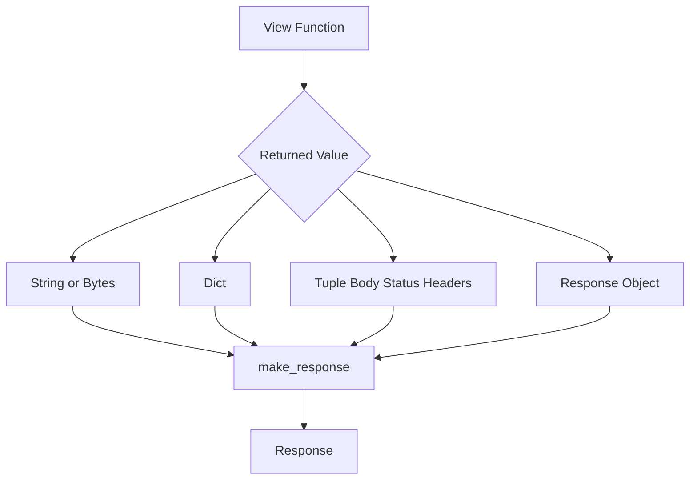

# Response Objects Are Mutable, Deferred, and Easy to Get Wrong

## English

A Flask view function rarely returns a bare string in real applications; it returns a Response object, or something Flask can convert into one. Understanding that conversion chain is where a lot of subtle bugs live. Flask accepts a string, bytes, a dict (which it will jsonify), a tuple of (body, status), (body, headers), or (body, status, headers), or a real Response instance. Each of those shapes is normalised by make_response() before it leaves the view, so the tuple form is really just a convenience for constructing a Response without importing it.

The Response object itself is a Werkzeug object, and it is not a frozen value — it is a mutable buffer with a header list attached. That means you can write into it incrementally: create an empty Response, set its status and mimetype, then call response.set_data() or stream chunks via a generator passed as the response body. This is how streaming endpoints work, and it is also why the order of operations matters. If you set headers after the response has already started streaming to the client, those headers are silently lost, because the WSGI server has already flushed them.

A classic trap is the difference between modifying a response and returning a new one. If a view does resp = make_response('ok'), resp.headers['X-Thing'] = 'a', and then returns resp, you get the header. But if you return a plain string and try to mutate it, there is nothing to mutate. Similarly, after_request hooks receive the Response and may modify it — but only if the response has not already been sent. This is why after_request is the right place for adding security headers like Content-Security-Policy or Cache-Control, and the wrong place for anything that depends on the body having been fully generated for a streaming response.

Another common stumble is status codes and content types. Flask defaults to 200 and text/html when you return a string, which surprises people building JSON APIs — the client gets an HTML content type on a JSON body. Returning a dict from a view (supported in modern Flask) automatically produces application/json, but returning a string of JSON does not. Explicitly constructing the response, or using jsonify, makes the contract visible. The same goes for error responses: returning ('not found', 404) gives you a text body with a 404 status, which is fine for a browser but hostile to an API client expecting a JSON error envelope.

Finally, remember that Response objects are per-request. You cannot stash one on a global and reuse it across requests, because headers and the underlying stream are stateful. If you need a reusable template for a response — say a standard error payload — build the dict or the string fresh each time and let make_response assemble a new Response. Treating the Response as a value you construct, not an object you share, keeps you out of a whole family of concurrency and header-leak bugs.

## 中文

在真實應用中，Flask 的 view function 很少直接回傳一個純字串；它通常回傳 Response 物件，或者回傳一些 Flask 能夠轉換成 Response 的東西。這條轉換鏈正是許多隱微 bug 的藏身之處。Flask 接受字串、bytes、dict（會自動 jsonify）、由 (body, status)、(body, headers) 或 (body, status, headers) 組成的 tuple，或者一個真正的 Response 實例。這些形態都會在離開 view 之前由 make_response() 正規化，所以 tuple 形式其實只是讓你毋須 import Response 就能建構 Response 的方便寫法。

Response 物件本身是 Werkzeug 的物件，而且它不是一個凍結的值——它是一個可變的緩衝區，附帶一個 header 列表。這意味著你可以逐步寫入：建立一個空的 Response，設定 status 和 mimetype，然後用 response.set_data() 或把 generator 當作 body 傳進去來串流區塊。串流端點就是這樣運作的，這也是為何操作順序如此重要。如果你在 response 已經開始串流給 client 之後才設定 header，那些 header 會無聲無息地消失，因為 WSGI server 已經把它們 flush 出去了。

一個經典陷阱是「修改 response」與「回傳新 response」的分別。如果 view 做 resp = make_response('ok')、resp.headers['X-Thing'] = 'a'，然後 return resp，你就會得到那個 header。但如果你回傳一個純字串，然後試圖去 mutate 它，根本沒有東西可以 mutate。同樣地，after_request hook 會收到 Response 並可以修改它——但僅限於 response 尚未送出。這就是為何 after_request 是加入 Content-Security-Policy 或 Cache-Control 這類安全 header 的正確位置，而對於串流 response 而言，它卻是錯的位置，因為那時 body 尚未完全產生。

另一個常見的絆腳石是 status code 與 content type。當你回傳字串時，Flask 預設是 200 和 text/html，這會讓建 JSON API 的人很意外——client 在 JSON body 上收到 HTML content type。從 view 回傳 dict（現代 Flask 支援）會自動產生 application/json，但回傳一段 JSON 字串就不會。明確建構 response，或者用 jsonify，會令這個契約變得可見。錯誤 response 也一樣：回傳 ('not found', 404) 會得到一個帶 404 status 的文字 body，對瀏覽器來說沒問題，但對期望 JSON 錯誤信封的 API client 來說就很難受。

最後，要記住 Response 物件是 per-request 的。你不能把一個 response 藏在 global 然後跨請求重用，因為 header 和底層 stream 都是有狀態的。如果你需要一個可重用的 response 模板——例如標準錯誤 payload——每次都要重新建構那個 dict 或字串，讓 make_response 組裝一個新的 Response。把 Response 視為一個你建構出來的值，而不是一個你共用的物件，就能避開一整族 concurrency 和 header 洩漏的 bug。

## Key Takeaway

Treat the Response object as a per-request value you construct and mutate before it is sent — never as a shared, reusable object.

## Related Concepts
- make_response and response normalisation
- after_request hooks and header injection

## Diagram

