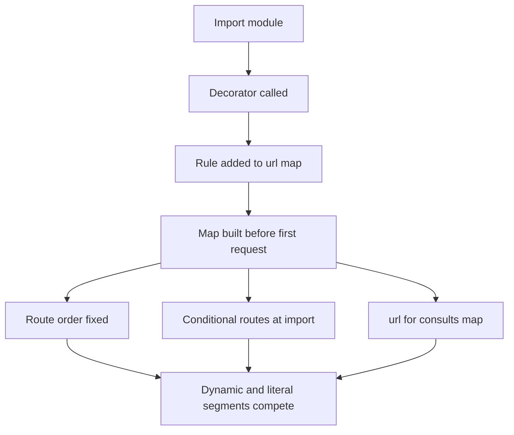

# URL Maps Are Built at Import Time — And That Has Consequences

## English

When you write @app.route('/users/<int:user_id>'), you are not registering a route at request time. You are calling a decorator that immediately adds a Rule to the app's url_map, a Werkzeug Map object. That map is built during import, before the first request ever arrives. Understanding this timing explains several behaviours that otherwise look like magic or like bugs.

First, it means route registration order is fixed once the module is imported. If you register /users/<int:user_id> and later register /users/me, the order in which the Map sorts rules matters. Werkzeug sorts rules by complexity and specificity, not purely by declaration order, and the resolution is by specificity: for a given path segment, a rule with a static part takes priority over one with a variable part. So /users/me always wins over /users/<int:user_id> — and over /users/<user_id>, where 'me' would match the converter — no matter which was registered first. The genuine risk runs the other way, to a literal path that the dynamic pattern does not cover, so design URLs so literal segments do not sit under a dynamic prefix unless you have deliberately chosen the converter.

Second, because the map is built at import, any code that conditionally registers routes — for example, only enabling an admin route when a config flag is set — must run at import time, not inside a request. If you try to add routes lazily inside a view or a before_request hook, you will get a runtime error or, worse, inconsistent behaviour depending on which worker process handled the request. Application factories exist partly to make this explicit: the factory builds the app, registers routes, and returns it, all before serving begins.

Third, the URL map is what url_for() consults in reverse. url_for('view_name', user_id=42) looks up the endpoint name in the map and builds the URL, applying the converter's to_url logic. This is why url_for can fail with a BuildError if the endpoint does not exist or if a required argument is missing — it is a lookup in a static structure, not a search through your code. It also means url_for is cheap and safe to call inside templates, because it does not touch the database or the request.

Finally, the import-time nature of routing interacts with blueprints and reloading. When a blueprint is registered on an app, its deferred route registrations are flushed into the app's map at that moment. In development, the reloader restarts the process when files change, rebuilding the map from scratch — which is why a route you just added suddenly appears. In production, with pre-forked workers, each worker builds its own map from the same code, so the maps are identical as long as the code and config are identical. Any divergence — say, a route registered conditionally based on an environment variable read at import — will produce workers that disagree about which URLs exist, and requests will fail intermittently depending on which worker answers.

## 中文

當你寫 @app.route('/users/<int:user_id>') 時，你並不是在請求時才註冊路由。你是在呼叫一個 decorator，它會立即把一條 Rule 加入 app 的 url_map，也就是一個 Werkzeug Map 物件。這個 map 是在 import 期間、第一個請求到達之前就已建好。理解這個時機，就能解釋幾個原本看似魔法或看似 bug 的行為。

第一，這意味著一旦 module 被 import，路由註冊順序就固定了。如果你註冊 /users/<int:user_id>，之後才註冊 /users/me，Map 排序規則的次序就有影響。Werkzeug 會按複雜度和具體程度排序規則，而不是純粹按宣告次序，而且重疊時由具體程度取勝：同一段位置上，靜態部分優先於動態部分。所以 /users/me 一定會贏過 /users/<int:user_id>（亦贏過 'me' 符合的 /users/<user_id>），與註冊先後無關。真正的風險在相反方向 —— 字面路徑沒有被動態模式涵蓋 —— 所以仍應避免讓字面段落落在動態前綴之下，除非你刻意選擇過 converter。

第二，因為 map 是在 import 時建立，任何有條件地註冊路由的程式碼——例如只在某個 config flag 設定時才啟用 admin 路由——必須在 import 時執行，而不是在請求之內。如果你試圖在 view 或 before_request hook 裡懶惰地加入路由，你會得到 runtime error，或者更糟：行為取決於哪個 worker process 處理該請求而不一致。Application factory 存在的部分原因正是要把這一點明確化：factory 建立 app、註冊路由、回傳它，全部在開始服務之前完成。

第三，URL map 正是 url_for() 反向查詢的對象。url_for('view_name', user_id=42) 會在 map 中查找 endpoint 名稱並建構 URL，套用 converter 的 to_url 邏輯。這就是為何當 endpoint 不存在或缺少必要參數時，url_for 會拋出 BuildError——它是在一個靜態結構中查找，而不是在你的程式碼中搜尋。這也意味著 url_for 很便宜，在 template 裡呼叫很安全，因為它不碰資料庫，也不碰 request。

最後，路由的 import-time 本質與 blueprint 和 reloading 互相影響。當一個 blueprint 被註冊到 app 上時，它延後的路由註冊會在那一刻 flush 進 app 的 map。在開發時，reloader 會在檔案變更時重啟 process，從頭重建 map——這就是為何你剛加的路由會突然出現。在生產環境，用 pre-forked workers 時，每個 worker 都從同一份程式碼建立自己的 map，所以只要程式碼和 config 相同，map 就相同。任何分歧——例如某條路由依據 import 時讀取的環境變數而有條件地註冊——都會令 workers 對哪些 URL 存在產生分歧，請求就會視乎哪個 worker 回應而間歇性失敗。

## Key Takeaway

Routes are compiled into a Werkzeug URL map at import time, so conditional or late registration creates worker-dependent behaviour.

## Related Concepts
- Werkzeug Map and Rule sorting
- Application factories and import-time registration

## Diagram

