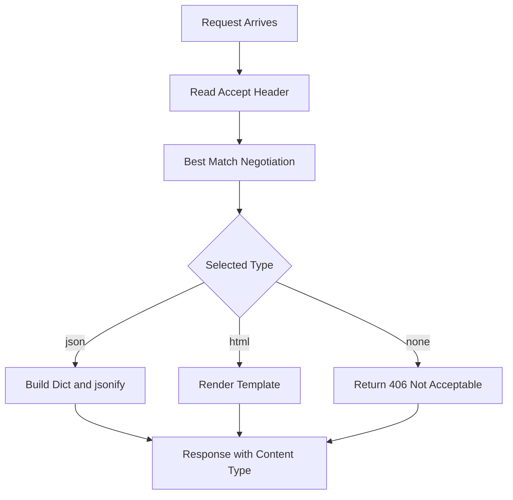

# Content Negotiation and the Accept Header: Serving JSON and HTML From One Route

## English

A common requirement is to serve the same resource as HTML to a browser and JSON to an API client. Flask does not do this for you automatically, but it gives you the pieces, and understanding them prevents a lot of hand-rolled, fragile branching. The key is the Accept request header, which the client sends to say what media types it can handle, and the response's Content-Type header, which tells the client what it actually got.

request.accept_mimetypes is a Werkzeug MIMEAccept object built from the Accept header. It supports quality values, so a client can say it prefers JSON but will accept HTML: 'application/json;q=0.9, text/html;q=0.8'. You can query it with request.accept_mimetypes.best_match(['application/json', 'text/html']), which returns the best supported type according to the client's preferences and your server's list. If the client sends Accept: */*, best_match returns the first item in your list, which lets you choose a sensible default; with no Accept header at all the list of acceptable types is empty and best_match returns None, so handle that case explicitly rather than assuming a fallback. If the client explicitly asks for something you cannot produce, the correct response is 406 Not Acceptable, not a silent fallback to HTML.

A clean pattern is to check the negotiated type once at the top of the view and branch. If JSON is chosen, build a dict and return jsonify(payload). If HTML is chosen, render a template with the same underlying data. The important discipline is to compute the data once and format it twice, rather than duplicating the query logic in two code paths. That keeps the two representations from drifting apart, which is the usual failure mode when HTML and JSON endpoints are written separately and one gets updated but not the other.

There is a subtlety with error responses. If a client asks for JSON and your app raises a 404, Flask's default error handler returns an HTML error page. That violates the negotiation you just performed. The fix is an error handler that inspects request.accept_mimetypes and returns a JSON envelope for API clients and an HTML page for browsers. This is exactly the kind of cross-cutting concern that belongs in a shared error handler rather than in every view, and it is why error handling and content negotiation are usually designed together.

Finally, be careful about conflating negotiation with URL design. Some APIs use a file extension like /users/42.json, others use a query parameter, and others rely purely on Accept. All three are legitimate, but they have different caching and routing implications. Extension-based routes multiply your URL map and can confuse proxies that key caches on path. Accept-based negotiation keeps one URL per resource, which is better for caching and for REST semantics, but it requires clients to set headers correctly — and many simple HTTP tools do not. A pragmatic compromise is to default to JSON for programmatic clients and use Accept to opt into HTML, documenting the behaviour clearly.

## 中文

一個常見需求是把同一個資源以 HTML 供應給瀏覽器、以 JSON 供應給 API client。Flask 不會自動幫你做這件事，但它給你所需的零件，理解它們可以避免大量手寫而脆弱的 branching。關鍵在於 Accept request header——client 用它說明自己能夠處理哪些 media type——以及 response 的 Content-Type header，它告訴 client 實際收到的是什麼。

request.accept_mimetypes 是一個由 Accept header 建構出來的 Werkzeug MIMEAccept 物件。它支援 quality value，所以 client 可以說它偏好 JSON 但接受 HTML：'application/json;q=0.9, text/html;q=0.8'。你可以用 request.accept_mimetypes.best_match(['application/json', 'text/html']) 查詢，它會根據 client 的偏好和你的伺服器清單回傳最佳支援類型。如果 client 送出 Accept: */*，best_match 會回傳你清單中的第一項，讓你選擇一個合理的預設；如果完全沒有送出 Accept header，可接受類型的清單會是空的，best_match 會回傳 None，所以要顯式處理這種情況，而唔係假設有後備值。如果 client 明確要求你無法產生的東西，正確回應是 406 Not Acceptable，而不是靜默地 fallback 到 HTML。

一個乾淨的模式是在 view 頂部協商一次類型然後分支。如果選中 JSON，就建構 dict 並回傳 jsonify(payload)。如果選中 HTML，就用同一份底層資料 render 一個 template。重要的紀律是：計算資料一次，格式化兩次，而不是在兩條程式碼路徑中重複查詢邏輯。這樣可以防止兩種表示逐漸偏離，而那正是 HTML 與 JSON 端點分開撰寫、其中一個被更新而另一個沒有的典型失敗模式。

錯誤 response 有一個微妙之處。如果 client 要求 JSON，而你的 app 拋出 404，Flask 預設的錯誤處理器會回傳一個 HTML 錯誤頁。這違反了你剛才做的協商。修正方法是寫一個錯誤處理器，檢查 request.accept_mimetypes，對 API client 回傳 JSON 信封，對瀏覽器回傳 HTML 頁。這正是應該放在共用錯誤處理器、而不是每個 view 裡的橫切關注點，也是為何錯誤處理與內容協商通常要一起設計。

最後，要小心不要把協商與 URL 設計混為一談。有些 API 用副檔名如 /users/42.json，有些用 query parameter，有些純粹依賴 Accept。三者都合理，但它們對 caching 和 routing 有不同影響。以副檔名為基礎的路由會令你的 URL map 倍增，並可能令以 path 為 key 的 proxy cache 混亂。以 Accept 為基礎的協商令每個資源保持一個 URL，對 caching 和 REST 語意更好，但它要求 client 正確設定 header——而許多簡單的 HTTP 工具並不會。一個務實的折衷是：對程式化 client 預設 JSON，用 Accept 選擇進入 HTML，並清楚記錄這個行為。

## Key Takeaway

Negotiate once at the top of the view using request.accept_mimetypes.best_match, compute data once, and mirror the same negotiation in your error handlers.

## Related Concepts
- Accept header and MIMEAccept quality values
- JSON error envelopes and 406 Not Acceptable

## Diagram

