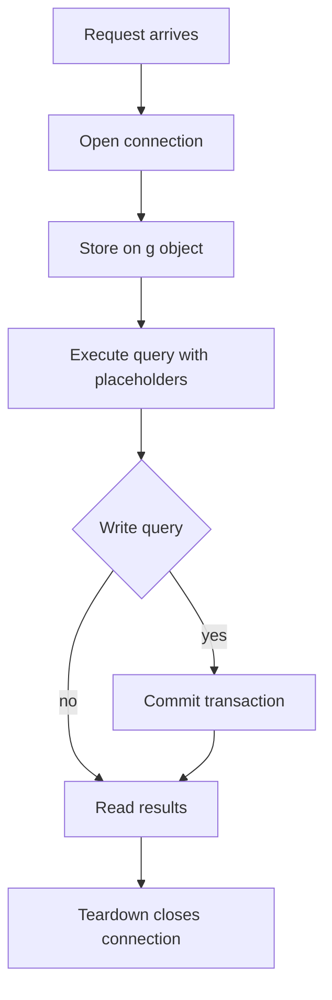

# Talking to the Database Without an ORM: Raw SQL, Parameter Binding, and Connection Lifecycle

## English

Flask ships with no database layer at all, so it is worth understanding what happens if you skip SQLAlchemy and talk to SQLite or PostgreSQL directly. Python's standard library includes sqlite3, and a minimal Flask app can open a connection, run a query, and close it inside each request. The critical discipline is the connection lifecycle: a database connection is a stateful socket-like object, and if you create one at import time and share it across threads, you will hit confusing errors because sqlite3 connections are not safe to use from multiple threads by default. The idiomatic pattern is to open a connection at the start of a request and store it on Flask's request-scoped g object, then close it in a teardown function registered with app.teardown_appcontext, which Flask calls when the application context is popped. This gives you one connection per request with predictable cleanup even when the handler raises an exception.

The second discipline is parameter binding. Never build SQL by string concatenation with user input — that is the classic SQL injection hole. Instead use the driver's placeholder syntax: sqlite3 uses ? and psycopg uses %s. The driver sends the query and the parameters separately to the database, so a malicious value like "'; DROP TABLE users; --" is treated as a literal string, not as SQL. This is not just a convenience; it is the security boundary. If you find yourself writing f-strings around SQL, stop and use placeholders.

A third thing to understand is transactions. Most drivers open an implicit transaction when you execute a write and require an explicit commit() to make it durable. If your handler returns a 200 but you forgot to commit, the user sees success while the database silently discards the change. Conversely, if you commit halfway through a multi-step operation and then fail, you leave partial data behind. Wrap related writes in a single transaction and commit once at the end, or use a context manager if the driver offers one.

Finally, connection pooling matters once you leave development. The sqlite3 module is fine for a single-process app, but production PostgreSQL deployments should use a pool so that each request does not pay the cost of a TCP handshake and authentication. Libraries like psycopg_pool or SQLAlchemy's engine handle this for you. Understanding the raw layer makes the ORM feel less magical: an ORM is ultimately a query builder plus a connection manager plus a unit-of-work tracker, and every one of those pieces has a raw-SQL equivalent you can reason about.

A useful exercise is to build a tiny CRUD app with only sqlite3 and Flask, no extensions, and then read the SQLAlchemy docs on sessions and engines. You will recognise the same concepts — connection, transaction, cursor, commit, rollback — wearing different names, and you will be much better equipped to debug the ORM when it misbehaves.

## 中文

Flask 本身完全沒有資料庫層，所以值得了解如果你跳過 SQLAlchemy、直接與 SQLite 或 PostgreSQL 對話會發生什麼事。Python 標準庫內建 sqlite3，一個極簡的 Flask 應用可以在每個請求中開啟連線、執行查詢、再關閉。關鍵紀律在於連線的生命週期：資料庫連線是有狀態、類似 socket 的物件，如果你在 import 時建立一條連線並跨執行緒共用，就會遇到令人困惑的錯誤，因為 sqlite3 連線預設不保證可從多個執行緒安全使用。慣用做法是在請求開始時開啟連線、存到 Flask 的請求作用域物件 g 上，然後在 app.teardown_appcontext 註冊的 teardown 函式中關閉——Flask 會在應用程式上下文被彈出時呼叫它。這樣即使處理函式拋出例外，也能保證每個請求一條連線、清理可預期。

第二項紀律是參數綁定。千萬不要用字串拼接把使用者輸入塞進 SQL——那正是經典的 SQL 注入漏洞。應改用驅動程式的佔位符語法：sqlite3 用 ?，psycopg 用 %s。驅動程式會把查詢與參數分開送到資料庫，所以像 "'; DROP TABLE users; --" 這種惡意值會被當成普通字串，而不是 SQL。這不只是方便，而是安全邊界。如果你發現自己在 SQL 外面套 f-string，請停手，改用佔位符。

第三件要理解的是交易。多數驅動程式在你執行寫入時會開啟隱含交易，並要求明確的 commit() 才會持久化。如果處理函式回傳 200 但你忘了 commit，使用者看到成功，資料庫卻悄悄丟棄了變更。反過來說，如果多步驟操作中途 commit 然後失敗，你就留下半套資料。把相關寫入包在單一交易裡、最後只 commit 一次，或使用驅動程式提供的 context manager。

最後，一旦離開開發環境，連線池就很重要。sqlite3 模組對單一行程式的應用足夠，但正式環境的 PostgreSQL 部署應使用連線池，讓每個請求不必再付 TCP 握手與認證的成本。psycopg_pool 或 SQLAlchemy 的 engine 會替你處理。理解原始層會讓 ORM 不再神奇：ORM 本質上就是查詢建構器加上連線管理器加上工作單元追蹤器，每一塊都有可用原始 SQL 對應、可推理的等價物。

一個有用的練習是只用 sqlite3 和 Flask（不用任何擴充）做一個小型 CRUD 應用，然後去讀 SQLAlchemy 關於 session 與 engine 的文件。你會認出同一批概念——連線、交易、游標、commit、rollback——只是換了名字，而當 ORM 出錯時，你會更有能力除錯。

## Key Takeaway

Skipping the ORM teaches you the connection lifecycle, parameter binding, and transaction discipline that every ORM is built on top of.

## Related Concepts
- SQL injection and parameter binding
- Connection pooling and teardown functions

## Diagram

