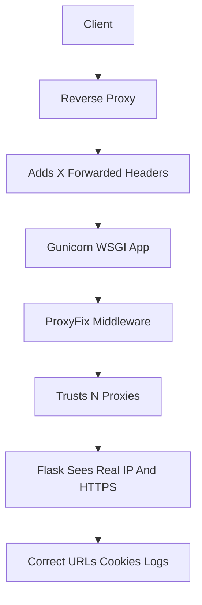

# Deploying Behind a Reverse Proxy: ProxyFix, X-Forwarded-For, and Trusting the Right Headers

## English

When a Flask app runs in production it almost never faces the internet directly. A reverse proxy such as Nginx or a cloud load balancer terminates TLS, serves static files, and forwards requests to Gunicorn over a private network. This arrangement is efficient, but it breaks a subtle assumption: Flask sees the proxy's IP address as the client, and it sees plain HTTP even though the user connected over HTTPS. That is why request.remote_addr shows 127.0.0.1, url_for(_external=True) generates http:// links, and your rate limiter thinks every user is the same person.

The fix is the X-Forwarded-For, X-Forwarded-Proto, and X-Forwarded-Host headers, which well-behaved proxies append to the forwarded request. Flask does not trust these by default, because any client can send them and lie. The Werkzeug ProxyFix middleware is the standard way to opt in: you wrap your WSGI app with ProxyFix(app.wsgi_app, x_for=1, x_proto=1, x_host=1). The numbers tell ProxyFix how many trusted proxies sit in front of your app. With x_for=1 it reads the last entry in X-Forwarded-For, which is the one appended by your own proxy, and ignores anything the client may have prepended. This distinction matters: if you set x_for=2 but only one proxy exists, an attacker can spoof their apparent IP by sending a fake header.

Getting this wrong has real consequences. Password reset emails that embed absolute URLs will point to http:// and leak the token over the wire when clicked. Secure cookies flagged with the Secure attribute will not be set because Flask thinks the connection is insecure. Logging will attribute all traffic to one IP, making abuse detection useless. And if you blindly trust X-Forwarded-For without ProxyFix, a client can claim any IP and bypass IP-based access rules.

A related concern is host header validation. Flask can be configured with TRUSTED_HOSTS (in newer versions) or you can check request.host in a before_request hook. If your app builds absolute URLs from the Host header without validation, an attacker can poison password reset links by sending a request with a forged Host. The proxy should normally normalise this, but defence in depth is cheap.

To debug proxy issues, log the raw headers on a test request and compare what the client sent versus what your app sees. A common symptom is that everything works locally but redirects loop or downgrade to HTTP in production — that is almost always a missing ProxyFix or a proxy that is not setting X-Forwarded-Proto. Treat the proxy configuration as part of your application's contract, not as an ops detail you can ignore.

## 中文

正式環境中的 Flask 應用幾乎不會直接面對網際網路。Nginx 或雲端負載平衡器這類反向代理會終結 TLS、提供靜態檔案，並透過私有網路把請求轉給 Gunicorn。這種安排很有效率，但它打破了個微妙假設：Flask 看到的用戶端 IP 是代理的位址，而且看到的是純 HTTP，即使使用者是透過 HTTPS 連線。這就是為什麼 request.remote_addr 顯示 127.0.0.1、url_for(_external=True) 產生 http:// 連結，而你的限流器以為所有使用者都是同一個人。

解法是 X-Forwarded-For、X-Forwarded-Proto、X-Forwarded-Host 這些標頭，行為良好的代理會把它們附加到轉送的請求上。Flask 預設不信任這些標頭，因為任何用戶端都可以送出並說謊。Werkzeug 的 ProxyFix 中介軟體是標準的選擇加入方式：用 ProxyFix(app.wsgi_app, x_for=1, x_proto=1, x_host=1) 包住你的 WSGI 應用。這些數字告訴 ProxyFix 你的應用前面有幾個受信任的代理。x_for=1 會讀取 X-Forwarded-For 的最後一項——也就是你自己的代理附加的那個——並忽略用戶端可能自行加在前面的任何東西。這個區別很重要：如果你設 x_for=2 但實際上只有一個代理，攻擊者就能送出偽造標頭來謊報自己的 IP。

搞錯這件事有真實後果。內嵌絕對 URL 的密碼重設信會指向 http://，使用者一點就讓 token 在網路上裸奔。標記 Secure 的 cookie 不會被設定，因為 Flask 以為連線不安全。日誌會把所有流量歸到同一個 IP，讓濫用偵測失效。而如果你不用 ProxyFix 就盲目信任 X-Forwarded-For，用戶端可以自稱任何 IP，繞過以 IP 為基礎的存取規則。

相關的顧慮是 Host 標頭驗證。Flask 可透過 TRUSTED_HOSTS（較新版本）設定，或在 before_request 勾子中檢查 request.host。如果你的應用未經驗證就從 Host 標頭建構絕對 URL，攻擊者可送出偽造 Host 的請求來汙染密碼重設連結。代理通常會正規化這個標頭，但縱深防禦成本很低。

要除錯代理問題，可在測試請求中記錄原始標頭，比較用戶端送出什麼與你的應用看到什麼。常見症狀是本機一切正常，正式環境卻出現重導迴圈或降級為 HTTP——那幾乎總是少了 ProxyFix，或代理沒有設定 X-Forwarded-Proto。請把代理設定視為應用契約的一部分，而不是可以忽略的維運細節。

## Key Takeaway

ProxyFix is how Flask learns the truth about client IP and scheme from a reverse proxy, and misconfiguring it silently breaks security-sensitive features.

## Related Concepts
- Reverse proxy and TLS termination
- Host header injection

## Diagram

