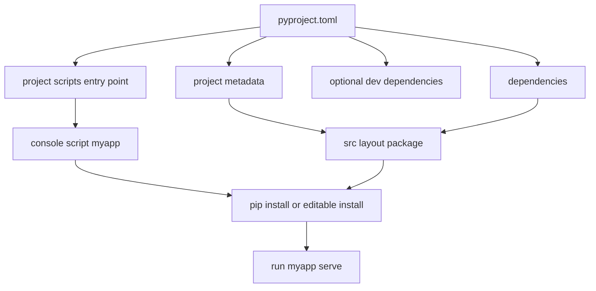

# Packaging a Flask App: pyproject.toml, Entry Points, and the Installable Project Layout

## English

A Flask app that only runs via flask run from a checkout is a script, not a package. The moment you want to deploy it, share it with a colleague, or run it inside a container, you need to think about packaging. Modern Python packaging centres on pyproject.toml, a declarative file that names your project, lists dependencies, and tells build tools how to produce a distributable artifact. For Flask specifically, it also lets you register a console script — an entry point — so users can run your app as a command rather than remembering a module path.

The layout matters. A common structure is a src/ directory containing your package, with the Flask app factory living in src/myapp/__init__.py and templates and static files inside src/myapp/templates and src/myapp/static. Putting code under src/ prevents accidental imports of the local directory during tests, because Python will only find the package if it is installed or on the path. The pyproject.toml declares [project] with name, version, dependencies (flask, gunicorn, maybe sqlalchemy), and optional [project.optional-dependencies] groups like dev for pytest and ruff.

Entry points are the piece most people miss. Under [project.scripts] you can write myapp = "myapp.cli:main", which tells pip to create a myapp executable that calls the main function. That function can parse arguments and invoke Flask's CLI or your own logic. This is how tools like flask itself work: the flask command is a console script installed by the Flask package. Giving your app a similar entry point means operators run myapp serve --port 8000 instead of hunting for the right python -m invocation.

Once packaged, installation is pip install . (or pip install -e . for editable development). The editable install is especially useful because changes to your source are reflected immediately without reinstalling, while the package metadata stays consistent. In Docker, you copy pyproject.toml first, run pip install, then copy the source — this exploits layer caching so that dependency installation is not repeated on every code change.

A final consideration is versioning and reproducibility. Pin your dependencies in a lock file or use a tool that generates one, and keep the version in pyproject.toml in sync with your release tags. Without this, a deploy six months from now may pull a newer Flask or Werkzeug with a breaking change. Packaging is unglamorous, but it is the difference between an app that works on your laptop and one that works everywhere.

## 中文

一個只能從程式碼目錄用 flask run 啟動的 Flask 應用只是腳本，不是套件。當你想要部署、與同事分享，或在容器裡執行時，就必須思考打包。現代 Python 打包以 pyproject.toml 為核心，這個宣告式檔案命名專案、列出相依套件，並告訴建置工具如何產出可散布的成品。對 Flask 而言，它還讓你註冊 console script——也就是進入點——使用者可用指令執行你的應用，而不必記住模組路徑。

目錄結構很重要。常見做法是用 src/ 目錄容納你的套件，Flask 應用工廠放在 src/myapp/__init__.py，範本與靜態檔案放在 src/myapp/templates 與 src/myapp/static。把程式碼放在 src/ 下可避免測試時不小心 import 到本地目錄，因為 Python 只有在套件已安裝或在路徑上時才找得到它。pyproject.toml 用 [project] 宣告名稱、版本、相依套件（flask、gunicorn，也許 sqlalchemy），並可用 [project.optional-dependencies] 定義像 dev 這種給 pytest 與 ruff 用的選用群組。

進入點是最多人忽略的部分。在 [project.scripts] 下寫 myapp = "myapp.cli:main"，就是告訴 pip 建立一個名為 myapp 的執行檔來呼叫 main 函式。該函式可解析參數並呼叫 Flask 的 CLI 或你自己的邏輯。flask 這個工具本身就是這樣運作的：flask 指令是 Flask 套件安裝的 console script。替你的應用加上類似進入點，維運人員就能執行 myapp serve --port 8000，而不必到處尋找正確的 python -m 呼叫方式。

打包完成後，安裝就是 pip install .（開發時用 pip install -e . 做可編輯安裝）。可編輯安裝特別有用，因為原始碼的變更會立即反映、不必重裝，同時套件中介資料保持一致。在 Docker 裡，先複製 pyproject.toml、執行 pip install、再複製原始碼——這利用了層快取，讓相依安裝不會在每次改程式碼時重跑。

最後要考慮版本與可重現性。把相依套件釘在 lock 檔中，或使用會產生 lock 檔的工具，並讓 pyproject.toml 裡的版本與發布標籤同步。否則半年後的一次部署可能拉到有破壞性變更的新版 Flask 或 Werkzeug。打包並不光鮮，但它是「只在你筆電上能跑」與「到處都能跑」之間的差別。

## Key Takeaway

Packaging a Flask app with pyproject.toml, a src layout, and a console-script entry point turns a local script into a reproducible, installable project.

## Related Concepts
- Python packaging and pyproject.toml
- Docker layer caching

## Diagram

