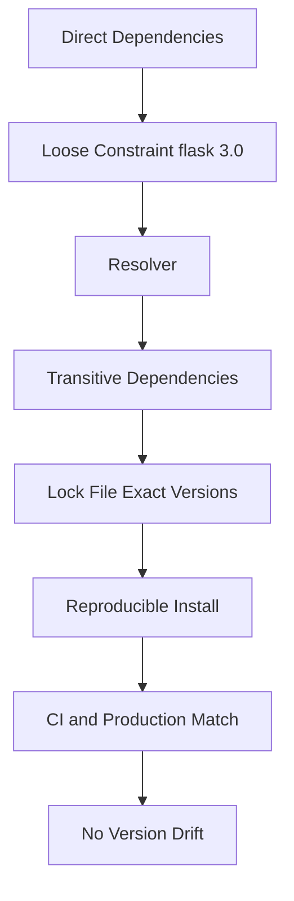

# Dependency Management and Dependency Pinning for Flask Projects

## English

A Flask application is really a small constellation of packages: Flask itself, Werkzeug (the WSGI toolkit that does routing and request/response objects), Jinja2 (the template engine), Click (the CLI framework behind `flask run`), itsdangerous (the library that signs cookies), and MarkupSafe (which escapes untrusted text in templates). When you `pip install flask`, pip resolves these transitively, and the versions you get on your laptop in March may differ from what a CI runner installs in August. A silent minor-version bump in Werkzeug can change routing behaviour or a deprecation warning can become an error. This is the classic "works on my machine" failure, and it is not a Flask bug — it is an unpinned dependency graph drifting underneath you.

The standard remedy is a lock file: a fully resolved snapshot listing every package and its exact version, plus hashes in many setups. Tools like pip-tools (`pip-compile requirements.in` produces a pinned `requirements.txt`), Poetry (`poetry.lock`), PDM, and uv (`uv.lock`) all do this. The key mental model is the difference between *direct* dependencies (what you typed) and *transitive* dependencies (what those pull in). You declare a loose constraint like `flask>=3.0` in your source-of-truth file, and the lock file records the concrete resolution. Commit the lock file; do not commit a hand-edited pile of `==` lines you cannot regenerate.

Virtual environments are the other half of the story. A venv is just a directory containing its own `python` and `site-packages`, isolated from the system interpreter. Without one, installing a package for project A can break project B, and on some systems you cannot write to system site-packages at all. Create one per project (`python -m venv .venv`), activate it, and make sure your editor and your test runner point at the same interpreter — a surprising number of confusing import errors are just the wrong Python being used.

In production, resist the urge to `pip install -r requirements.txt` at deploy time on a live server. Build an artifact (a wheel, a container image) once, with the lock file, and deploy that exact artifact to staging and production. This makes the deployed bytes identical to what you tested. Also pin your Python interpreter version: Flask 3.0 requires Python 3.8+ but Flask 3.1 raised the floor to Python 3.9, and some extensions lag behind new Python releases, so a container base image bump is a real change deserving a test run, not an afterthought.

Finally, treat upgrades as deliberate events. Read the changelogs for Flask and Werkzeug before bumping a major version; run your test suite against the new resolution in a branch; and keep a note of *why* a pin exists if you ever need to hold one back. Dependencies are part of your program's source code in every practical sense — they execute in your process and shape your behaviour — so they deserve the same review discipline as the files you write yourself.

## 中文

一個 Flask 應用程式其實是一小群套件的集合：Flask 本身、Werkzeug（負責路由與 request/response 物件的 WSGI 工具組）、Jinja2（模板引擎）、Click（`flask run` 背後的 CLI 框架）、itsdangerous（簽署 cookie 的函式庫）以及 MarkupSafe（在模板中轉義不可信文字）。當你執行 `pip install flask` 時，pip 會遞迴解析這些依賴，而你三月在筆記型電腦上取得的版本，可能與 CI 在八月安裝的版本不同。Werkzeug 一個無聲的次版本升級就可能改變路由行為，或讓一個棄用警告變成錯誤。這就是經典的「在我機器上可以跑」故障，而它並非 Flask 的 bug——而是未鎖定的依賴圖在你腳下漂移。

標準的補救方法是鎖定檔（lock file）：一份完整解析的快照，列出每個套件及其確切版本，許多設定還會附上雜湊值。pip-tools（`pip-compile requirements.in` 會產生鎖定的 `requirements.txt`）、Poetry（`poetry.lock`）、PDM 以及 uv（`uv.lock`）都能做到這件事。關鍵的心智模型是「直接依賴」（你親手打的）與「間接依賴」（那些套件再拉進來的）之間的差別。你在真實來源檔中宣告寬鬆的約束，例如 `flask>=3.0`，而鎖定檔則記錄具體的解析結果。把鎖定檔提交進版本控制；不要提交一堆你無法重新產生的、手工編輯的 `==` 行。

虛擬環境是故事的另一半。venv 只是一個目錄，裡面有自己的 `python` 與 `site-packages`，與系統直譯器隔離。沒有它，為專案 A 安裝套件可能會弄壞專案 B，而且在某些系統上你根本無法寫入系統的 site-packages。每個專案建立一個（`python -m venv .venv`）、啟用它，並確保你的編輯器與測試執行器指向同一個直譯器——許多令人困惑的匯入錯誤，其實只是用錯了 Python。

在正式環境中，要抗拒線上上伺服器部署時才執行 `pip install -r requirements.txt` 的衝動。用鎖定檔建置一次成品（wheel 或容器映像），然後把那個確切的成品部署到預備環境與正式環境。這讓部署的位元組與你測試過的完全一致。同時也要鎖定 Python 直譯器版本：Flask 3.0 需要 Python 3.8 以上，但 Flask 3.1 已經把門檻提高到 Python 3.9，而某些擴充套件會落後於新的 Python 版本，所以升級容器基底映像是一項值得跑一次測試的真實變更，而非事後補救。

最後，把升級視為刻意的活動。在升級主要版本前，先讀 Flask 與 Werkzeug 的更新日誌；在分支上對新的解析結果跑一次測試套件；如果你必須把某個釘選版本按住不動，就記下*為什麼*。依賴套件在每個實際意義上都是你程式碼的一部分——它們在你的行程中執行並塑造你的行為——所以它們值得和你親手寫的檔案一樣的審查紀律。

## Key Takeaway

Pin your entire dependency graph with a lock file and install the same built artifact everywhere, because unpinned transitive dependencies are the most common cause of "works on my machine" failures.

## Related Concepts
- Werkzeug
- Virtual environments

## Diagram

