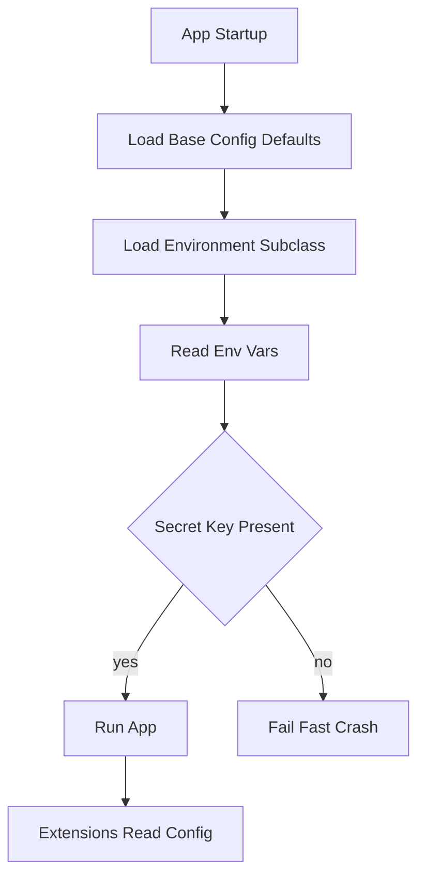

# Structuring Configuration for Multiple Environments Without Leaking Secrets

## English

Flask's `app.config` is a dictionary-like object that holds settings such as `SECRET_KEY`, `DEBUG`, `SQLALCHEMY_DATABASE_URI` (if you use that extension), and any custom keys you invent. A useful mental model is that `app.config` is *the* place the framework and extensions look for their instructions, and it is populated from several sources in a defined order: built-in defaults, then values you load explicitly (often via `app.config.from_object(...)` or `app.config.from_mapping(...)`), then environment variables if you choose to read them. Later writes win, so the order in which you load configuration matters as much as the values themselves.

The central problem is that different environments need different values for the same key. Development wants `DEBUG=True` and a local SQLite file; production wants `DEBUG=False`, a real database URL, and a strong `SECRET_KEY`. Hard-coding these in source leads to two classic disasters: committing a production secret to a public repository, and accidentally running production with development settings. A robust pattern is to keep a base configuration class with safe defaults, then small environment-specific subclasses that override only what differs, and select one at startup via an environment variable of your own choosing, such as `APP_SETTINGS`. Note that `FLASK_ENV` no longer works for this: it was removed in Flask 2.3 along with the `ENV` config key and the `app.env` property. Debug mode is now toggled separately with `FLASK_DEBUG=1`.

Secrets deserve special care. The `SECRET_KEY` is used by Flask to sign session cookies and other tokens; if it leaks, an attacker can forge session data. Never put it in a file that goes into version control. Instead, read it from the environment (`os.environ["SECRET_KEY"]`) or a secrets manager, and fail loudly at startup if it is missing in production rather than silently falling back to a default. A missing secret should crash the app immediately, not quietly weaken security. The same principle applies to database passwords and API tokens.

Be aware of a subtle trap: `DEBUG=True` enables the interactive debugger, which allows arbitrary code execution in the browser if exposed. Production must always run with `DEBUG=False`, and the debugger should never be reachable from the public internet. Similarly, `TESTING=True` changes error propagation so exceptions surface in tests instead of being caught — useful in tests, dangerous elsewhere. Treat these boolean flags as security-relevant, not just convenience toggles.

A practical workflow is to commit an example file (often `.env.example`) listing every required variable with placeholder values, and to load real values from an untracked `.env` file locally or from the platform's environment in production. Document each variable's purpose and expected format next to the example. When a new configuration key is added, update the example file in the same commit so the next person setting up the project knows it exists. Configuration is part of your application's interface to its operators — make it explicit, validated, and boring.

## 中文

Flask 的 `app.config` 是一個類似字典的物件，存放 `SECRET_KEY`、`DEBUG`、`SQLALCHEMY_DATABASE_URI`（若你使用該擴充套件）以及你自創的任何自訂鍵。一個有用的心智模型是：`app.config` 就是框架與擴充套件尋找指示的*那個*地方，而它會依既定順序從多個來源填入：內建預設值、你明確載入的值（通常透過 `app.config.from_object(...)` 或 `app.config.from_mapping(...)`），以及你選擇讀取的環境變數。後寫入者勝出，所以載入設定的順序與值本身同樣重要。

核心問題在於不同環境對同一個鍵需要不同的值。開發環境想要 `DEBUG=True` 和本地的 SQLite 檔；正式環境想要 `DEBUG=False`、真實的資料庫 URL 以及強健的 `SECRET_KEY`。把這些硬編碼在原始碼中會導致兩種經典災難：把正式環境的機密提交到公開儲存庫，以及不小心用開發設定跑正式環境。一個穩健的模式是保留一個帶安全預設值的基礎設定類別，然後用小的環境專屬子類別只覆寫有差異的部分，並在啟動時透過你自己定義的環境變數（例如 `APP_SETTINGS`）選擇其中一個。要留意 `FLASK_ENV` 已經唔再適用：它連同 `ENV` 設定鍵與 `app.env` 屬性一齊喺 Flask 2.3 被移除。Debug 模式而家要另外用 `FLASK_DEBUG=1` 開關。

機密需要特別小心。`SECRET_KEY` 被 Flask 用來簽署 session cookie 與其他權杖；如果它外洩，攻擊者就能偽造 session 資料。絕不要把它放進會進入版本控制的檔案。改從環境讀取（`os.environ["SECRET_KEY"]`）或從機密管理服務取得，並在正式環境中若它缺失就大聲失敗，而不是默默退回預設值。缺少機密應該讓應用程式立刻崩潰，而不是悄悄削弱安全性。同樣的原則適用於資料庫密碼與 API 權杖。

要留意一個微妙的陷阱：`DEBUG=True` 會啟用互動式除錯器，一旦曝露，就允許在瀏覽器中執行任意程式碼。正式環境必須永遠以 `DEBUG=False` 執行，除錯器絕不應能從公開網際網路觸及。同樣地，`TESTING=True` 會改變錯誤傳播方式，讓例外在測試中浮現而非被捕捉——在測試中有用，在其他地方則危險。把這些布林旗標視為與安全相關，而不只是方便開關。

一個實用的工作流程是提交一個範例檔（通常是 `.env.example`），列出每個必要變數及其佔位值，並在本機從不受版本控制的 `.env` 檔載入真實值，或在正式環境從平臺環境變數載入。在範例旁記錄每個變數的用途與預期格式。當新增一個設定鍵時，在同一個提交中更新範例檔，讓下一個設定專案的人知道它存在。設定是應用程式對其操作者的介面——讓它明確、經過驗證且無聊。

## Key Takeaway

Keep configuration in layered, environment-specific objects, load secrets only from the environment or a secrets manager, and fail loudly at startup when a required secret is missing.

## Related Concepts
- Application factory
- Environment variables

## Diagram

