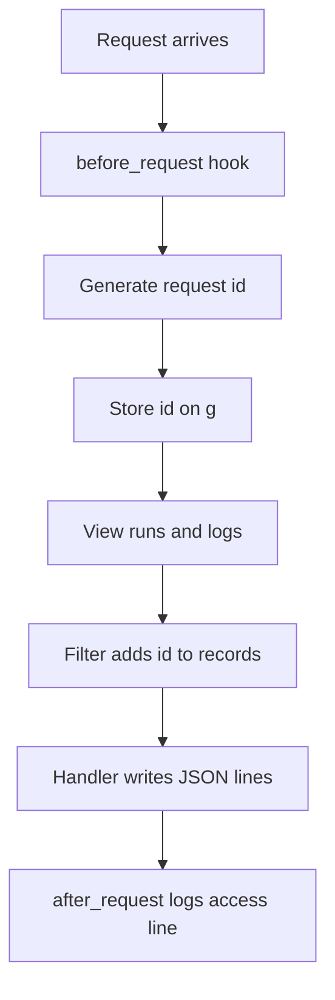

# Structured Logging and Request Tracing in Flask

## English

By default, Flask uses Python's standard `logging` module and attaches a handler that writes to stderr when the app is created. That default is fine for a tutorial but weak for production: messages are unstructured text, timestamps may be missing, and there is no request identifier to tie the lines of one request together. The first upgrade is to configure logging explicitly in your application factory — set a formatter, a level, and a handler — rather than relying on whatever the framework happened to set up. `logging.basicConfig` is convenient but global; for an app factory pattern, configuring `app.logger` and any named loggers you create is usually clearer.

A request identifier is the single most valuable addition. Generate a short random ID at the start of each request (a `before_request` hook is a natural place), store it on `g` (Flask's request-scoped namespace), and include it in every log line via a logging filter or a context-aware formatter. When a user reports an error, you can search your logs for that ID and see every step of that specific request, even when many requests were interleaved. Include the method, path, status code, and duration in a single access-log line per request, emitted in an `after_request` or `teardown_request` hook.

Structured logging means emitting records as key-value data — commonly JSON lines — rather than free-form sentences. A JSON line like `{"level":"INFO","request_id":"a1b2","method":"GET","path":"/orders/42","status":200,"duration_ms":12}` can be parsed, filtered, and aggregated by log platforms without fragile regular expressions. The trade-off is readability for humans tailing a terminal; many teams keep a human-friendly format locally and JSON in production, selected by configuration. The important rule is consistency: pick a schema, document the field names, and use them everywhere.

Be deliberate about what you log and what you never log. Request bodies, cookies, authorization headers, passwords, and personal data should not appear in logs by default — logs are often shipped to third-party services and retained longer than you expect. Log identifiers, outcomes, and counts rather than payloads. If you must log something sensitive for debugging, do it behind an explicit flag, at a low level, and remove it afterwards. Also log at the right level: `DEBUG` for developer detail, `INFO` for normal business events, `WARNING` for recoverable oddities, `ERROR` for failures that need attention, `CRITICAL` for the app being unusable.

Finally, remember that logs are only half of observability. Metrics (counts, latencies, error rates) and traces (the path of a request across services) answer different questions. A useful starting point is to log a small number of high-signal events — request start, request end with status and duration, and every unhandled exception — and to make sure unhandled exceptions are logged with a full traceback by registering an error handler that calls `app.logger.exception(...)`. Good logging is less about volume and more about being able to answer "what happened to this request?" in under a minute.

## 中文

預設情況下，Flask 使用 Python 標準的 `logging` 模組，並在應用程式建立時附加一個寫入 stderr 的處理器。這個預設值對教學來說沒問題，但對正式環境而言很弱：訊息是非結構化文字、可能缺少時間戳，而且沒有請求識別碼把同一個請求的各行串起來。第一個升級步驟是在應用程式工廠中明確設定日誌——設定格式器、層級與處理器——而不是依賴框架剛好設定的東西。`logging.basicConfig` 很方便但屬於全域；對應用程式工廠模式而言，設定 `app.logger` 以及你建立的所有具名 logger 通常更清楚。

請求識別碼是最有價值的單一新增專案。在每個請求開始時產生一個簡短的隨機 ID（`before_request` 鉤子是自然的位置），將它存到 `g`（Flask 的請求作用域名稱空間），並透過 logging filter 或能感知上下文的格式器把它納入每一行日誌。當使用者回報錯誤時，你可以用那個 ID 搜尋日誌，看到該特定請求的每一步，即使同時有許多請求交錯。在每個請求的單一行存取日誌中納入方法、路徑、狀態碼與耗時，於 `after_request` 或 `teardown_request` 鉤子中發出。

結構化日誌意味著把記錄以鍵值資料發出——通常是 JSON 行——而不是自由形式的句子。像 `{"level":"INFO","request_id":"a1b2","method":"GET","path":"/orders/42","status":200,"duration_ms":12}` 這樣的 JSON 行，可以被日誌平臺解析、過濾與彙總，而不需要脆弱的正規表示式。代價是對在終端機追蹤日誌的人來說可讀性較差；許多團隊在本機保留人-friendly 格式、在正式環境使用 JSON，由設定選擇。重要的規則是一致性：選定一個結構描述、記錄欄位名稱，並在所有地方使用它們。

要刻意決定記錄什麼、以及絕不記錄什麼。請求主體、cookie、授權標頭、密碼與個人資料預設不應出現在日誌中——日誌經常被運送到第三方服務，且保留時間比你想像的長。記錄識別碼、結果與計數，而非酬載。如果你必須為除錯記錄敏感內容，把它放在明確的旗標後面、使用低層級，並在事後移除。同時也要在正確的層級記錄：`DEBUG` 給開發者細節、`INFO` 給正常業務事件、`WARNING` 給可復原的異常、`ERROR` 給需要關注的失敗、`CRITICAL` 給應用程式無法使用的情況。

最後，記住日誌只是可觀測性的一半。指標（計數、延遲、錯誤率）與追蹤（請求跨服務的路徑）回答不同的問題。一個有用的起點是記錄少量高訊號事件——請求開始、請求結束並附狀態與耗時，以及每個未處理的例外——並確保未處理的例外在完整 traceback 下被記錄，作法是註冊一個呼叫 `app.logger.exception(...)` 的錯誤處理器。良好的日誌不在於數量，而在於能在一分鐘內回答「這個請求發生了什麼事？」。

## Key Takeaway

Attach a per-request correlation ID to structured log records and log outcomes rather than payloads, so you can reconstruct any single request's story without leaking sensitive data.

## Related Concepts
- Python logging module
- Observability

## Diagram

