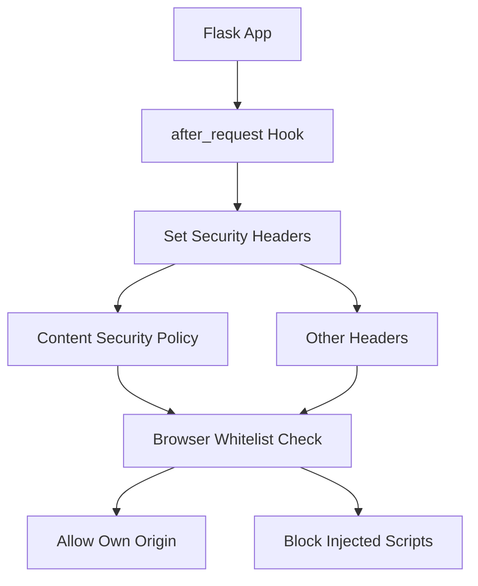

# Content Security Policy and Security Headers in Flask

## English

A Flask app that correctly escapes Jinja2 output is still vulnerable to whole classes of browser-side attacks, because escaping protects against injected markup but not against injected behaviour. The defence is a family of HTTP response headers that tell the browser what the page is allowed to do. The most powerful is Content-Security-Policy (CSP): a whitelist, expressed as a header value, of which origins may supply scripts, styles, images, fonts, frames, and connections. A strict policy such as default-src 'self' means the browser will refuse to execute any JavaScript that did not arrive from your own origin. That single rule neutralises most cross-site scripting (XSS) payloads, because an attacker who manages to inject a script tag finds the browser declining to run it. The same header family includes X-Content-Type-Options: nosniff, which stops the browser from second-guessing your Content-Type and treating a text file as a script; X-Frame-Options or the frame-ancestors directive, which blocks clickjacking by forbidding other sites from embedding your pages in an iframe; Referrer-Policy, which limits how much URL information leaks to third parties; and Strict-Transport-Security (HSTS), which tells the browser to refuse plain HTTP to your domain for a stated period. In Flask these are just response headers, so the cleanest place to set them is an after_request hook registered on the app, which receives every outgoing Response object and can mutate its headers dict before it leaves the server. A single function can therefore enforce a baseline across every route without each view remembering to do it.

The hard part of CSP is not the header, it is the discipline it forces on your templates. Inline event handlers such as onclick attributes and inline script blocks are exactly what CSP is designed to block, so a policy that forbids them will break any page that relies on them. The migration path is to move JavaScript into external files served from your own origin and to pass data to them through data attributes or a JSON blob in a script tag of an allowed type, rather than by generating code strings. Nonces are the escape hatch for genuinely dynamic inline scripts: the server generates a fresh random value per response, puts it in the CSP header as script-src 'nonce-...', and stamps the same value onto the script tag it wants to permit. Because the nonce changes every response, an attacker cannot predict it, so injected scripts cannot carry a valid one. Flask makes this easy because a nonce can be generated in a before_request hook, stored on g, and read both by the header-setting function and by the template through a context processor.

A practical rollout strategy is to start with Content-Security-Policy-Report-Only, which does not block anything but makes the browser POST a JSON report to a URL you specify whenever a violation would have occurred. You point that at a Flask route that logs the report, run your app in staging, and collect the list of things your own pages do that the policy forbids. Once the list is empty, you flip the header name to the enforcing version. This turns a scary, site-breaking change into an observable, iterative one, and it is the same pattern used by large production sites. The report endpoint itself needs care: it accepts unauthenticated POSTs from browsers, so it should be rate limited, should cap the size of the body it reads, and should never reflect the report content back to the caller.

Security headers also interact with the rest of your stack in ways worth knowing. If Flask sits behind Nginx, the proxy may add or strip headers, so you need to decide which layer owns each one; duplicating a header can produce confusing results, since some headers (like CSP) combine across multiple values in ways that are not simply additive. HSTS is especially dangerous to enable carelessly: once a browser has seen Strict-Transport-Security for a domain, it will refuse HTTP to that domain, including subdomains if includeSubDomains is set, for the max-age you specified, and there is no way to revoke it early. Test with a short max-age first. Similarly, X-Frame-Options: DENY on an app that is legitimately embedded by a partner will break that integration, which is why the newer frame-ancestors directive, which can list specific allowed origins, is preferable where supported.

Finally, remember that headers are only one layer. They do not replace input validation, they do not fix an authorisation bug, and they do not protect against attacks that never touch a browser. What they do is shrink the blast radius of the mistakes you inevitably make in templates and JavaScript. Treat them as defence in depth: a cheap, centralised, per-response control that makes a whole category of exploit much harder, applied once in an after_request hook and audited with report-only mode before enforcement.

## 中文

一個正確轉義 Jinja2 輸出的 Flask 應用，仍然會暴露於一整類瀏覽器端攻擊之下，因為轉義只能防止被注入的標記，卻防不了被注入的行為。防禦手段是一系列 HTTP 回應標頭，它們告訴瀏覽器這個頁面允許做什麼。最強大的是 Content-Security-Policy（CSP）：它以標頭值的形式列出白名單，規定哪些來源可以提供腳本、樣式、圖片、字型、框架與連線。嚴格的政策例如 default-src 'self'，意味著瀏覽器會拒絕執行任何不是來你自己來源的 JavaScript。這一條規則就中和了大部分跨站腳本（XSS）載荷，因為攻擊者即使成功注入了一個 script 標籤，瀏覽器也會拒絕執行它。同一族標頭還包括 X-Content-Type-Options: nosniff，它阻止瀏覽器自行猜測你的 Content-Type 而把文字檔當成腳本執行；X-Frame-Options 或 frame-ancestors 指令，禁止其他網站把你的頁面嵌入 iframe，從而阻擋點擊劫持；Referrer-Policy，限制有多少 URL 資訊洩漏給第三方；以及 Strict-Transport-Security（HSTS），告訴瀏覽器在指定期間內拒絕以明文 HTTP 連上你的網域。在 Flask 裡這些都只是回應標頭，所以最乾淨的設定位置是註冊在 app 上的 after_request 掛鉤，它會收到每一個外送的 Response 物件，可以在它離開伺服器之前改動其 headers 字典。因此一個函式就能對每條路由強制執行同一套基線，而不必每個 view 自己記得去做。

CSP 困難的地方不是標頭本身，而是它對你的模板所強加的紀律。內聯事件處理器例如 onclick 屬性，以及內聯 script 區塊，正是 CSP 設計來封鎖的東西，所以一條禁止它們的政策會弄壞任何依賴它們的頁面。遷移路徑是把 JavaScript 移到由你自己來源提供的外部檔案，並透過 data 屬性、或是一個允許類型的 script 標籤裡的 JSON 區塊，把資料傳給它們，而不是靠產生程式碼字串。Nonce 是真正動態內聯腳本的逃生門：伺服器每次回應都產生一個新的隨機值，放進 CSP 標頭的 script-src 'nonce-...' 中，並把同一個值蓋在它想放行的 script 標籤上。因為 nonce 每次回應都不同，攻擊者無法預測，所以注入的腳本無法帶上有效的 nonce。Flask 讓這件事很容易，因為 nonce 可以在 before_request 掛鉤中產生、存到 g 上，然後由設定標頭的函式與透過 context processor 的模板同時讀取。

實務上的推行策略是先從 Content-Security-Policy-Report-Only 開始，它不會封鎖任何東西，但每當本應發生違規時，瀏覽器會把一份 JSON 報告 POST 到你指定的網址。你把該網址指向一條記錄報告的 Flask 路由，在預備環境跑你的應用，收集自己的頁面做了哪些政策禁止的事。當清單清空後，你就把標頭名稱改成強制執行的版本。這把一個令人害怕、可能弄壞網站的改動，變成可觀察、可迭代的過程，大型生產網站也是用同一套模式。報告端點本身需要小心處理：它接受來自瀏覽器未經認證的 POST，所以應該限流、應該限制它讀取的主體大小，而且絕不應把報告內容反射回呼叫者。

安全標頭也會與堆疊的其他部分互動，值得了解。如果 Flask 位於 Nginx 之後，代理可能會加上或剝除標頭，所以你要決定每一層各自擁有哪個標頭；重複一個標頭可能產生令人困惑的結果，因為某些標頭（例如 CSP）在多個值之間合併的方式並不是簡單相加。HSTS 尤其不能隨便開啟：一旦瀏覽器看過某個網域的 Strict-Transport-Security，它就會在你指定的 max-age 期間內拒絕以 HTTP 連上該網域，若設了 includeSubDomains 還包括子網域，而且無法提前撤銷。先用很短的 max-age 測試。同樣地，在一個會被合作夥伴合法嵌入的應用上設 X-Frame-Options: DENY 會弄壞那個整合，這就是為什麼在支援的地方，較新的 frame-ancestors 指令（可以列出特定允許來源）更可取。

最後，記住標頭只是其中一層。它們不能取代輸入驗證，不能修好授權漏洞，也防不了根本不經過瀏覽器的攻擊。它們能做的是縮小你在模板與 JavaScript 中無可避免犯錯時的爆炸半徑。把它們當作縱深防禦：一種便宜、集中、逐回應的控制，讓一整類漏洞利用變得困難得多，只要在 after_request 掛鉤裡設定一次，並在強制執行前用 report-only 模式稽核。

## Key Takeaway

Security headers such as CSP turn the browser into an enforcer of your policy, and Flask's after_request hook is the natural single place to apply them, ideally rolled out first in report-only mode.

## Related Concepts
- Content-Security-Policy
- after_request hooks

## Diagram

