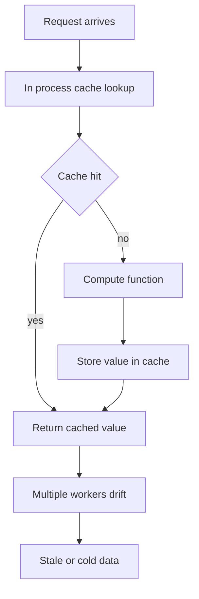

# Flask's Built-in Caching Primitives and When They Betray You

## English

Beyond HTTP-level caching, Flask ships a small but frequently misused in-process cache: the simple cache available through flask_caching's SimpleCache backend, or more fundamentally the plain dictionaries people reach for when they want to memoise a function. The appeal is obvious — a dictionary lookup is microseconds, a database query is milliseconds, and memoising a hot function can cut a page's response time dramatically. The trap is that a Python process's memory is per-process. If you run Gunicorn with four worker processes, you now have four independent caches that drift apart: a value cached by worker one is invisible to worker two, so a user's second request may hit a different worker and see stale or cold data. Worse, cache invalidation must be broadcast to every worker, and there is no built-in mechanism to do it. This is why in-process caches are fine for immutable data — a configuration lookup, a compiled regex, a country code table loaded at startup — and dangerous for anything that changes.

A second trap is that the cache key is whatever you choose, and a bad key silently returns wrong answers. If you memoise a function of a user's ID but forget to include the ID in the key, every user receives the first user's data. If you key on a URL but forget the query string, filtered and unfiltered views collide. If you key on a float or a datetime, you may be surprised by equality semantics. The safest pattern is to derive the key explicitly from every input that affects the output, and to include a version prefix so that changing the function's logic lets you invalidate everything at once by bumping the prefix. This is the same reason HTTP caches use the full URL including query parameters, and the same reason ETags are computed from the representation rather than the path.

A third trap is unbounded growth. A plain dict used as a cache never evicts, so a function called with a million distinct arguments will eventually consume all available memory and the process will be killed by the OOM killer. Production caches need a policy — LRU, TTL, or both. Flask-Caching's SimpleCache supports a default timeout and a threshold after which it prunes, and the functools.lru_cache decorator gives you a bounded, thread-safe memoisation for pure functions with hashable arguments. Knowing which to reach for matters: lru_cache is ideal for expensive pure computations (parsing a schema, computing a checksum) and useless for anything involving request state, because the request object is not hashable and is different on every call.

A fourth trap is thread safety. Flask's development server is threaded by default in recent versions, and WSGI servers use threads or processes, so any shared mutable structure must be safe under concurrent access. A bare dict is safe for individual get and set operations in CPython due to the GIL, but a check-then-act sequence (look up, if missing compute and store) is not atomic, so two threads can both compute the expensive value and both write it. That is usually harmless (wasted work) but can be harmful if the computation has side effects. A lock around the compute-and-store section fixes it, at the cost of serialising the misses.

When you outgrow in-process caching, the natural step is a shared cache such as Redis or Memcached, which all workers can see. Flask-Caching supports both through the same interface, so switching backends is mostly a configuration change — but the semantics change too. A network round trip is orders of magnitude slower than a dict lookup, so caching a trivially cheap computation can actually make things slower. Serialisation becomes a concern: values must be picklable or JSON-encodable, and large objects cost bandwidth. And the cache is now a dependency that can fail independently of your app, so you must decide whether a cache outage should degrade to slow-but-correct behaviour (usually yes) or take the site down (usually no). Wrapping cache calls in try/except and falling through to the source of truth is the resilient default.

## 中文

除了 HTTP 層的快取之外，Flask 附帶了一個小巧但經常被誤用的行程內快取：透過 flask_caching 的 SimpleCache 後端取得的簡單快取，更根本地說，就是人們想記憶化（memoise）一個函式時隨手拿起的普通字典。吸引力很明顯——字典查詢是微秒級，資料庫查詢是毫秒級，把一個熱門函式記憶化可以大幅縮短頁面回應時間。陷阱在於，一個 Python 行程的記憶體是逐行程的。如果你用 Gunicorn 跑四個 worker 行程，你現在就有四個彼此漂移的獨立快取：worker 一快取的值對 worker 二不可見，所以使用者的第二次請求可能打到另一個 worker，看到過期或冷掉的資料。更糟的是，快取失效必須廣播到每個 worker，而沒有內建機制能做到。這就是為什麼行程內快取適合不可變的資料——設定查詢、編譯好的正規表示式、啟動時載入的國碼表——而對任何會變動的東西都很危險。

第二個陷阱是快取鍵是你自己選的，而壞鍵會無聲地回傳錯誤答案。如果你記憶化一個以使用者 ID 為輸入的函式，卻忘了把 ID 放進鍵裡，每個使用者都會收到第一個使用者的資料。如果你以 URL 為鍵卻忘了查詢字串，有篩選與無篩選的檢視就會相撞。如果你以浮點數或 datetime 為鍵，可能會對相等語意感到意外。最安全的模式是從每一個影響輸出的輸入明確推匯出鍵，並加上版本字首，這樣改變函式邏輯時只要把字首升一版就能一次讓所有東西失效。這和 HTTP 快取使用包含查詢引數的完整 URL 是同一個道理，也和 ETag 是從表示本身而非路徑計算出來是同一個道理。

第三個陷阱是無界增長。當作快取用的普通字典從不淘汰，所以一個被以一百萬個不同引數呼叫的函式，最終會吃光所有可用記憶體，行程會被 OOM killer 殺掉。生產快取需要策略——LRU、TTL，或兩者。Flask-Caching 的 SimpleCache 支援預設逾時，以及超過某個數量後進行修剪，而 functools.lru_cache 裝飾器則為引數可雜湊的純函式提供有界、執行緒安全的記憶化。知道該用哪個很重要：lru_cache 適合昂貴的純計算（解析 schema、計算校驗和），對任何牽涉請求狀態的東西則無用，因為 request 物件不可雜湊，而且每次呼叫都不同。

第四個陷阱是執行緒安全。Flask 的開發伺服器在近期版本預設是多執行緒的，而 WSGI 伺服器會用執行緒或行程，所以任何共享的可變結構都必須在並行存取下安全。在 CPython 中，由於 GIL，裸字典的單次 get 與 set 是安全的，但「先查再動作」的序列（查詢、若缺少則計算並存入）不是原子的，所以兩個執行緒可能都計算出昂貴的值並都寫入。這通常無害（浪費工作），但如果計算有副作用就可能有害。在計算並儲存的區段加鎖可以修好它，代價是讓未命中的情況序列化。

當行程內快取不夠用時，自然的下一步是共享快取，例如 Redis 或 Memcached，所有 worker 都看得見。Flask-Caching 透過同一介面支援兩者，所以切換後端大致上只是改設定——但語意也跟著改變。網路往返比字典查詢慢上好幾個數量級，所以快取一個極便宜的計算反而可能讓事情變慢。序列化成為問題：值必須可 pickle 或可 JSON 編碼，而大型物件會耗費頻寬。而且快取現在是一個可能獨立於你的應用而失效的依賴，所以你必須決定快取故障時應該降級成慢但正確的行為（通常應該如此），還是讓網站掛掉（通常不應該）。把快取呼叫包在 try/except 裡、失敗時落回真實來源，是有韌性的預設做法。

## Key Takeaway

In-process caches in Flask are fast but per-worker and unbounded, so use them only for immutable data with explicit, versioned keys and prefer a shared backend once correctness across workers matters.

## Related Concepts
- Cache invalidation
- Gunicorn worker model

## Diagram

