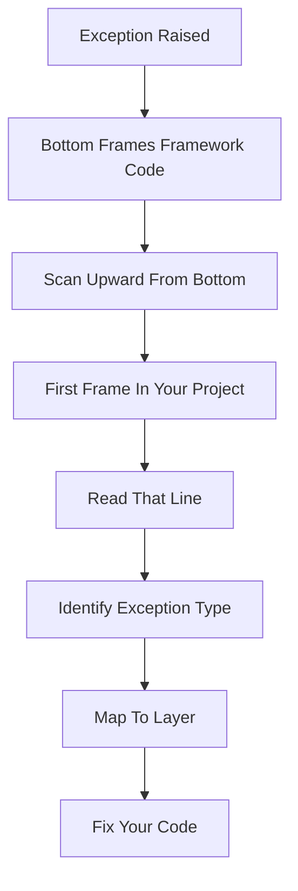

# Reading a Flask Traceback: Turning a Stack Trace Into a Diagnosis

## English

The single most useful debugging skill in Flask is reading a traceback from the bottom up. Python prints the most recent call last, so the bottom of the trace is where the exception was actually raised, and the frames above it are the path that led there. In a Flask app, the bottom frames are usually deep inside Werkzeug or Jinja2 — a line in werkzeug/routing.py, or a line in jinja2/environment.py — and the frames that matter to you are the ones just above them, in your own code. The trick is to scan upward from the bottom until you find the first frame whose filename is in your project, then read that line. That is almost always where your mistake lives, even though the exception was raised a few frames deeper.

Different exception types point at different layers, and knowing the mapping saves enormous time. A KeyError on request.form or request.args means a field the client did not send; it is a contract mismatch, not a framework bug. An AttributeError mentioning NoneType means something you expected to be an object was None — a query that returned nothing, a get() that missed, a config key that was never set. A RuntimeError about working outside of application context means you touched current_app, g, or a database session outside a request or an explicit app context; this is common in background threads and CLI commands, and the fix is an explicit with app.app_context(): block. A TypeError about missing positional arguments usually means a route function's signature does not match the variables in its URL rule — you declared <int:user_id> but the function takes no arguments, or vice versa. A TemplateNotFound means Jinja2's loader searched its configured directories and did not find the name you asked for, which is often a path relative to the templates folder rather than to the project root.

In debug mode, Flask replaces the plain traceback with the Werkzeug interactive debugger, which renders each frame with its source and a live console. This is enormously powerful and enormously dangerous: the console lets anyone who can reach the page execute arbitrary Python in your process, which means reading your secrets, your database, and your filesystem. The debugger is protected only by a PIN derived from machine-specific values, and that PIN has been bypassed in the wild when those values are guessable or when the debugger is exposed behind a misconfigured proxy. The rule is simple: debug mode must never be reachable from an untrusted network, and the reloader and debugger should be disabled in any environment that real users touch. A staging server reachable from the internet with debug on is a production incident waiting to happen.

Logging complements the traceback. Flask's app.logger is a standard Python logger, so exceptions caught inside your own try/except blocks vanish from the traceback unless you log them. The pattern is to catch the exception, call app.logger.exception('...') (which records the message plus the current traceback at ERROR level), and then either re-raise or return a controlled error response. Without this, a swallowed exception becomes an invisible bug that produces a wrong-but-not-crashing response. Structured logging — emitting JSON with request ID, route, status, and duration — makes it possible to correlate a user's report with the exact request in the logs, which is often faster than reproducing the bug locally.

Finally, learn to reproduce the failure in a test. A traceback tells you where the code broke; a test tells you why and prevents recurrence. Flask's test client makes this cheap: construct the exact request that failed (same method, same path, same form data or JSON body, same headers) and assert on the response. If the bug only appears with a particular session, set the session in the test client. If it only appears under concurrency, that is a signal to look for shared mutable state, not to add a lock and hope. The discipline of converting every production traceback into a failing test is what turns debugging from archaeology into engineering.

## 中文

在 Flask 裡最實用的除錯技能，是從下往上讀 traceback。Python 最後印出的是最近一次呼叫，所以 trace 的最底部才是例外真正被丟擲的地方，而它上面的影格則是通往那裡的路徑。在 Flask 應用中，最底部的影格通常深藏在 Werkzeug 或 Jinja2 裡——werkzeug/routing.py 的某一行，或 jinja2/environment.py 的某一行——而對你有意義的影格，是緊接在它們上方、屬於你自己程式碼的那些。訣竅是從底部往上掃，直到找到第一個檔名落在你專案裡的影格，然後讀那一行。那幾乎總是你的錯誤所在，即使例外是在更深的幾個影格之外被丟擲的。

不同的例外型別指向不同的層，知道這個對應關係能省下大量時間。request.form 或 request.args 上的 KeyError 表示客戶端沒送某個欄位；這是契約不匹配，不是框架的錯。提到 NoneType 的 AttributeError 表示某個你以為是物件的東西其實是 None——一個回傳空結果的查詢、一個沒命中的 get()、一個從未設定的設定鍵。關於在應用情境之外運作的 RuntimeError 表示你在請求或明確的 app context 之外碰了 current_app、g 或資料庫 session；這在背景執行緒與 CLI 指令中很常見，修法是明確的 with app.app_context(): 區塊。關於缺少位置引數的 TypeError 通常表示路由函式的簽章與其 URL 規則裡的變數不匹配——你宣告了 <int:user_id> 但函式不吃引數，或反過來。TemplateNotFound 表示 Jinja2 的載入器搜過它設定的目錄卻找不到你要求的名字，這通常是相對於 templates 資料夾而非專案根目錄的路徑問題。

在除錯模式下，Flask 會把樸素的 traceback 換成 Werkzeug 的互動式除錯器，它會把每個影格連同原始碼與一個即時主控臺渲染出來。這極其強大，也極其危險：主控臺讓任何能連到該頁面的人在你的行程裡執行任意 Python，意思是可以讀你的金鑰、你的資料庫、你的檔案系統。除錯器只靠一個由機器特定值推匯出的 PIN 保護，而當那些值可被猜到、或除錯器因代理設定錯誤而暴露時，這個 PIN 在真實世界已被繞過。規則很簡單：除錯模式絕不可從不受信任的網路觸達，而過載器與除錯器應在任何真實使用者會碰到的環境中停用。一個從網際網路可達、開著除錯的預備伺服器，就是一場等著發生的生產事故。

日誌與 traceback 相輔相成。Flask 的 app.logger 是標準的 Python logger，所以你在自己的 try/except 區塊裡捕捉到的例外，除非你記錄它們，否則會從 traceback 中消失。模式是捕捉例外、呼叫 app.logger.exception('...')（它會以 ERROR 等級記錄訊息加上當前 traceback），然後看是要重新丟擲，還是回傳一個受控的錯誤回應。沒有這個，被吞掉的例外會變成看不見的 bug，產生錯誤但不會當掉的回應。結構化日誌——輸出帶有請求 ID、路由、狀態與耗時的 JSON——讓你有可能把使用者的回報與日誌中確切的那個請求關聯起來，這通常比在本機重現 bug 更快。

最後，學會在測試中重現失敗。traceback 告訴你程式碼在哪裡壞掉；測試告訴你為什麼，並防止它再發生。Flask 的測試客戶端讓這件事很便宜：建構出失敗的那個確切請求（同樣的方法、同樣的路徑、同樣的表單資料或 JSON 主體、同樣的標頭），並對回應做斷言。如果 bug 只在特定 session 下出現，就在測試客戶端裡設定 session。如果它只在並行下出現，那是個訊號，要去找共享的可變狀態，而不是加個鎖然後祈禱。把每一份生產 traceback 轉換成一個會失敗的測試，這個紀律就是把除錯從考古學變成工程學的關鍵。

## Key Takeaway

Read tracebacks bottom-up to the first frame in your own code, map exception types to layers, and convert every production traceback into a failing test.

## Related Concepts
- Werkzeug interactive debugger
- app.logger

## Diagram

