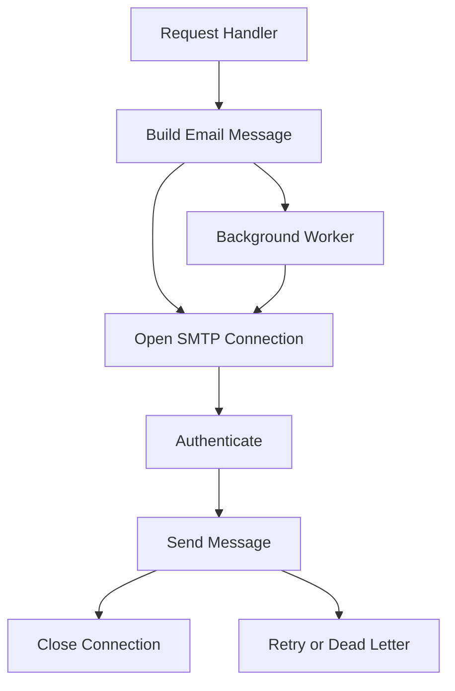

# Sending Email from Flask: SMTP, Background Sending, and the Failures Nobody Tests

## English

Sending mail is one of the first things a real app needs — password resets, receipts, notifications — and Flask has no opinion about it at all. The core framework ships nothing for email; you either use Python's built-in smtplib and email packages directly, or install Flask-Mail, a thin extension that wraps smtplib and reads its settings (server host, port, username, password, TLS flag) from Flask's config object. Under the hood, Flask-Mail opens an SMTP connection, authenticates, hands the message over, and closes. That's it. Everything interesting is in the details around that call.

The first trap is that SMTP is a network call with a timeout measured in seconds, and your request handler is blocked while it runs. If the mail server is slow or unreachable, your user stares at a spinner until the connection times out. The standard fix is to push the send into a background worker — a task queue like Celery or RQ, or a simple thread pool — and return the response immediately. The trade-off: once you've returned 200 OK, you can no longer tell the user the email failed. You need retries, a record of what was attempted, and ideally a dead-letter path for messages that never go out.

The second trap is development versus production. In development you don't want to actually send mail; you want to see it. Options include a local debugging SMTP server that catches messages and shows them in a web UI, or configuring the app to write messages to a folder. Production, by contrast, usually needs a real relay — a transactional email provider's SMTP endpoint — because sending directly from your server tends to land in spam due to missing SPF, DKIM, and DMARC records. Those are DNS records that prove your server is allowed to send for your domain; without them, major providers will quietly bin your mail.

The third trap is that 'sent' is not 'delivered'. SMTP acceptance means the receiving server took responsibility for the message, not that a human ever saw it. Bounces come back asynchronously, often to a separate address (the envelope sender, which can differ from the From: header). If you want to know whether a password reset actually arrived, you need to integrate with your provider's bounce and complaint webhooks, which your Flask app can expose as ordinary routes.

Finally, keep secrets out of code. SMTP credentials belong in environment variables loaded into config, never committed. And always send both a plain-text and an HTML alternative in the same message — a multipart/alternative email — because some clients and accessibility tools only render text, and a text part also reduces spam scoring.

## 中文

寄送電郵係幾乎每個真實應用都需要嘅功能——重設密碼、收據、通知——而 Flask 對呢件事完全冇立場。核心框架唔提供任何電郵功能；你要麼直接用 Python 內建嘅 smtplib 同 email 套件，要麼安裝 Flask-Mail，一個薄薄嘅擴充，包住 smtplib，並由 Flask 嘅 config 物件讀取設定（伺服器主機、埠、用戶名、密碼、TLS 開關）。底層嚟講，Flask-Mail 開一條 SMTP 連線、驗證、交低訊息、再關閉。就係咁多。所有有趣嘅嘢都喺呢個呼叫周圍嘅細節入面。

第一個陷阱係：SMTP 係一個有幾秒逾時嘅網絡呼叫，而你嘅請求處理器喺佢執行期間會被阻塞。如果郵件伺服器慢或者連唔到，用戶就會對住個轉圈等到連線逾時。標準做法係將寄送推去背景工作者——好似 Celery 或 RQ 咁嘅任務隊列，或者簡單嘅執行緒池——然後即刻回傳回應。代價係：一旦你回咗 200 OK，你就再也冇辦法話畀用戶知封郵件寄失敗咗。你需要重試、需要記錄嘗試過啲乜，最好仲有一條死信路徑去處理永遠寄唔出嘅訊息。

第二個陷阱係開發同生產嘅分別。喺開發環境你唔想真係寄出電郵；你想睇到佢。可以揀用一個本機除錯 SMTP 伺服器，截住訊息喺網頁介面顯示，或者設定應用將訊息寫入資料夾。相反，生產環境通常需要一個真實嘅中繼——交易型電郵供應商嘅 SMTP 端點——因為由你自己伺服器直接寄，通常會因為缺少 SPF、DKIM 同 DMARC 記錄而跌落垃圾郵件。呢啲係 DNS 記錄，用嚟證明你嘅伺服器有權代表你個網域寄信；冇咗佢哋，大型供應商會靜靜雞丟棄你嘅郵件。

第三個陷阱係：「已寄出」唔等於「已送達」。SMTP 接受只代表接收伺服器承擔咗封訊息嘅責任，唔代表有人真係睇過。退信係非同步咁返嚟，通常去另一個地址（信封寄件人，可以同 From: 標頭唔同）。如果你想知封重設密碼電郵有冇真正送到，就要整合你供應商嘅退信同投訴 webhook，而你嘅 Flask 應用可以將佢哋暴露成普通路由。

最後，唔好將機密放喺程式碼入面。SMTP 憑證應該放喺環境變數，載入去 config，永遠唔好提交上版本控制。而且同一封訊息入面永遠要同時提供純文字同 HTML 兩個版本——即 multipart/alternative 電郵——因為有啲客戶端同輔助工具只會顯示文字部分，而有文字部分亦可以降低垃圾郵件評分。

## Key Takeaway

Flask gives you nothing for email on purpose — the real work is deciding where the send happens (request or worker), how failures are recorded, and how you prove your mail is legitimate.

## Related Concepts
- SMTP and transactional email providers
- Background task queues

## Diagram

