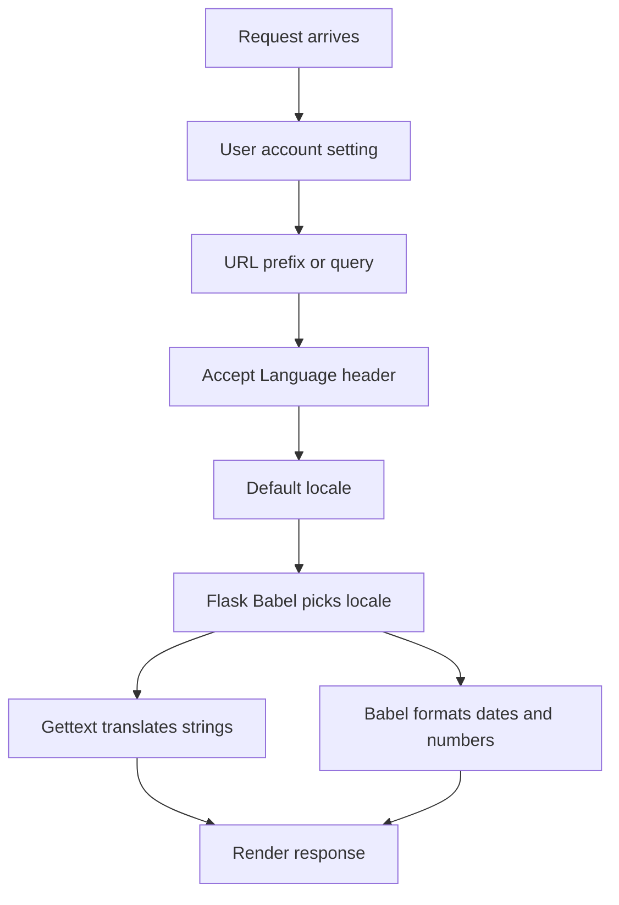

# Internationalization in Flask: Babel, Locale Negotiation, and the Plural Trap

## English

The moment your app has users in more than one country, three separate problems appear that look like one: translating strings, formatting data (dates, numbers, currency), and choosing which language to show. Flask solves none of them in core, but the pattern is well established. The common tool is Flask-Babel, which wraps the Babel library and connects it to Flask's request context. Babel handles the formatting side — it knows that 1,234.5 in en-US is 1.234,5 in de-DE and that dates have wildly different conventional orders. Flask-Babel handles the Flask side: it picks a locale per request, exposes a gettext function (usually aliased to _) for marking translatable strings, and provides a Jinja filter so templates can format dates and numbers per locale.

Locale selection is a negotiation, and it's worth being explicit about your order of preference. Typical priority: an explicit user setting stored on their account, then a URL prefix or query parameter, then the browser's Accept-Language header, then a default. Accept-Language is a ranked list with quality values (q-values), so 'en-GB,en;q=0.9,fr;q=0.5' means British English first, generic English second, French third. Parsing it properly matters: a naive substring check will happily match the wrong language. And you must have a fallback, because a user may accept a language you don't support at all.

The translation workflow itself is file-based. You mark strings in code with gettext calls, extract them into a template file (a .pot file), and translators fill in per-language .po files, which are then compiled into binary .mo files that the runtime loads. A common beginner mistake is editing .po files and forgetting to compile, then wondering why nothing changes. Another is concatenating translated fragments — 'You have ' + count + ' messages' — which is unfixable in languages with different word order. Always translate whole sentences with placeholders, not fragments.

Plurals are where most i18n bugs live. English has two plural forms; Polish has several; Arabic has six. A naive conditional (count == 1 ? singular : plural) is wrong in most of the world. gettext's ngettext function takes the singular, the plural, and the count, and picks the right form using rules stored in the translation catalog for that language. Use it whenever a number appears in a sentence, even if you think the language only has two forms.

Finally, separate translation from formatting. Translating a date string is usually wrong — you want to format a datetime object according to the locale's conventions, not translate the words 'March' into a fixed string. Same for currency: store amounts as integers in a minor unit or as decimals, and format at the edge. And remember that time zones are a separate axis from language: a French speaker in Tokyo wants French text with Tokyo time.

## 中文

當你嘅應用開始有唔同國家嘅使用者，三個看似一個嘅問題就會出現：翻譯字串、格式化資料（日期、數字、貨幣），同埋決定顯示邊種語言。Flask 核心一個都唔解決，但係做法已經好成熟。常用工具係 Flask-Babel，佢包住 Babel 函式庫，並將佢連線去 Flask 嘅請求上下文。Babel 負責格式化嗰邊——佢知道 1,234.5 喺 en-US 係 1.234,5 喺 de-DE，亦知道日期嘅慣用次序各處都唔同。Flask-Babel 負責 Flask 嗰邊：佢為每個請求揀一個 locale，提供一個 gettext 函式（通常別名做 _）去標記可翻譯字串，仲提供一個 Jinja 過濾器，等範本可以按 locale 格式化日期同數字。

Locale 選擇係一場談判，值得明確寫出你嘅優先次序。典型優先順序：使用者帳戶入面儲存嘅明確設定，然後係 URL 字首或者查詢引數，然後係瀏覽器嘅 Accept-Language 標頭，最後係預設值。Accept-Language 係一個有品質值（q 值）嘅排序清單，所以「en-GB,en;q=0.9,fr;q=0.5」代表英式英文第一、通用英文第二、法文第三。正確解析佢好重要：一個天真嘅子字串檢查會好容易匹配錯語言。而且你一定要有後備方案，因為使用者可能接受一啲你完全唔支援嘅語言。

翻譯流程本身係基於檔案嘅。你用 gettext 呼叫喺程式碼入面標記字串，抽取佢哋去一個範本檔（.pot 檔），翻譯員填寫各語言嘅 .po 檔，然後編譯成執行時載入嘅二進位 .mo 檔。新手常見錯誤係改咗 .po 檔但唔記得編譯，然後奇怪點解冇變化。另一個係拼接翻譯碎片——「你有 」+ count + 「 條訊息」——呢種做法喺詞序唔同嘅語言入面根本冇得救。永遠翻譯完整句子連佔位符，唔好翻譯碎片。

複數係大部分 i18n 錯誤嘅溫床。英文有兩種複數形式；波蘭文有幾種；阿拉伯文有六種。一個天真嘅條件判斷（count == 1 ? 單數 : 複數）喺世界上大部分地方都係錯嘅。gettext 嘅 ngettext 函式會接收單數、複數同數量，然後用該語言翻譯目錄入面儲存嘅規則揀正確形式。只要句子入面出現數字就用佢，即使你以為嗰種語言只有兩種形式。

最後，將翻譯同格式化分開。翻譯一個日期字串通常係錯嘅——你想按 locale 慣例格式化一個 datetime 物件，而唔係將「March」呢個字翻譯成一個固定字串。貨幣都一樣：以最小單位整數或者小數儲存金額，喺邊緣格式化。仲要記住時區同語言係兩條唔同嘅軸：一個喺東京嘅法文使用者想要法文文字配東京時間。

## Key Takeaway

i18n is three problems in a trench coat — string translation, locale-aware formatting, and locale negotiation — and plurals are where naive code silently breaks in most of the world.

## Related Concepts
- gettext and message catalogs
- Accept-Language negotiation

## Diagram

