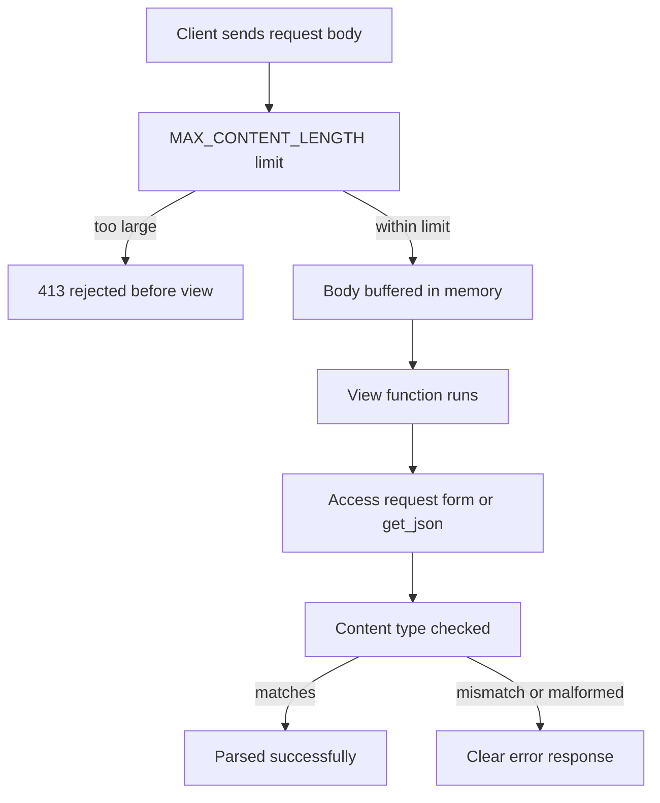

# Reading Request Bodies Safely: Size Limits, Parsing Order, and the JSON Trap

## English

By the time your view function runs, Flask has already done something consequential: it has read the request body off the socket and buffered it in memory (or spooled it to a temporary file past a threshold). This is convenient — you can call request.get_json() or request.form as many times as you like — but it means the body is already in your process before your code sees it. That has two consequences worth internalising: the cost of a large body is paid before any of your validation runs, and any code that touches request.form or request.get_json() triggers parsing, which can fail.

The first defence is a hard limit. Werkzeug enforces a maximum content length via a config setting (MAX_CONTENT_LENGTH), and requests exceeding it are rejected with a 413 response before your view is called. Set it deliberately, per route if needed, rather than leaving it unset. Without it, a client can stream gigabytes at you and your worker will happily allocate memory until the process dies. The limit is a blunt instrument — it caps the whole body — so file upload endpoints need a larger value than a JSON API endpoint.

The second subtlety is parsing order and content type. request.form only parses bodies with form content types; request.get_json() only parses JSON content types (and by default raises or returns None depending on how it's called). If a client sends JSON but labels it text/plain, get_json() will refuse — and that's correct behaviour, not a bug. The dangerous pattern is calling get_json() without handling the failure: malformed JSON raises an error that becomes a 400, which is fine, but if you call it inside a broad try/except you can end up with a confusing 500. Be explicit about what you expect and return a clear error when you don't get it.

A third trap is that reading the body twice is not free. Flask caches the parsed result, so repeated calls are cheap, but if you access the raw stream (request.stream or request.get_data()) and then try to parse, you may find the stream already consumed. The rule of thumb: pick one access pattern per endpoint and stick to it. If you need to verify a signature over the raw bytes (as webhook providers require), read the raw data first, verify, then parse the JSON from the bytes you already have — never the other way around.

Finally, remember that the body is untrusted input of unbounded shape. JSON can be deeply nested, enormous, or contain unexpected types. Validation libraries help, but the first line of defence is always: reject early on size and content type, parse once, and treat every field as hostile until proven otherwise.

## 中文

當你嘅 view 函數執行嗰陣，Flask 已經做咗一件有後果嘅事：佢已經由 socket 讀取請求主體，並緩衝喺記憶體（或者超過某個門檻就暫存去臨時檔案）。呢個好方便——你可以任意次呼叫 request.get_json() 或者 request.form——但即係話主體喺你嘅程式碼見到佢之前已經入咗你個 process。呢點有兩個值得記住嘅後果：大型主體嘅成本喺你任何驗證執行之前就已經付出咗，而同任何觸碰 request.form 或 request.get_json() 嘅程式碼都會觸發解析，而解析可以失敗。

第一道防線係硬性上限。Werkzeug 透過一個 config 設定（MAX_CONTENT_LENGTH）強制最大內容長度，超過嘅請求會喺你嘅 view 被呼叫之前就以 413 回應拒絕。要有意識咁設定佢，有需要時按路由設定，而唔係留空。冇咗佢，客戶端可以向你串流幾 GB 資料，你嘅工作者會開開心心咁分配記憶體直到 process 死亡。呢個上限係一把鈍刀——佢封頂整個主體——所以檔案上傳端點需要比 JSON API 端點更大嘅值。

第二個微妙之處係解析次序同內容類型。request.form 只會解析表單內容類型嘅主體；request.get_json() 只會解析 JSON 內容類型（而且視乎你點呼叫，預設會拋錯或者回傳 None）。如果客戶端送 JSON 但標籤做 text/plain，get_json() 會拒絕——而呢個係正確行為，唔係 bug。危險嘅模式係呼叫 get_json() 而唔處理失敗：格式錯誤嘅 JSON 會拋錯變成 400，呢個冇問題，但如果你喺一個寬泛嘅 try/except 入面呼叫佢，你可能會得到一個令人困惑嘅 500。要明確講出你預期乜嘢，收唔到嗰陣回傳清晰嘅錯誤。

第三個陷阱係讀取主體兩次唔係免費嘅。Flask 會快取解析結果，所以重複呼叫好便宜，但如果你存取原始串流（request.stream 或 request.get_data()）然後再嘗試解析，你可能會發現串流已經被消耗咗。經驗法則：每個端點揀一種存取模式並堅持落去。如果你需要對原始位元組驗證簽名（好似 webhook 供應商要求咁），先讀原始資料、驗證、然後由你已經有嘅位元組解析 JSON——永遠唔好倒轉次序。

最後，記住主體係形狀無上限嘅不可信輸入。JSON 可以深度嵌套、極巨大、或者包含預期之外嘅類型。驗證函式庫有幫助，但第一道防線永遠係：喺大小同內容類型上及早拒絕、只解析一次、並將每個欄位都當作敵意對待直到證明唔係。

## Key Takeaway

Flask buffers the body before your code runs, so your real defences are a deliberate size limit, a strict expectation about content type, and a single consistent parsing path per endpoint.

## Related Concepts
- MAX_CONTENT_LENGTH and 413 responses
- Webhook signature verification over raw bytes

## Diagram

