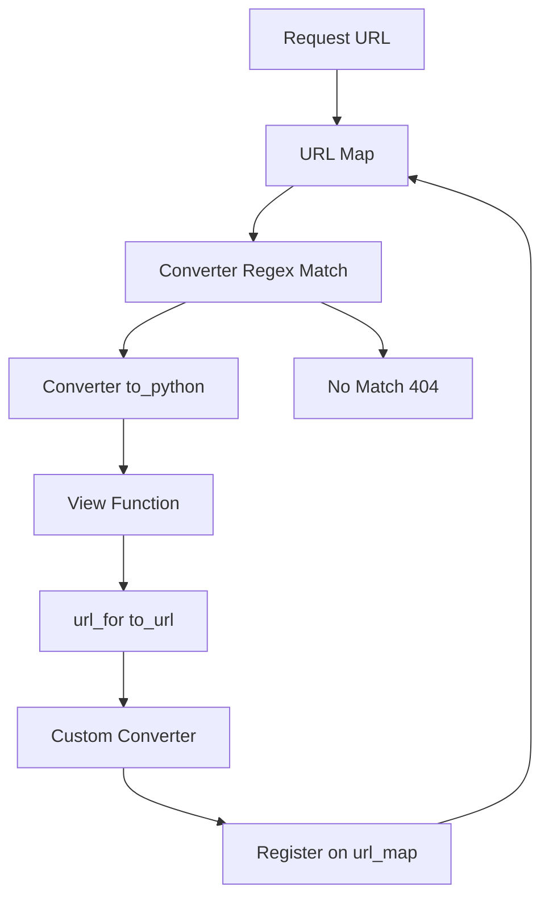

# Custom Converters and URL Matching Edge Cases

## English

Flask routes are not just strings with pointy brackets; the part inside the brackets is a converter name plus a variable name, and Flask ships a small set of built-in converters such as string, int, float, path, uuid and any. The string converter is the default and matches any text without a slash, while path is the same but allows slashes, which is why a route like /files/<path:name> can capture nested directories. The int converter does not merely accept digits; it converts the matched segment to a Python int before your view function sees it, so a route declared as /item/<int:item_id> will never hand you a string. This matters because type errors get pushed to the routing layer, where a non-matching URL becomes a 404 rather than a ValueError inside your handler.

The any converter is the one people forget. You can write /<any(about, contact, help):page> and Werkzeug will compile those literal alternatives into the URL rule, so only those three words match and everything else 404s. This is often cleaner than a catch-all string route with an if/elif ladder inside the view. Similarly, the uuid converter validates the canonical 8-4-4-4-12 hexadecimal shape, which means malformed IDs are rejected before your code runs. These converters are not magic; they are small classes registered on the URL map, and each one implements a regex fragment plus a to_python method that does the conversion.

You can write your own by subclassing BaseConverter from werkzeug.routing and registering it on the app's url_map. A common example is a date converter that matches YYYY-MM-DD and returns a datetime.date object. The converter class defines a regex attribute, a weight for ordering, and a to_python method; optionally a to_url method for reverse URL building with url_for. Registering it with app.url_map.converters['date'] = DateConverter makes <date:when> available everywhere, including inside blueprints, because blueprints share the application's URL map.

Matching order is a subtle trap. Werkzeug sorts rules by complexity, not by the order you declared them, and a static rule like /about will generally win over a dynamic /<page> even if the dynamic one was registered first. But when two dynamic rules overlap, such as /<int:id> and /<string:slug>, the int rule is considered more specific and is tried first, so /42 hits the int route. If you rely on declaration order you will eventually be surprised. The reliable mental model is: Werkzeug ranks rules by how constrained they are, and you should design routes so that ambiguity is impossible rather than hoping ordering saves you.

Finally, remember that the URL map is built when the application is created, not when a request arrives. Adding routes at runtime after the first request is possible but discouraged because the map may already be compiled and cached. If you find yourself wanting dynamic route registration per request, that is usually a sign you want a single catch-all route with explicit dispatch logic inside, or a blueprint registered conditionally at startup. Treat the URL map as a build artifact: define it once, inspect it with app.url_map when debugging, and keep converters small and pure.

## 中文

Flask 路由不只是一堆帶尖括號的字串；括號裡其實是「轉換器名稱 + 變數名稱」，而 Flask 內建了一小組轉換器，例如 string、int、float、path、uuid 和 any。string 是預設值，會匹配任何不含斜線的文字；path 也一樣，但允許斜線，所以像 /files/<path:name> 這種路由可以捕捉巢狀目錄。int 轉換器不只是接受數字；它會在檢視函式看到之前，就把匹配到的片段轉成 Python 的 int，所以宣告成 /item/<int:item_id> 的路由永遠不會丟字串給你。這一點很重要，因為型別錯誤被推到路由層：不匹配的 URL 會變成 404，而不是在你處理函式裡炸出 ValueError。

any 轉換器是最常被遺忘的一個。你可以寫 /<any(about, contact, help):page>，Werkzeug 會把這幾個字面選項編譯進 URL 規則，所以只有這三個字會匹配，其他一律 404。這通常比寫一個萬用字串路由、再在檢視裡用 if/elif 串接來得乾淨。同樣地，uuid 轉換器會驗證標準的 8-4-4-4-12 十六進位格式，代表格式錯誤的 ID 會在你的程式碼執行前就被拒絕。這些轉換器不是魔法；它們只是註冊在 URL map 上的小型類別，每個都實作一段正則片段，以及一個負責轉換的 to_python 方法。

你可以繼承 werkzeug.routing 的 BaseConverter 來寫自己的轉換器，並註冊到 app 的 url_map 上。常見例子是一個日期轉換器，匹配 YYYY-MM-DD 並回傳 datetime.date 物件。轉換器類別會定義 regex 屬性、用來排序的 weight，以及 to_python 方法；另外可選一個給 url_for 反向建 URL 用的 to_url 方法。用 app.url_map.converters['date'] = DateConverter 註冊之後，<date:when> 就到處都能用，包括 blueprint 裡面，因為 blueprint 共用應用程式的 URL map。

匹配順序是一個微妙的陷阱。Werkzeug 是依「複雜度」而非你宣告的順序來排序規則，像 /about 這種靜態規則通常會贏過 /<page> 這種動態規則，即使動態那條先註冊也一樣。但當兩條動態規則重疊時，例如 /<int:id> 和 /<string:slug>，int 規則被視為更具體、會先被嘗試，所以 /42 會命中 int 路由。如果你依賴宣告順序，早晚會踩雷。可靠的心智模型是：Werkzeug 依規則受限制的程度排序，而你應該把路由設計成根本不可能有歧義，而不是指望排序來救你。

最後，記住 URL map 是在應用程式建立時建好的，不是請求到達時。在第一次請求之後於執行期新增路由雖然可行，但不建議，因為 map 可能已經編譯並快取。如果你發現自己想在每個請求時動態註冊路由，那通常代表你真正想要的是一條萬用路由加上明確的分派邏輯，或者在啟動時有條件地註冊 blueprint。把 URL map 當成建置產物：一次定義好，除錯時用 app.url_map 檢視它，並讓轉換器保持小而純粹。

## Key Takeaway

Converters move validation and type conversion into the routing layer, and Werkzeug ranks rules by specificity rather than declaration order, so design routes to be unambiguous.

## Related Concepts
- Werkzeug routing converters
- URL map compilation

## Diagram

