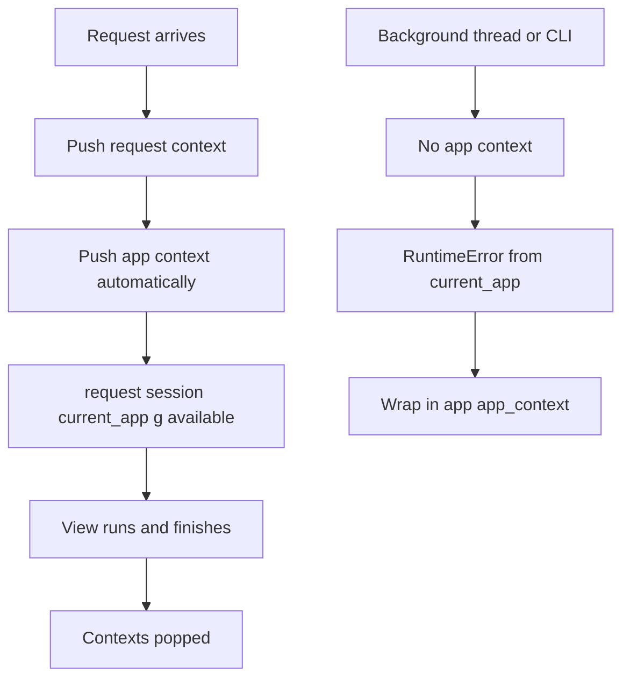

# Application vs Request Context: Why Some Code Fails Outside a Request

## English

Flask has two context objects, the application context and the request context, and understanding the difference explains a whole class of confusing errors. The application context binds current_app, which points at your Flask application object, and g, the per-context scratch space. The request context binds request and session, which describe the incoming HTTP call. When a request arrives, Flask pushes the request context, and pushing a request context automatically pushes an application context if one is not already active. That is why inside a view function you can freely touch request.args, session, current_app and g without passing anything around.

The trouble starts outside a request. Suppose you write a helper that reads a config value via current_app.config and call it from a background thread, a scheduled job, or a CLI command. If no application context is active, current_app raises a RuntimeError telling you to work inside an application context. The fix is to wrap the call in with app.app_context(): which pushes an application context for the duration of the block. This is exactly what Flask's CLI commands do for you, and why the @app.cli.command decorator gives you an app context automatically.

A subtler failure mode is a stale context. If you push an application context in one thread and another thread pushes a different one, the proxy objects resolve to different underlying objects per thread, because Flask stores the current context in a thread-local (and in newer versions, in a contextvars-based local that also isolates async tasks). This is why a long-lived background thread that captured current_app at startup may later see a different app, or none at all. The safe pattern is to capture the real object, not the proxy: store app = current_app._get_current_object() at the point where a context is definitely active, then use that reference in the thread.

Request contexts are even more fragile. The session object is only meaningful inside a request, because it is populated from and saved back to cookies at the request boundaries. Touching session outside a request context raises an error, and rightly so: there is no cookie to read. Similarly, url_for can build URLs without a request context only if you provide the necessary information, because it needs to know the host and scheme. Inside a request it can infer them from the request; outside, you must pass _external=True plus the server name in config, or accept relative URLs.

A useful diagnostic habit is to ask, for any line of code, which context is active here and who pushed it. View functions, before_request and after_request hooks, and error handlers all run inside a request context. Teardown functions run while the context is still available but about to be popped. Background tasks and threads run in whatever context you explicitly give them, which is usually none. Once you can answer that question, the RuntimeError messages stop being mysterious and start being signposts pointing at exactly the missing with block.

## 中文

Flask 有兩種 context 物件：application context 和 request context，搞懂它們的差別，就能解釋一整類令人困惑的錯誤。application context 繫結 current_app（指向你的 Flask 應用程式物件）以及 g（每個 context 的暫存空間）。request context 繫結 request 和 session，用來描述進來的 HTTP 呼叫。當請求到達時，Flask 會推入 request context，而推入 request context 時若還沒有作用中的 application context，會自動一併推入。這就是為什麼在檢視函式裡你可以自由取用 request.args、session、current_app 和 g，完全不用把它們傳來傳去。

麻煩從「請求之外」開始。假設你寫了一個透過 current_app.config 讀設定值的輔助函式，然後從背景執行緒、排程工作或 CLI 指令呼叫它。若沒有作用中的 application context，current_app 會丟出 RuntimeError，告訴你要在 application context 內工作。解法是用 with app.app_context(): 把呼叫包起來，這會在區塊期間推入一個 application context。Flask 的 CLI 指令就是幫你做這件事，也是為什麼 @app.cli.command 裝飾器會自動給你一個 app context。

更微妙的失敗模式是「過期的 context」。如果你在一個執行緒推入 application context，另一個執行緒又推入不同的 context，proxy 物件會依執行緒解析到不同的底層物件，因為 Flask 把目前的 context 存在 thread-local 裡（較新版本則存在基於 contextvars 的 local，也會隔離 async 任務）。這就是為什麼一個在啟動時捕捉了 current_app 的長壽背景執行緒，之後可能看到不同的 app，甚至完全沒有。安全的模式是捕捉真正的物件，而不是 proxy：在確定 context 作用中的地方存下 app = current_app._get_current_object()，然後在執行緒裡用那個參照。

request context 更脆弱。session 物件只有在請求內才有意義，因為它是在請求邊界從 cookie 載入、之後再寫回 cookie。在 request context 外碰 session 會報錯，而且理當如此：根本沒有 cookie 可讀。同樣地，url_for 只有在提供必要資訊時，才能在沒有 request context 的情況下建 URL，因為它需要知道 host 和 scheme。在請求內它可以從 request 推斷；在外面，你得傳 _external=True 並在設定裡提供 server name，否則就只能接受相對 URL。

一個有用的診斷習慣是：對任何一行程式碼，問「這裡哪個 context 是作用中的，是誰推入的？」檢視函式、before_request 和 after_request 勾子、錯誤處理器，全都在 request context 內執行。teardown 函式在 context 還可用但即將彈出時執行。背景任務和執行緒則在你明確給它們的 context 裡執行，通常什麼都沒有。一旦你能回答這個問題，RuntimeError 的訊息就不再神秘，而是路標，精準指向那個少寫的 with 區塊。

## Key Takeaway

Every confusing context error reduces to one question: which context is active on this line, and who pushed it?

## Related Concepts
- Context locals and proxy objects
- Application factory pattern

## Diagram

