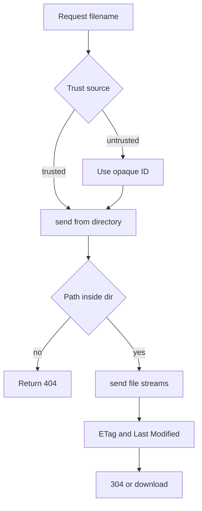

# Serving Files and Downloads Without Leaking Paths or Memory

## English

Sooner or later a Flask app has to hand a file to the browser, and the naive approach of reading the whole file into memory and returning it as a response body works in development and fails in production. The built-in send_file function exists precisely to avoid that. Given a filesystem path, it opens the file and returns a response whose body is streamed in chunks, sets a sensible Content-Type from the file extension, adds Content-Length, and supports conditional requests via ETag and Last-Modified headers so a browser can revalidate with If-None-Match and get a cheap 304 Not Modified. That last part is not optional polish; it is the difference between a photo gallery that reloads every image on every visit and one that does not.

The dangerous part is the path. If a route accepts a filename from the URL and passes it straight to send_file, an attacker can request ../../etc/passwd or an encoded variant, and you have a path traversal vulnerability. Flask's send_from_directory is the safer companion: you give it a directory and a filename, and it joins them and verifies the result stays inside the directory, raising a 404 if the resolved path escapes. Even then, you should not trust arbitrary filenames from users. A robust pattern is to store files under opaque identifiers you generate, keep the original name in a database column, and serve by ID, so the URL never contains a filesystem path at all.

There is a second subtlety: Content-Disposition. When you want the browser to download rather than display, pass as_attachment=True and optionally a download_name. The download name is encoded according to RFC 6266, and non-ASCII filenames need care because older clients mishandle raw UTF-8 in the header. Flask handles the common cases, but if your users have Chinese or Arabic filenames you should test in a real browser rather than trusting curl output. Also decide deliberately whether the file should be inline (rendered by the browser, useful for PDFs and images) or attachment (forced download), because the wrong choice is a usability bug at best and an XSS vector at worst if the browser sniffs a user-uploaded HTML file as a document.

For files generated on the fly, such as a CSV export or a PDF report, you do not need a file on disk. You can wrap a generator in a Response with the right mimetype and let Werkzeug stream it. The catch is that streaming responses interact badly with some middleware and with error handling: once the first byte is sent, you cannot change the status code or headers, so any exception raised mid-stream produces a truncated body rather than a clean 500. If your generator can fail, either build the whole payload first when it is small, or design the format so a truncated stream is detectable by the client.

Finally, think about who is allowed to fetch a file. A URL that is hard to guess is not authorization. If files are private, the route must check the session or token before calling send_file, and that check must happen before any headers are written. Combine that with sensible caching headers: private files should not be cached by shared proxies, so set Cache-Control to private or no-store, while public static assets benefit from long max-age with fingerprinted filenames. File serving looks trivial, but it quietly touches security, memory, HTTP semantics and caching all at once.

## 中文

Flask 應用程式遲早要送檔案給瀏覽器，而最天真的做法——把整個檔案讀進記憶體、當作回應主體回傳——在開發環境能用，在正式環境會掛掉。內建的 send_file 正是為了避免這件事。給它一個檔案系統路徑，它會開啟檔案並回傳一個主體以區塊串流送出、依副檔名設定合理的 Content-Type、加上 Content-Length，並透過 ETag 和 Last-Modified 標頭支援條件式請求，讓瀏覽器可以用 If-None-Match 重新驗證並拿到便宜的 304 Not Modified。這不是可有可無的加分項；這是「每次造訪都重新載入所有圖片的相簿」和「不會」之間的差別。

危險的部分是路徑。如果路由從 URL 接受檔名並直接丟給 send_file，攻擊者可以請求 ../../etc/passwd 或其編碼變體，你就有了路徑穿越漏洞。Flask 的 send_from_directory 是更安全的夥伴：你給它一個目錄和一個檔名，它會把它們接起來並確認結果仍在那個目錄內，若解析後的路徑逃出去就回 404。即使如此，你還是不該信任使用者給的任意檔名。穩健的模式是把檔案存在你自己產生的不透明識別碼底下，把原始檔名存在資料庫欄位，並用 ID 來提供檔案，這樣 URL 裡根本不會出現檔案系統路徑。

還有第二個微妙之處：Content-Disposition。當你要瀏覽器下載而不是顯示時，傳 as_attachment=True，並可選擇性傳 download_name。下載名稱依 RFC 6266 編碼，而非 ASCII 檔名需要小心，因為較舊的客戶端會錯誤處理標頭裡的原始 UTF-8。Flask 處理了常見情況，但如果你的使用者有中文或阿拉伯文檔名，你應該在真實瀏覽器裡測試，而不是相信 curl 的輸出。另外要刻意決定檔案該是 inline（由瀏覽器呈現，對 PDF 和圖片有用）還是 attachment（強制下載），因為選錯輕則是可用性問題，重則若瀏覽器把使用者上傳的 HTML 檔嗅探成文件，就變成 XSS 途徑。

對於即時產生的檔案，例如 CSV 匯出或 PDF 報告，你不需要磁碟上的檔案。你可以把生成器包進 Response，設好正確的 mimetype，讓 Werkzeug 串流它。陷阱是串流回應和一些中介軟體及錯誤處理互動不良：一旦送出第一個位元組，你就不能改狀態碼或標頭，所以串流中途丟出的例外只會產生被截斷的主體，而不是乾淨的 500。如果你的生成器可能失敗，要嘛在資料量小時先組好完整內容，要嘛設計格式讓客戶端能偵測到串流被截斷。

最後，想想誰有權取得檔案。難以猜測的 URL 不是授權。如果檔案是私有的，路由必須在呼叫 send_file 之前檢查 session 或 token，而且那個檢查必須在任何標頭寫出之前發生。再搭配合理的快取標頭：私有檔案不該被共享代理快取，所以把 Cache-Control 設成 private 或 no-store，而公開的靜態資源則受益於長 max-age 加上帶指紋的檔名。檔案服務看起來微不足道，但它同時悄悄牽涉到安全、記憶體、HTTP 語意和快取。

## Key Takeaway

Use send_from_directory and opaque IDs instead of raw paths, and remember that once a streamed response starts, you can no longer change its status or headers.

## Related Concepts
- Path traversal prevention
- Conditional GET and ETags

## Diagram

