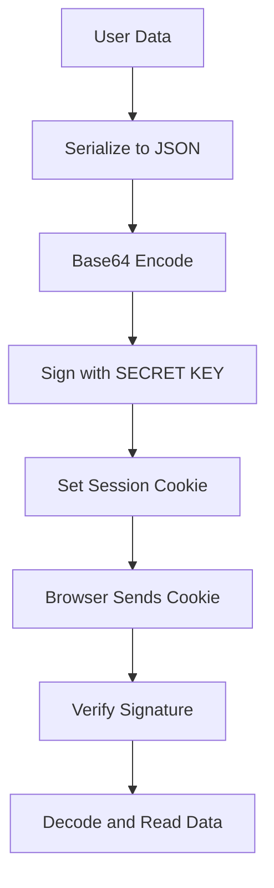

# The Session Cookie Is Signed, Not Encrypted

## English

Flask's default client-side session stores its data in a cookie named `session`, and it protects that data with a cryptographic signature produced by itsdangerous using the app's `SECRET_KEY`. The crucial point students miss: signing proves integrity, not confidentiality. The payload is base64-encoded, not encrypted, so anyone who opens browser developer tools can read the whole thing. If you put a user's role or a discount flag in the session, a curious user can decode it and learn exactly what your server thinks about them.

The signature does its real job by making tampering detectable. When a request arrives, Flask re-computes the signature over the cookie's payload using `SECRET_KEY` and compares it with the one attached. Change a single byte and the comparison fails, so Flask discards the cookie and hands your code an empty session. That is why the `SECRET_KEY` must be long, random, and secret: anyone holding it can mint valid sessions for any user, which is equivalent to forging login state.

A practical consequence is size. Browsers commonly cap a single cookie around 4 KB, and the signature plus base64 expansion eats into that budget. Sessions holding a few IDs are fine; sessions holding a shopping cart with fifty items are not. When data grows, the usual answer is a server-side session — store a random session ID in the signed cookie and keep the actual data in Redis or your database — so the cookie stays tiny and revocation becomes possible.

Another subtlety is that the cookie is sent on every request to the domain, so it travels over the wire constantly. Mark it `HttpOnly` so JavaScript cannot read it, `Secure` so it only goes over HTTPS, and consider `SameSite` to reduce cross-site request forgery exposure. None of these flags make the contents secret; they only limit who can send and read the cookie.

Finally, remember that client-side sessions cannot be invalidated server-side without extra machinery. Logging a user out by clearing the cookie works for that browser, but a copy of the old cookie still validates until it expires or the `SECRET_KEY` rotates. For high-stakes state like password reset tokens or admin flags, keep the truth on the server and use the session only as a pointer.

## 中文

Flask 預設的使用者端 session 會把資料存在一個名為 `session` 的 cookie 裡，並用 itsdangerous 配合應用程式的 `SECRET_KEY` 產生密碼學簽章來保護它。學生最常忽略的重點是：簽章證明的是完整性，不是機密性。內容只是 base64 編碼，並非加密，所以任何人開啟瀏覽器開發者工具就能讀到全部內容。如果你把使用者的角色或折扣旗標放進 session，好奇的使用者可以解碼，確切知道你伺服器對他抱持什麼看法。

簽章真正的作用是讓竄改可被偵測。請求到達時，Flask 會用 `SECRET_KEY` 對 cookie 的內容重新計算簽章，再與附加的那個比對。只要改動任何一個位元組，比對就會失敗，Flask 便丟棄該 cookie，交給你的程式碼一個空的 session。這就是為何 `SECRET_KEY` 必須夠長、隨機且保密：任何持有它的人都能為任何使用者簽出有效 session，等同於偽造登入狀態。

實務上的後果是大小。瀏覽器一般把單一 cookie 限制在約 4 KB，而簽章加上 base64 膨脹會吃掉這份額度。只放幾個 ID 的 session 沒問題；放五十件商品的購物車就不行。當資料變大，常見做法是伺服器端 session——在簽章 cookie 裡只放隨機 session ID，真正的資料放在 Redis 或資料庫——這樣 cookie 保持精簡，也才有可能撤銷。

另一個微妙之處是 cookie 會隨每個送往該網域的請求一起送出，所以它無時無刻都在網路上傳輸。把它標成 `HttpOnly` 讓 JavaScript 讀不到，標成 `Secure` 讓它只走 HTTPS，並考慮 `SameSite` 以降低跨站請求偽造的風險。這些旗標都不會讓內容變成秘密，只是限制誰能送出與讀取這個 cookie。

最後要記得，使用者端 session 若沒有額外機制，就無法在伺服器端作廢。清除 cookie 來登出只對那個瀏覽器有效，但舊 cookie 的副本在到期或 `SECRET_KEY` 輪替之前仍然驗證得過。對於密碼重設權杖或管理員旗標這類高風險狀態，把真相留在伺服器端，session 只當作指向它的指標。

## Key Takeaway

A Flask session cookie is signed for integrity but merely base64-encoded, so never store secrets in it and guard the SECRET_KEY like a password.

## Related Concepts
- itsdangerous signing
- server-side session stores

## Diagram

