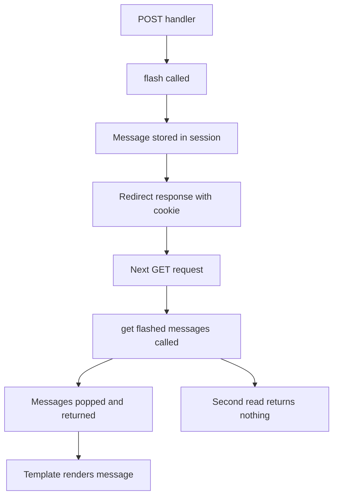

# Flash Messages: The One-Request-Only Mailbox

## English

The `flash()` function solves a small but recurring problem: you handle a POST, redirect to a GET page, and want to tell the user "your changes were saved" — but the message must survive exactly one redirect and then vanish. Flask implements this by stashing messages in the session under a private key, then popping them out the next time a template calls `get_flashed_messages()`. That pop is the whole trick: reading the messages removes them.

Because it rides on the session, the flash mechanism inherits the session's storage model. With the default client-side session, the message is serialized into the signed cookie, sent back to the browser in the redirect response, and returned on the next request. That means flash text counts against the 4 KB cookie budget, and very long messages or many queued flashes can silently break the cookie. It also means flash messages are visible to the user if they decode the cookie — fine for "Saved!", bad for anything sensitive.

The ordering has a subtlety worth knowing. Messages accumulate in a list in the order they were flashed, and `get_flashed_messages()` returns them in that order by default; passing `with_categories=True` returns tuples of category and message so templates can style success versus error differently. Categories are just strings you choose, typically matched to CSS classes.

A classic bug is calling `get_flashed_messages()` in a place that runs before the redirect target renders — for example inside a base template that is included twice, or in an error handler. Since reading consumes the messages, the second read returns nothing and the user sees no feedback at all. The fix is to read once, assign to a template variable, and render from that.

Finally, flash messages are not a notification system. They are per-browser, per-session, and disappear on the next read, so they cannot deliver messages to a user on another device or survive a page reload after consumption. For anything durable, store notifications in the database and query them; use flash only for the immediate "that worked" or "that failed" feedback right after a redirect.

## 中文

`flash()` 函式解決一個小而常見的問題：你處理完 POST、重新導向到某個 GET 頁面，想告訴使用者「你的變更已儲存」——但這則訊息必須剛好撐過一次重新導向然後消失。Flask 的做法是把訊息塞進 session 裡一個私有鍵之下，等下一次樣板呼叫 `get_flashed_messages()` 時再把它們彈出來。彈出就是整個訣竅：讀取訊息就會移除訊息。

因為它依附在 session 上，flash 機制繼承了 session 的儲存模型。使用預設的使用者端 session 時，訊息會被序列化進簽章 cookie，隨著重新導向的回應送回瀏覽器，並在下一次請求時帶回來。這表示 flash 文字會佔用 4 KB 的 cookie 額度，過長的訊息或太多排隊中的 flash 可能悄悄弄壞 cookie。這也表示使用者若解碼 cookie 就能看到 flash 訊息——對「已儲存！」沒問題，對任何敏感內容就不妙了。

順序有個值得知道的微妙之處。訊息會依 flash 的順序累積在一個清單裡，`get_flashed_messages()` 預設就照這個順序回傳；傳入 `with_categories=True` 則回傳類別與訊息的元組，讓樣板能分別為成功與錯誤加上不同樣式。類別只是你自己選的字串，通常對應到 CSS class。

典型錯誤是在重新導向目標算繪之前就呼叫 `get_flashed_messages()`——例如在一個被 include 兩次的基底樣板裡，或在錯誤處理常式中。由於讀取會消耗訊息，第二次讀取什麼都拿不到，使用者就完全看不到回饋。解法是隻讀一次、指定給樣板變數，再從那裡算繪。

最後，flash 訊息不是通知系統。它們是每個瀏覽器、每個 session 各自的，而且下一次讀取就消失，所以無法把訊息送到使用者的另一臺裝置，也無法在被消耗後撐過一次頁面重新載入。任何需要持久的東西，請把通知存進資料庫再查詢；flash 只用在重新導向後立刻的「成功了」或「失敗了」這類即時回饋。

## Key Takeaway

Flash messages are a consume-once mailbox stored in the session, so read them exactly once and keep them short and non-sensitive.

## Related Concepts
- post-redirect-get pattern
- Jinja2 template inheritance

## Diagram

