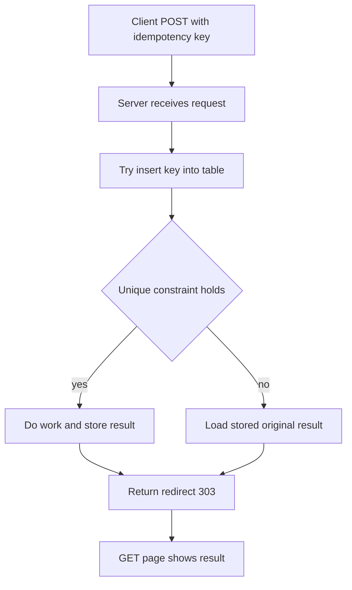

# Rate-Limiting by Design: Idempotent Retries and the Double-Submit Problem

## English

A browser refresh after a form POST is the most common way users accidentally submit data twice. The pattern that prevents this is called Post/Redirect/Get: the POST handler does its work, then returns a redirect (typically 302 or 303) to a GET page that shows the result. Because the browser's address bar now holds a GET URL, pressing refresh re-fetches the page instead of re-posting the form. Flask makes this easy — just return `redirect(url_for(...))` — but the discipline is on you.

Even with PRG, networks and users produce duplicates: a mobile client times out and retries, a load balancer replays a request, a user double-clicks a button before the first response lands. The robust answer is idempotency: make the operation safe to repeat. For a payment or order creation, this usually means the client generates a unique key (a UUID) and sends it with the request; the server records the key alongside the result and, on a repeat with the same key, returns the original result instead of doing the work again. This is the same idea as an idempotency key in many payment APIs.

In Flask, the implementation is straightforward: accept the key as a header or form field, look it up in a table with a unique constraint, and use the database's uniqueness enforcement to reject the second writer. If you try to insert a duplicate key, the database raises an integrity error, and you can catch it and return the stored response. This works because the check-and-insert is atomic at the database level, unlike a Python-level check-then-insert which races under concurrency.

A related trap is the double-submit on the client side. Disabling a button with JavaScript is a courtesy, not a guarantee — scripts can be bypassed or fail to run. Server-side protection is the only real defense, and it comes in two flavors: idempotency keys for state-changing operations, and CSRF tokens for verifying that the request came from your own page. Flask-WTF's CSRF protection handles the second; the first is your design responsibility.

Finally, note that GET requests should already be safe and idempotent by HTTP semantics. If your GET handler creates a record, writes a file, or sends an email, you have broken the contract and every crawler, prefetcher, or link preview will trigger side effects. Keep state changes on POST, PUT, PATCH, and DELETE, and reserve GET for reading.

## 中文

表單 POST 之後瀏覽器重新整理，是使用者不小心重複送出資料最常見的方式。防止這件事的模式叫 Post/Redirect/Get：POST 處理常式做完工作後，回傳一個重新導向（通常是 302 或 303）到顯示結果的 GET 頁面。因為瀏覽器網址列現在是 GET 網址，按重新整理會重新抓取頁面，而不是重新送出表單。Flask 讓這件事很簡單——只要回傳 `redirect(url_for(...))`——但這份紀律得由你維持。

即使有 PRG，網路與使用者仍會製造重複：行動使用者端逾時後重試、負載平衡器重播請求、使用者在第一個回應到達前連點按鈕。穩健的答案是冪等性：讓操作可以安全地重複執行。對於付款或建立訂單，這通常表示使用者端產生一個唯一鍵（UUID）隨請求送出；伺服器把該鍵與結果一起記錄，遇到同一個鍵的重複請求時，回傳原本的結果，而不是再做一次工作。這和許多付款 API 的冪等鍵是同一個概念。

在 Flask 裡實作很直接：從標頭或表單欄位接受這個鍵，在有唯一約束的資料表裡查它，並用資料庫的唯一性強制來擋掉第二個寫入者。若你嘗試插入重複的鍵，資料庫會丟擲完整性錯誤，你可以攔截它並回傳已儲存的回應。這之所以可行，是因為檢查加插入在資料庫層是原子的，不像 Python 層的「先查再插」在併發下會產生競態。

相關的陷阱是使用者端的重複送出。用 JavaScript 停用按鈕只是禮貌，不是保證——指令碼可以被繞過或根本沒執行。伺服器端防護才是唯一真正的防線，它有兩種形式：針對會改變狀態的操作使用冪等鍵，以及用 CSRF 權杖確認請求來自你自己的頁面。Flask-WTF 的 CSRF 防護負責後者；前者是你的設計責任。

最後要注意，依 HTTP 語意，GET 請求本來就應該是安全且冪等的。如果你的 GET 處理常式會建立記錄、寫檔案或寄信，你就破壞了契約，每個爬蟲、預取器或連結預覽都會觸發副作用。把狀態變更留在 POST、PUT、PATCH 與 DELETE，GET 只保留給讀取。

## Key Takeaway

Use Post/Redirect/Get to stop refresh-resubmits, and idempotency keys enforced by a database unique constraint to survive retries.

## Related Concepts
- HTTP idempotency semantics
- CSRF tokens

## Diagram

