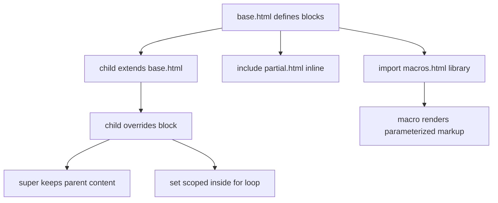

# Template Inheritance and Jinja2's Block/Include/Macro Toolkit

## English

Jinja2, the template engine Flask ships with, is not a string-formatting toy — it is a small language with its own control flow, scoping rules, and composition primitives. The most important of these is template inheritance: a base template declares named blocks with , and a child template writes  at the top and then overrides only the blocks it cares about. This gives you the classic layout pattern — one base.html holding the doctype, <head>, navigation, and footer, with every page filling in a content block. Because the child can call {{ super() }} inside an overridden block, you can extend a parent's block rather than replace it outright, which is how you add one extra <script> tag to a single page without duplicating the whole head.

Beyond inheritance, Jinja2 offers three other composition tools that solve different problems.  drops another template's rendered output inline — useful for a reusable widget like a comment form that needs no parameters beyond the current context.  pulls in a library of  definitions, which are essentially parameterised functions that return markup; a macro like forms.input(name, label) can standardise how every form field is rendered, and  lets the macro see the template context if it needs request data. Finally,  is single-inheritance only — a template cannot extend two parents — so deep hierarchies are usually a smell, and composition via include and macros is often cleaner than five levels of extends.

Scoping is where newcomers get burned. Variables set with  inside a  loop are not visible after the loop ends, because Jinja2 treats loop bodies as their own scope. To accumulate across iterations you either use the namespace object ( then ns.total = ns.total + item) or compute the value in Python and pass it in. Similarly, the special loop variable inside a for loop exposes loop.index (1-based), loop.index0 (0-based), loop.first, loop.last, and loop.cycle('odd', 'even') — small conveniences that eliminate most of the conditional logic you would otherwise write in the template.

Autoescaping is on by default for .html templates in Flask, which means {{ user_input }} is HTML-escaped and safe against injection. The escape hatch is the |safe filter, and every use of it is a promise that the value is trusted. The correct pattern is to escape at the boundary: if you must emit HTML, build it with markupsafe.Markup in Python or use the |e filter explicitly, and never concatenate user data into a string you then mark safe. Jinja2 also has a sandboxed mode (jinja2.sandbox.SandboxedEnvironment) that blocks attribute access to dunder names, which matters if you ever let users supply templates themselves.

Performance and debugging round this out. Jinja2 compiles templates to Python bytecode and caches them; in development the auto-reloader clears that cache when files change, but in production you control it via the environment's cache settings. When a template raises, Flask's debug page shows the exact template line, and the undefined value behaviour is configurable — the default Undefined silently renders as empty string, while StrictUndefined raises on any missing variable, which is invaluable for catching typos in large templates. A common production setting is to keep the default but add a custom error handler or a linter pass that flags undefined variables at build time.

## 中文

Jinja2 係 Flask 內置嘅模板引擎，佢唔係單純嘅字串格式化玩具——佢係一門有自己控制流、作用域規則同組合原語嘅小型語言。當中最重要的係模板繼承：base template 用  宣告具名區塊，child template 喺頂部寫 ，然後只覆寫自己關心嘅區塊。呢個就係經典 layout 模式——一個 base.html 裝住 doctype、<head>、導覽同 footer，每個頁面只填 content 區塊。因為 child 可以喺覆寫嘅區塊內呼叫 {{ super() }}，你可以擴充父區塊而唔係完全取代佢，咁就可以喺單一頁面加多一個 <script> tag，而唔使複製成個 head。

除咗繼承，Jinja2 仲有三種組合工具解決唔同問題。 會將另一個模板嘅渲染結果直接嵌入——適合用喺唔需要額外參數、只靠當前 context 嘅可重用 widget，例如留言表單。 會引入一組  定義，macro 本質上係回傳標記嘅參數化函數；好似 forms.input(name, label) 呢類 macro 可以統一每個表單欄位嘅渲染方式，而  就喺 macro 需要 request 資料時讓佢睇到模板 context。最後， 只支援單一繼承——一個模板唔可以同時 extend 兩個父模板——所以太深嘅繼承層級通常係壞味道，用 include 同 macro 組合往往比五層 extends 更清晰。

作用域係新手最易中招嘅地方。喺  迴圈內用  設定嘅變數，迴圈結束後係睇唔到嘅，因為 Jinja2 將迴圈主體當成獨立作用域。要跨迭代累加，你要麼用 namespace 物件（ 然後 ns.total = ns.total + item），要麼喺 Python 計好再傳入。同樣，for 迴圈內嘅特殊 loop 變數提供 loop.index（由 1 開始）、loop.index0（由 0 開始）、loop.first、loop.last 同 loop.cycle('odd', 'even')——呢啲小便利可以消除大部分你原本要喺模板寫嘅條件邏輯。

喺 Flask 入面，.html 模板預設開啟 autoescaping，即係 {{ user_input }} 會被 HTML 轉義，可防注入。逃生門係 |safe filter，而每次用佢都係一個承諾：呢個值係可信嘅。正確做法係喺邊界轉義：如果真係要輸出 HTML，喺 Python 用 markupsafe.Markup 建立，或者明確用 |e filter，千萬唔好將用戶資料串接成字串再標記為 safe。Jinja2 亦有沙盒模式（jinja2.sandbox.SandboxedEnvironment），會封鎖對 dunder 名稱嘅屬性存取，如果你曾經讓用戶自己提供模板，呢點就好重要。

效能同除錯係最後一塊。Jinja2 會將模板編譯成 Python bytecode 並快取；開發時 auto-reloader 會喺檔案變更時清除快取，但生產環境你就要透過 environment 嘅 cache 設定控制。當模板拋錯，Flask 嘅 debug page 會顯示確切嘅模板行號，而未定義值嘅行為係可配置嘅——預設 Undefined 會靜靜渲染成空字串，而 StrictUndefined 會喺任何缺失變數時拋錯，對於喺大型模板捕捉打錯字極有價值。常見嘅生產設定係保留預設值，但加自訂錯誤處理器，或者喺建置時跑一次 linter 標記未定義變數。

## Key Takeaway

Jinja2 is a composition language: use extends for layout, include and macros for reuse, and remember that loop bodies have their own scope and that |safe is a security promise, not a formatting convenience.

## Related Concepts
- Autoescaping and XSS Defence
- Template Caching and Compilation

## Diagram

