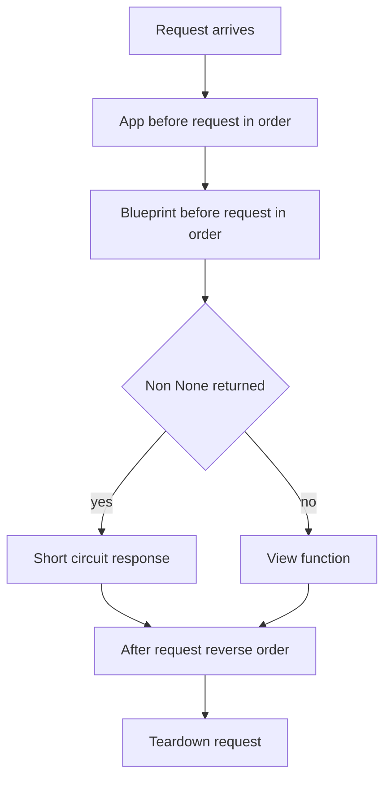

# Request Hooks in Depth: before_request, after_request, and teardown_request Ordering

## English

Flask exposes four request-scoped hook decorators, and their names hide a precise ordering contract that matters the moment you have more than one of them. before_request functions run in registration order, before the view function, and the first one that returns a non-None value short-circuits the rest — the returned value becomes the response and no view runs. This is the canonical place for authentication checks, opening a database connection, or loading the current user into g. If you register three before_request handlers in a blueprint and two at the app level, the app-level ones run first, then the blueprint's, each in their own registration order, because blueprint hooks are registered when the blueprint is registered on the app.

after_request functions run in reverse registration order — last registered, first executed — and they receive the response object. Crucially, they run for every response, including ones produced by a short-circuited before_request or by an error handler, so they are the right place to add headers (security headers, cache-control, a request ID echoed back) or to log the final status code. Because they run in reverse order, an after_request registered early at app level will run after a blueprint's after_request, which is usually what you want: app-wide concerns wrap the more specific ones. If an after_request handler raises, Flask logs it and the original response is still returned, which is a deliberate design choice — a broken logging hook should not take down the request.

teardown_request runs after the response has been sent, regardless of whether an exception occurred, and it receives the exception object (or None). This is where you release resources: close the database session, return a connection to the pool, clear a thread-local. The important subtlety is that teardown functions are guaranteed to run even when the view raised, which is why resource cleanup belongs here rather than in after_request. There is also teardown_appcontext, which fires when the application context is popped rather than the request context — relevant when you push an app context manually outside a request (for example, in a CLI command or a background thread) and still need cleanup.

The order in full, for a normal successful request, is: request context pushed, before_request handlers (app then blueprint, registration order), view function, after_request handlers (reverse registration order), response sent, teardown_request handlers (in registration order), request context popped. When an exception escapes the view, Flask first looks for an error handler, then runs after_request on the resulting response, then teardown_request with the exception. If the exception happens in a before_request handler, the view never runs and after_request still fires on whatever response the error handler produced. Knowing this sequence turns 'why is my header missing' into a five-second answer instead of an afternoon of print statements.

Two practical traps follow. First, hooks are per-app or per-blueprint, not per-route: you cannot say 'run this before_request only for /admin'. The usual patterns are to check request.endpoint or request.blueprint inside the hook and return early, or to register the hook on a dedicated blueprint so it only applies to that blueprint's routes. Second, before_request returning None means 'continue', and returning anything else — even an empty string — means 'stop and use this as the response'. An accidental return of a falsy-but-not-None value like 0 or '' will silently short-circuit your request, which is a classic bug when a helper function is called without a return statement in the wrong branch.

## 中文

Flask 提供四個 request-scoped 嘅 hook 裝飾器，而佢哋嘅名隱藏住一套精確嘅執行順序契約，一旦你有多過一個 hook 就會變得重要。before_request 函數按註冊順序執行，喺 view function 之前，而第一個回傳非 None 值嘅會短路其餘嘅——回傳值就成為 response，view 唔會執行。呢度係做認證檢查、開啟資料庫連線，或者將當前用戶載入 g 嘅標準位置。如果你喺 blueprint 註冊三個 before_request handler，喺 app 層註冊兩個，app 層嘅會先跑，然後係 blueprint 嘅，各自按自己嘅註冊順序，因為 blueprint hook 係喺 blueprint 註冊到 app 時先註冊嘅。

after_request 函數按相反嘅註冊順序執行——最後註冊，最先執行——並且接收 response 物件。關鍵係，佢哋對每個 response 都會執行，包括由短路嘅 before_request 或錯誤處理器產生嘅 response，所以佢哋係加 header（安全 header、cache-control、回傳 request ID）或者記錄最終 status code 嘅正確位置。因為佢哋按相反順序執行，早喺 app 層註冊嘅 after_request 會喺 blueprint 嘅 after_request 之後跑，呢個通常就係你想要嘅：app 層關注點包住更具體嘅關注點。如果 after_request handler 拋錯，Flask 會記錄佢，而原本嘅 response 仍然會回傳，呢個係刻意嘅設計選擇——一個壞咗嘅 logging hook 唔應該拖垮成個 request。

teardown_request 喺 response 送出之後執行，無論有冇發生異常，並且接收異常物件（或者 None）。呢度係釋放資源嘅地方：關閉資料庫 session、將連線歸還連線池、清除 thread-local。重要嘅微妙之處係，即使 view 拋錯，teardown 函數都保證會執行，所以資源清理應該放喺呢度而唔係 after_request。仲有 teardown_appcontext，佢喺 application context 被彈出時觸發，而唔係 request context——當你喺 request 之外手動 push 一個 app context（例如喺 CLI 命令或者背景執行緒），但仍然需要清理時就相關。

完整順序，對於一個正常成功嘅 request 係：push request context、before_request handler（app 然後 blueprint，註冊順序）、view function、after_request handler（相反註冊順序）、送出 response、teardown_request handler（註冊順序）、彈出 request context。當異常逃出 view，Flask 會先搵錯誤處理器，然後喺產生嘅 response 上執行 after_request，再以異常執行 teardown_request。如果異常喺 before_request handler 發生，view 永遠唔會執行，而 after_request 仍然會喺錯誤處理器產生嘅 response 上觸發。知道呢個序列，可以將「點解我個 header 唔見咗」由一個下午嘅 print 語句變成五秒鐘嘅答案。

跟住有兩個實際陷阱。第一，hook 係 per-app 或 per-blueprint，而唔係 per-route：你唔可以話「只喺 /admin 之前執行呢個 before_request」。常見模式係喺 hook 內檢查 request.endpoint 或 request.blueprint 然後提早 return，或者將 hook 註冊喺專屬 blueprint 上，令佢只適用於該 blueprint 嘅路由。第二，before_request 回傳 None 代表「繼續」，回傳任何其他嘢——即使係空字串——代表「停止並用呢個做 response」。意外回傳一個 falsy 但唔係 None 嘅值，好似 0 或者 ''，會靜靜咁短路你嘅 request，呢個係經典 bug：喺錯誤分支呼叫 helper 函數但冇 return 語句。

## Key Takeaway

Hooks run in a strict, documented order (before in registration order, after in reverse, teardown always) and are scoped per-app or per-blueprint, so use request.endpoint checks or dedicated blueprints to target specific routes.

## Related Concepts
- Short-Circuiting Requests
- Resource Cleanup and Connection Pools

## Diagram

