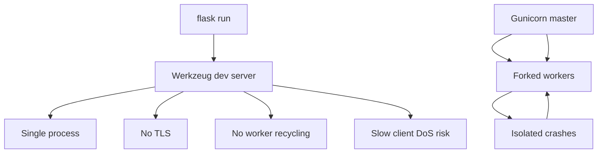

# The Development Server Is Not a Web Server: Why flask run Is Only for Your Laptop

## English

When you type flask run, Flask starts Werkzeug's built-in development server. It is a single-process, threaded-by-default HTTP server written in pure Python, and it is explicitly documented as unsuitable for production. The reasons are concrete rather than snobbish. It has no TLS support of its own, so serving HTTPS means putting something in front of it anyway. It has no graceful restart, no worker management, and no protection against slow clients — a single connection that dribbles bytes slowly can hold a thread for a long time, and with a bounded thread pool that is a denial-of-service vector. It also does not handle process crashes or memory leaks by recycling workers, which is exactly what production WSGI servers do.

The production answer is a WSGI server such as Gunicorn or uWSGI, which sit between your Flask application object and the network. Gunicorn uses a pre-fork model: a master process binds the socket and forks worker processes, each of which imports your app and handles requests independently. Because each worker is a separate OS process, a crash in one does not take down the others, and the master can restart it. The classic worker-count rule of thumb (roughly twice the CPU cores plus one) is a starting point for sync workers handling CPU-bound or mixed workloads; for I/O-bound apps, threaded workers or an async worker class (with the appropriate Flask async support) often scale better, and the right number is always determined by measurement, not folklore.

A frequent source of confusion is that the development server and the production server disagree about how the app is loaded. flask run locates the app via the FLASK_APP environment variable or the auto-discovery of app.py or wsgi.py, and it respects --debug and --reload flags. Gunicorn, by contrast, takes a module path in the form module:callable, for example myproject.app:create_app(), where the parentheses invoke an application factory. This is why application factories pair so naturally with Gunicorn: the factory is called once per worker at startup, giving each worker its own app instance and its own configuration, which avoids shared mutable state across processes. If your app object is created at import time instead, every worker still gets its own copy because of the fork, but the factory pattern makes the lifecycle explicit.

Behind Gunicorn you almost always find a reverse proxy such as Nginx. Nginx terminates TLS, serves static files directly from disk without touching Python, buffers slow client uploads so your workers are not held hostage, applies gzip and caching headers, and forwards requests to Gunicorn over a local socket or loopback port. This layering is why ProxyFix matters: when Nginx forwards a request, the client's real IP is in X-Forwarded-For and the scheme is in X-Forwarded-Proto, and Flask will otherwise report the proxy's address and http as the client's. ProxyFix is a WSGI middleware that rewrites the environ based on those headers — but only trust it when you control the proxy, because a client can forge those headers if requests reach your app directly.

Finally, the development server's conveniences are also production hazards. The auto-reloader watches files and restarts the process, which is wasteful and racy under load. The interactive debugger, when debug mode is on and an exception occurs, serves a web console that can execute arbitrary Python — it is guarded by a PIN, but the PIN is derived from machine-specific values and should never be exposed on a network you do not fully control. The correct production posture is debug off, reloader off, a real WSGI server, a reverse proxy for TLS and static files, and process supervision (systemd, a container orchestrator, or the server's own master process) to restart anything that dies.

## 中文

當你輸入 flask run，Flask 會啟動 Werkzeug 內建嘅開發伺服器。佢係一個純 Python 寫成、單程序、預設多執行緒嘅 HTTP 伺服器，而且官方檔案明確講明唔適合生產環境。原因好具體，唔係擺架子。佢本身唔支援 TLS，所以要提供 HTTPS 就一定要喺前面擺啲嘢。佢冇優雅重啟、冇 worker 管理、亦冇針對慢客戶端嘅保護——一條慢慢滴位元組嘅連線可以長時間霸住一個執行緒，而執行緒池有上限，咁就係一條阻斷服務攻擊途徑。佢亦唔會透過回收 worker 嚟處理程序崩潰或者記憶體洩漏，而呢啲正正係生產 WSGI 伺服器會做嘅事。

生產環境嘅答案係 WSGI 伺服器，例如 Gunicorn 或 uWSGI，佢哋坐喺你嘅 Flask application 物件同網路之間。Gunicorn 用 pre-fork 模型：一個 master 程序繫結 socket 並 fork worker 程序，每個 worker 獨立 import 你嘅 app 並處理請求。因為每個 worker 係獨立嘅 OS 程序，一個崩潰唔會拖垮其他，而 master 可以重啟佢。經典嘅 worker 數量經驗法則（大約 CPU 核心數兩倍加一）係 sync worker 處理 CPU-bound 或混合負載嘅起點；對於 I/O-bound app，threaded worker 或者 async worker class（配合適當嘅 Flask async 支援）通常擴充套件得更好，而正確數字永遠係靠量測決定，唔係靠口耳相傳。

一個常見混亂來源係：開發伺服器同生產伺服器對「點樣載入 app」有唔同睇法。flask run 透過 FLASK_APP 環境變數，或者自動探索 app.py 或 wsgi.py 嚟搵 app，並且尊重 --debug 同 --reload flag。相反，Gunicorn 接受 module:callable 形式嘅模組路徑，例如 myproject.app:create_app()，括號會呼叫 application factory。呢個就係點解 application factory 同 Gunicorn 咁自然配搭：factory 喺啟動時每個 worker 呼叫一次，令每個 worker 有自己嘅 app 例項同自己嘅配置，避免跨程序嘅共享可變狀態。如果你嘅 app 物件喺 import 時建立，因為 fork 嘅關係每個 worker 仍然會有自己嘅副本，但 factory 模式令生命週期更明確。

喺 Gunicorn 後面你幾乎一定會搵到反向代理，例如 Nginx。Nginx 負責終止 TLS、直接由磁碟提供靜態檔案而唔使掂 Python、緩衝慢客戶端上傳令你嘅 worker 唔使被脅持、套用 gzip 同快取 header，並透過本地 socket 或 loopback port 將請求轉發去 Gunicorn。呢個分層就係 ProxyFix 重要嘅原因：當 Nginx 轉發請求，客戶端真實 IP 喺 X-Forwarded-For，scheme 喺 X-Forwarded-Proto，而 Flask 否則會報告代理嘅地址同 http 作為客戶端嘅。ProxyFix 係一個 WSGI middleware，根據呢啲 header 重寫 environ——但只有當你控制個代理時才信任佢，因為如果請求可以直接到達你嘅 app，客戶端可以偽造呢啲 header。

最後，開發伺服器嘅便利同時係生產環境嘅危險。auto-reloader 會監察檔案並重啟程序，喺負載下既浪費又有競態。互動式除錯器喺 debug 模式開啟而發生異常時，會提供一個可以執行任意 Python 嘅網頁主控臺——佢有 PIN 保護，但 PIN 係由機器特定值衍生，絕對唔應該喺你唔完全控制嘅網路上暴露。正確嘅生產姿態係：關閉 debug、關閉 reloader、用真正嘅 WSGI 伺服器、用反向代理處理 TLS 同靜態檔案，並用程序監督（systemd、容器編排器，或者伺服器自己嘅 master 程序）重啟任何死咗嘅嘢。

## Key Takeaway

flask run is a developer convenience with no TLS, no worker management, and a dangerous debugger; production means a real WSGI server like Gunicorn behind a reverse proxy, with debug and the reloader off.

## Related Concepts
- Application Factories
- ProxyFix and Trusted Headers

## Diagram

