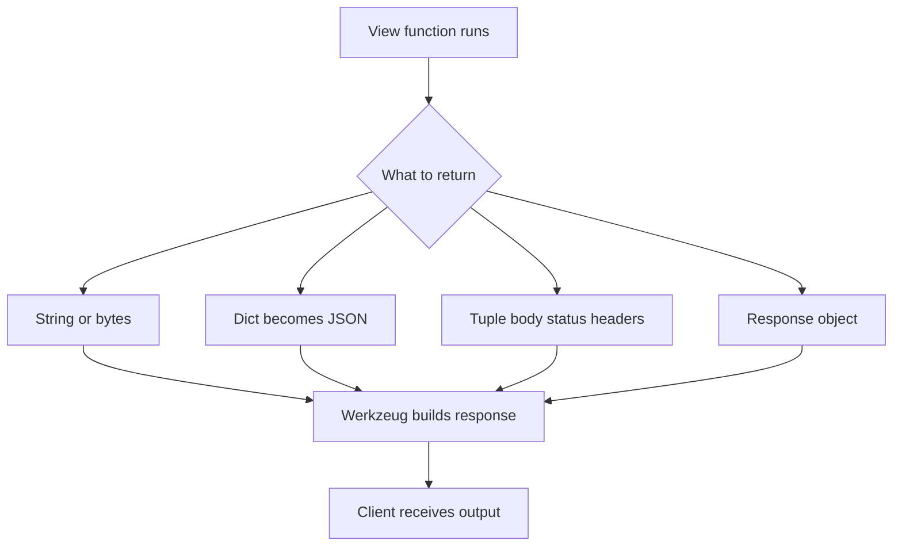

# Templating Without Jinja2: Returning Plain Data and Choosing Your Output Layer

## English

Flask ships with Jinja2 and most tutorials begin with render_template, but nothing in Flask forces you to produce HTML. A view function only has to return something Werkzeug can turn into a response: a string, bytes, a dict (which Flask serialises to JSON automatically since version 1.1), a tuple like (body, status, headers), or a full Response object. Understanding this return contract is liberating because it lets you treat the template engine as an optional rendering strategy rather than a core dependency of your app.

Consider a small internal service that answers questions about inventory. If every consumer is a script or a dashboard that speaks JSON, adding Jinja2 templates is pure overhead: you pay for template compilation, escaping, and a second mental model. Here instead you return a dict, and Flask's jsonify path handles serialisation, content type, and status codes for you. The same route can branch on request.accept_mimetypes to serve HTML to browsers and JSON to machines, a pattern that keeps one URL canonical while supporting both audiences.

Even when you do want HTML, Jinja2 is not the only option. You can use any templating library (Mako, Chameleon, or a hand-rolled f-string builder) by rendering to a string and returning it with an explicit mimetype. Flask's render_template is a convenience wrapper around the Jinja2 environment stored on the app; if you replace that environment or bypass it, Flask does not care. This is the micro-framework promise in action: the framework gives you a default and then gets out of the way.

The trade-off is real. Jinja2 gives you autoescaping (protection against cross-site scripting when interpolating user data), template inheritance, macros, and a large ecosystem of filters. If you drop it, you own escaping. A common middle path is to keep Jinja2 for HTML pages but skip it for API endpoints, so each route uses the lightest tool that fits. That decision is about clarity and safety, not ideology.

A useful exercise is to write one endpoint three ways: returning a dict, returning a rendered template, and returning a manually built Response. Compare what each version makes easy and what it makes dangerous. You will start to see that the output layer is a design choice you make per route, not a global property of the framework.

## 中文

Flask 內建 Jinja2，大部分教學都由 render_template 開始，但 Flask 本身並沒有強迫你產生 HTML。一個 view function 只需要回傳 Werkzeug 能夠轉成 response 的東西：字串、bytes、dict（由 Flask 1.1 起會自動序列化成 JSON）、像 (body, status, headers) 這樣的 tuple，或者一個完整的 Response 物件。理解這個回傳契約非常解放，因為它讓你視模板引擎為一個可選的渲染策略，而不是應用程式的核心依賴。

設想一個小型的內部服務，專門回答關於庫存的問題。如果每個使用方都是講 JSON 的腳本或儀表板，加入 Jinja2 模板就是純粹的開銷：你要付出模板編譯、跳脫（escaping）以及多一層心智模型的代價。相反地，你直接回傳一個 dict，Flask 的 jsonify 路徑就會替你處理序列化、content type 與 status code。同一條路由甚至可以根據 request.accept_mimetypes 分支，對瀏覽器送 HTML、對機器送 JSON，這個模式讓一個 URL 保持正典，同時服務兩種受眾。

即使你確實想要 HTML，Jinja2 也不是唯一選擇。你可以用任何模板函式庫（Mako、Chameleon，或者手寫 f-string 組裝器），先渲染成字串，再附上明確的 mimetype 回傳。Flask 的 render_template 只是包裝了存在 app 上的 Jinja2 environment 的便利函式；如果你替換那個 environment 或繞過它，Flask 並不在乎。這正是 micro-framework 承諾的體現：框架給你一個預設值，然後退到一旁。

當中的取捨是真實的。Jinja2 提供自動跳脫（在插入使用者資料時防範 cross-site scripting）、模板繼承、macro，以及龐大的 filter 生態。如果你放棄它，跳脫的責任就落在你身上。常見的中間路線是：HTML 頁面繼續用 Jinja2，API endpoint 則跳過它，讓每條路由使用最合適、最輕量的工具。這個決定關乎清晰與安全，而非意識形態。

一個有用的練習，是把同一個 endpoint 寫成三個版本：回傳 dict、回傳渲染後的模板、以及手動建構 Response。比較每個版本令什麼變容易、令什麼變危險。你會開始看到，輸出層是你在每條路由上做的設計選擇，而不是框架的全局屬性。

## Key Takeaway

Flask's return contract lets you treat templating as a per-route rendering strategy rather than a mandatory layer, but dropping Jinja2 means you own escaping.

## Related Concepts
- Jinja2 autoescaping
- Content negotiation with Accept headers

## Diagram

