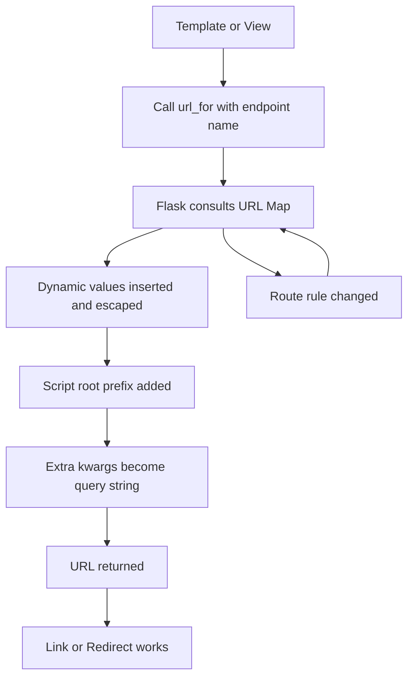

# The url_for Inversion: Why Generating URLs Beats Hardcoding Them

## English

Inside a template or a view you can write href="/users/42/edit" as a literal string, and it will work until it does not. The moment you rename a route, add a URL prefix, mount the app under a subpath, or move a blueprint to a different url_prefix, every hardcoded link breaks silently. Flask offers url_for, which takes an endpoint name (the dotted string identifying the view, such as 'user.edit' or 'static') plus keyword arguments for the dynamic parts, and returns the URL that the current URL map would produce for that endpoint.

This is inversion of control applied to URLs. Instead of the template knowing the URL shape, it knows the endpoint name, and the routing layer owns the shape. When you change a rule from /users/<int:user_id>/edit to /accounts/<int:user_id>/edit, every url_for('user.edit', user_id=42) call keeps working because the map is consulted at request time. Hardcoded strings would need a global search-and-replace that inevitably misses one.

url_for also handles details that are easy to get wrong by hand. It escapes special characters in dynamic segments, appends the application's script root when the app is mounted under a prefix (for example behind a reverse proxy at /app/), and produces an absolute URL when you pass _external=True, which is exactly what you need for links in emails or for Open Graph metadata. It also lets you pass extra query parameters as keyword arguments that do not correspond to route variables: url_for('search', q='flask', page=2) yields /search?q=flask&page=2, with proper percent-encoding.

In templates the function is available automatically, so <a href="{{ url_for('user.edit', user_id=user.id) }}"> is idiomatic. In view code you import it from flask and use it before returning a redirect: return redirect(url_for('user.edit', user_id=user.id)). This pattern means a rename of the endpoint is a single edit in the decorator, and every redirect and template link follows automatically. The same applies to static files: url_for('static', filename='css/app.css') respects the static folder configuration and any cache-busting query you add.

A subtle benefit is testability. Tests can assert that a response contains url_for('user.edit', user_id=1) rather than a literal path, which keeps the test coupled to intent rather than to a string that will drift. The rule of thumb: if a URL appears as a literal in your codebase outside of tests or documentation, ask whether url_for could express it instead.

## 中文

在模板或 view 裡面，你可以寫 href="/users/42/edit" 這樣的字面字串，它會一直運作，直到某天不再運作。當你重新命名路由、加上 URL 前綴、把應用程式掛在子路徑之下，或者把 blueprint 移到不同的 url_prefix，每一個硬編碼的連結都會無聲地壞掉。Flask 提供 url_for，它接受一個 endpoint 名稱（標識該 view 的帶點字串，例如 'user.edit' 或 'static'），加上動態部分的關鍵字參數，然後回傳目前 URL map 對該 endpoint 會產生的 URL。

這是把控制反轉（inversion of control）套用到 URL 上。模板不再知道 URL 的形狀，它只知道 endpoint 名稱，而路由層擁有那個形狀。當你把規則由 /users/<int:user_id>/edit 改成 /accounts/<int:user_id>/edit，每一個 url_for('user.edit', user_id=42) 呼叫都會繼續運作，因為 map 是在請求時查詢的。硬編碼字串則需要一次全局搜尋取代，而這無可避免會漏掉一個。

url_for 還會處理一些手寫時容易出錯的細節。它會跳脫動態區段中的特殊字元；當應用程式掛在前綴之下（例如在反向代理後面位於 /app/）時，它會附加應用程式的 script root；當你傳 _external=True 時，它會產生絕對 URL，這正是電郵中的連結或 Open Graph metadata 所需要的。它亦讓你以不對應路由變數的關鍵字參數附加額外的查詢參數：url_for('search', q='flask', page=2) 會產生 /search?q=flask&page=2，並附有正確的百分比編碼。

在模板裡面這個函式自動可用，所以 <a href="{{ url_for('user.edit', user_id=user.id) }}"> 是慣用寫法。在 view 程式碼裡，你從 flask 匯入它，並在回傳 redirect 之前使用：return redirect(url_for('user.edit', user_id=user.id))。這個模式意味著重新命名 endpoint 只需在 decorator 改一處，所有 redirect 與模板連結都會自動跟隨。同樣道理適用於靜態檔案：url_for('static', filename='css/app.css') 會尊重 static 資料夾的設定，以及你加入的任何 cache-busting 查詢字串。

一個微妙的好處是可測試性。測試可以斷言回應包含 url_for('user.edit', user_id=1)，而不是字面路徑，這讓測試緊扣意圖，而不是緊扣一個會漂移的字串。經驗法則是：如果某個 URL 以字面形式出現在測試或文件以外的程式碼裡，問一問 url_for 能否表達它。

## Key Takeaway

url_for inverts control over URLs: templates and views name endpoints, and the routing map owns the shape, so renames and prefixes propagate automatically.

## Related Concepts
- Endpoint naming and blueprints
- Reverse proxy script root handling

## Diagram

