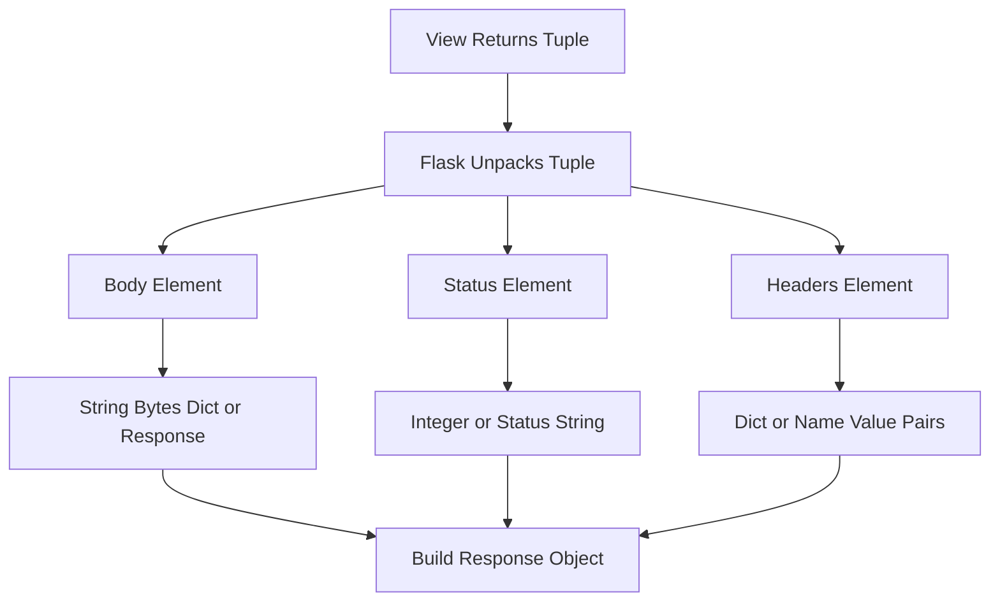

# Reading Flask's Response: Status, Headers, and the Tuple Contract

## English

A Flask view does not have to return a Response object; it can return a string, a dict, or a tuple. The tuple form is the most expressive and the least understood. A return of (body, status) or (body, headers) or (body, status, headers) is unpacked by Flask into a Response, and each element has a specific meaning. The body can be a string, bytes, a dict, or an existing Response; the status can be an integer like 404 or a string like '404 Not Found'; the headers can be a dict or a list of (name, value) pairs.

This contract is where HTTP semantics live. Returning 'Not found', 404 tells the client the resource is missing without raising an exception. Returning a dict with a 201 and a Location header is the canonical way to answer a successful POST that created a resource: the client learns where the new thing lives without parsing the body. Returning (render_template('page.html'), 200, {'Cache-Control': 'no-store'}) lets you attach caching policy to one page without touching global configuration. All of these are one-liners, but each encodes a real HTTP decision.

A common mistake is to reach for make_response only when a tuple would do. make_response is useful when you need to mutate the response after construction, for example to set a cookie: response = make_response(render_template('index.html')); response.set_cookie('theme', 'dark'); return response. But if you only need a status code or a header, the tuple is shorter and clearer. Mixing the two styles in one codebase is fine as long as the intent is obvious.

Headers deserve special attention because they are where cross-cutting behaviour is negotiated. Content-Type tells the client how to parse the body; Content-Disposition controls whether a browser displays or downloads a file; Set-Cookie carries session and preference state; Vary tells caches which request headers affect the response. When you return a tuple with a headers dict, you are writing these decisions explicitly. When you return a bare string, Flask fills in sensible defaults, which is convenient but hides the choices.

A useful habit is to read a few of your own responses with curl -i or your browser's network panel and check that the status, Content-Type, and any cache headers match what you intended. Many subtle bugs — a JSON endpoint returning text/html, a 200 that should be a 404, a cached response that should have been fresh — are visible in the first line and headers of the response. The tuple contract is the smallest, most direct way to control those details from a view.

## 中文

Flask 的 view 不一定回傳 Response 物件；它可以回傳字串、dict 或 tuple。tuple 形式最具表達力，卻最少人真正理解。回傳 (body, status) 或 (body, headers) 或 (body, status, headers) 時，Flask 會把它拆解成 Response，而每個元素都有明確意義。body 可以是字串、bytes、dict 或既有的 Response；status 可以是像 404 的整數，或像 '404 Not Found' 的字串；headers 可以是 dict 或一組 (name, value) 對的 list。

這個契約正是 HTTP 語意所在。回傳 'Not found', 404 告訴客戶端資源不存在，而不需要拋出例外。回傳一個 dict 配 201 與 Location header，是回應成功建立資源的 POST 的正典做法：客戶端得知新東西住在哪裡，而不必解析 body。回傳 (render_template('page.html'), 200, {'Cache-Control': 'no-store'}) 讓你為單一頁面附加快取政策，而不必動全局設定。這些全都是一行，但每一行都編碼了一個真實的 HTTP 決定。

常見的錯誤是，在 tuple 已經足夠時仍伸手去用 make_response。make_response 在你需要在建構之後改動 response 時才有用，例如設定 cookie：response = make_response(render_template('index.html')); response.set_cookie('theme', 'dark'); return response。但如果你只需要一個 status code 或一個 header，tuple 更短更清楚。在同一個程式碼庫混用兩種風格並無不可，只要意圖明顯。

Headers 值得特別注意，因為它們是橫切行為被協商的地方。Content-Type 告訴客戶端如何解析 body；Content-Disposition 控制瀏覽器是顯示還是下載檔案；Set-Cookie 攜帶 session 與偏好狀態；Vary 告訴快取哪些請求 header 會影響回應。當你回傳帶 headers dict 的 tuple，你是在明確寫下這些決定。當你回傳裸字串，Flask 會填入合理的預設值，方便但隱藏了選擇。

一個有用的習慣，是用 curl -i 或瀏覽器的 network 面板讀一讀你自己幾個回應，檢查 status、Content-Type 以及任何快取 header 是否符合你的意圖。許多微妙的 bug — JSON endpoint 回傳 text/html、本應是 404 卻回 200、本應新鮮卻被快取的回應 — 都看得見於回應的第一行與 headers。tuple 契約是從 view 控制這些細節最細小、最直接的方法。

## Key Takeaway

The (body, status, headers) tuple is Flask's most direct way to express HTTP decisions, and reading your own responses with curl -i reveals bugs that live in the first line.

## Related Concepts
- HTTP status codes and semantics
- make_response and response mutation

## Diagram

