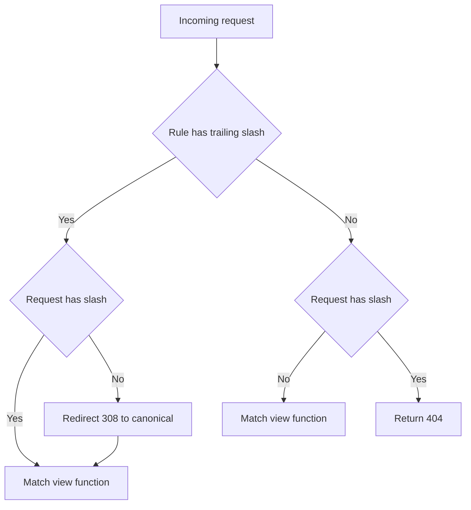

# Trailing Slashes, Redirects, and the 308 Status Change

## English

In Flask, whether a route rule ends with a slash is not cosmetic — it changes matching behaviour. A rule written as '/projects/' (with a trailing slash) matches both '/projects/' and '/projects', but a request for the slash-less form triggers a redirect to the canonical URL. A rule written as '/projects' (no slash) matches only the exact string; a request for '/projects/' will 404. This asymmetry exists because Werkzeug treats the trailing slash as a signal that the URL names a 'directory-like' collection, and it wants to keep one canonical form so that relative links inside the page resolve correctly.

The redirect Flask issues on the slash-less-to-slash transition used to be a 301 (Moved Permanently). That is dangerous for non-GET methods: browsers and intermediaries are allowed to rewrite a POST into a GET when following a 301, silently dropping the request body. Modern Werkzeug versions use 308 (Permanent Redirect) for this automatic redirect, which preserves the method and body. If you ever see a POST mysteriously arriving at your handler as a GET, suspect an old redirect status or a hand-written redirect() call that defaults to 302.

A practical consequence: pick one style per resource and stick to it. If a route represents a collection, use a trailing slash and let the redirect normalise the slash-less form. If it represents a single item, omit the slash. Then build every URL with url_for() rather than concatenating strings, so the canonical form is generated rather than guessed. Mixing styles across a codebase creates redirect chains that confuse clients, break caching (each URL is a separate cache key), and make logs harder to read.

One more subtlety: the automatic redirect happens before your view function runs, so before_request hooks still fire, but the request method may differ from what the client sent if the status is not method-preserving. Also, if you are behind a reverse proxy that terminates TLS, make sure your proxy passes the original scheme through so Flask generates the redirect with the right protocol — otherwise you can get an infinite redirect loop between http and https.

## 中文

在 Flask 裡面，路由規則有冇尾斜線（trailing slash）並不是裝飾，而是會改變匹配行為。寫成 '/projects/'（有尾斜線）的規則，會同時匹配 '/projects/' 和 '/projects'；但當請求是沒有斜線的那個形式時，Flask 會發出重新導向，指向正規化（canonical）的 URL。相反，寫成 '/projects'（冇尾斜線）的規則只會匹配完全相同的字串，請求 '/projects/' 就會 404。這種不對稱源於 Werkzeug 將尾斜線視為「類似目錄的集合」的訊號，它想維持單一正規形式，令頁面內的相對連結可以正確解析。

Flask 由無斜線轉去有斜線時發出的重新導向，以前是 301（Moved Permanently）。這對非 GET 方法很危險：瀏覽器與中間代理在跟隨 301 時，是容許將 POST 改寫成 GET 的，會靜靜地丟失請求主體。較新版本的 Werkzeug 對這個自動重新導向改用 308（Permanent Redirect），會保留方法與主體。如果你見過 POST 神秘地以 GET 形式到達你的處理函式，就要懷疑是舊的重新導向狀態碼，或者手寫的 redirect() 呼叫預設用了 302。

實際後果是：每個資源揀一種風格並且貫徹。如果路由代表一個集合，就用尾斜線，讓無斜線形式經重新導向正規化。如果代表單一專案，就省略斜線。然後所有 URL 都用 url_for() 建立，而不是自行拼接字串，這樣正規形式是「生成」出來而不是「猜」出來的。在同一個程式碼庫混用兩種風格，會造成重新導向鏈，令客戶端混亂、破壞快取（每個 URL 都是獨立的快取鍵），亦令日誌更難讀。

還有一個細節：自動重新導向是在你的 view function 執行之前發生的，所以 before_request hook 仍然會觸發，但如果狀態碼不是保留方法的型別，請求方法可能與客戶端送出的不同。另外，如果你在反向代理後面、由代理終止 TLS，就要確保代理把原本的 scheme 傳遞過來，令 Flask 用正確的協議生成重新導向——否則你可能會在 http 與 https 之間出現無限重新導向迴圈。

## Key Takeaway

A trailing slash in a Flask rule changes matching and triggers a canonicalising redirect; modern Werkzeug uses 308 so POST bodies survive, and you should pick one style per resource and always build URLs with url_for().

## Related Concepts
- URL Building with url_for and Dynamic Route Converters
- Routing Internals: Werkzeug's Map, Rules, and Matching Order

## Diagram

